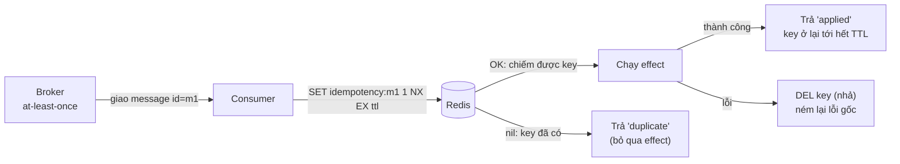
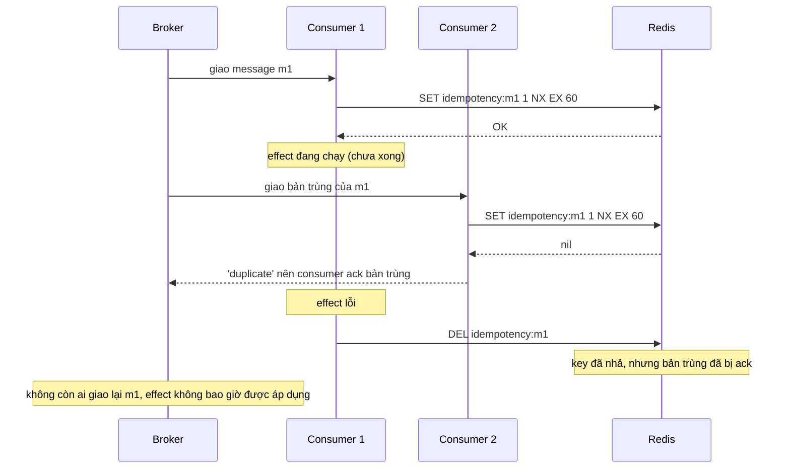

# Lab 01 - Idempotency với SET NX EX

## Mục tiêu

Biến delivery at-least-once thành effectively-once ở phía consumer bằng một dedup key trong Redis, và chứng minh bằng test:

- Cùng một message id được giao nhiều lần thì `effect` chỉ chạy một lần, các lần sau nhận `duplicate`.
- `effect` lỗi thì key bị xóa (nhả) để lần redeliver sau còn áp dụng được.
- 20 lời gọi đồng thời cùng một id: đúng một lời gọi chạy `effect`, 19 lời gọi còn lại nhận `duplicate`.
- Cửa sổ đã biết của pattern: bản trùng đến lúc `effect` đầu còn chạy nhận `duplicate`, và nếu `effect` đầu lỗi thì bản trùng đó mất.
- Key hết hạn sau `ttlSeconds` nên bản trùng đến muộn sẽ được áp dụng lại.

Lab cần Redis chạy bằng `make up`.
Lab đọc `REDIS_URL` (mặc định `redis://127.0.0.1:6379`), mọi key dedup có tên duy nhất và được xóa khi test kết thúc.
Lý thuyết của cả chương nằm ở theory.md của chủ đề 08 (viết sau khi đủ cả sáu lab).

## Kiến trúc



Đường lỗi: bản trùng đến trong lúc `effect` đầu còn chạy, rồi `effect` đầu lỗi.
Đây là cửa sổ mà test `in_flight_duplicate_is_reported_duplicate_and_lost_when_first_effect_fails` đo.



## Giao diện

TypeScript (`ts/lab.ts`):

```ts
processOnce(rdb: Redis, messageId: string, effect: () => Promise<void>, ttlSeconds: number): Promise<"applied" | "duplicate">;
dedupKey(messageId: string): string; // "idempotency:<messageId>"
```

Go (`go/lab.go`): `ProcessOnce(ctx, rdb, messageID, effect func(context.Context) error, ttlSeconds int) (Result, error)` với `Result` là `Applied` hoặc `Duplicate`, và `DedupKey(messageID)`.
Khi `effect` lỗi, Go trả `"", err` với lỗi gốc (dùng `errors.Is` được), TypeScript ném lại lỗi gốc.
`ttlSeconds` phải là số nguyên dương, giá trị khác bị từ chối trước khi chạm Redis (`SET ... EX 0` sẽ bị server từ chối).

## Các điểm quan trọng

`SET key 1 NX EX ttl` là một lệnh atomic: trả `OK` khi key chưa có và nil khi đã có.
Vì vậy trọng tài cho các bản trùng đồng thời là Redis, không phải một bước "check rồi set" riêng, vốn có race.
Test `concurrent_duplicates_apply_effect_once` giữ `effect` của người thắng đang chạy cho tới khi 19 người còn lại đã có kết quả, nên 20 lời gọi chắc chắn chồng lên nhau, không phải chạy nối tiếp.

Dedup key phải ổn định qua mọi lần redeliver: dùng message id do producer gán hoặc business idempotency key.
Không dùng id transport do broker sinh lại, không dùng timestamp nhận, không dùng correlation id dùng chung.
Khi nhiều consumer độc lập cùng đọc một channel, key dedup phải gồm cả consumer identity và message identity.

Sau khi thành công key vẫn còn tới hết TTL, đó chính là bộ nhớ của pattern.
TTL phải lớn hơn cửa sổ mà broker còn có thể giao lại (số lần giao tối đa, visibility hoặc lock timeout, message TTL) và cả message do operator replay từ DLQ.
Xóa sớm sẽ mở lại cửa sổ trùng lặp: test `key_expires_after_ttl_so_later_duplicate_is_applied_again` đo với TTL 1 giây, chờ bằng `eventually` tới khi key biến mất rồi gọi lại và nhận `applied`.
Đây là tính chất của pattern, không phải lỗi của code.

## Giới hạn thật của pattern

Cửa sổ "đang xử lý".
Trong lúc `effect` đầu còn chạy, key đã tồn tại nên mọi bản trùng nhận `duplicate`, và consumer thường ack ngay bản trùng đó.
Nếu `effect` đầu rồi lỗi và nhả key, bản trùng đã ack không còn ai giao lại, nên effect không bao giờ được áp dụng.
Test `in_flight_duplicate_is_reported_duplicate_and_lost_when_first_effect_fails` tái hiện đúng kịch bản này ở cả hai ngôn ngữ.
Cùng cơ chế đó, nếu process chết ngay sau `SET` và trước khi `effect` xong, key ở lại tới hết TTL và mọi lần redeliver bị coi là trùng (mất effect cho tới khi TTL hết).

Hệ quả khi `effect` lỗi mà không nhả key: key đã chiếm khiến lần retry bị coi là trùng và bỏ qua effect (mất việc).
Hàm này tránh điều đó bằng cách xóa key khi `effect` lỗi, nhưng cách đó không đóng được cửa sổ ở trên.
Đây là suy luận từ hai pha của Microsoft, không phải câu khẳng định trực tiếp của docs.

Cách giảm thiểu (từ nghiên cứu): dùng hai trạng thái thay vì một key.

- Ghi key `processing` với TTL ngắn, chạy `effect`, rồi đổi key thành `done` với TTL dài.
- Lần redeliver gặp `processing` phải coi là "thử lại sau" (không ack, để broker giao lại), không coi là trùng, hoặc reconcile hoặc đưa ra can thiệp thủ công.
- Chỉ ack bản trùng khi key đã ở trạng thái `done`.
- Nếu `effect` ghi vào một database, cách chuẩn là ghi marker và side effect trong cùng một transaction (Inbox pattern) và dùng unique constraint làm trọng tài.

Các giới hạn khác:

- Nhả key bằng `DEL` không kiểm tra chủ sở hữu: nếu `effect` chạy lâu hơn TTL, key đã hết hạn và một consumer khác đã chiếm, `DEL` của người đầu sẽ xóa nhầm key của người đó.
  Cách sửa là lưu token ngẫu nhiên làm value và nhả bằng Lua hoặc `DELEX key IFEQ token` (Redis 8.4 trở lên).
- Dedup bằng Redis không bảo vệ được side effect ở hệ thống ngoài: nếu process chết giữa chừng và key hết hạn trước khi broker giao lại, effect có thể chạy lần hai.
  Hãy truyền idempotency key xuống các service gọi tiếp.
- Dedup key nằm trong Redis nên nó chỉ bền bằng độ bền của Redis.
  Key có thể mất khi Redis restart mà không bật persistence (suy luận từ cách Redis lưu dữ liệu trong bộ nhớ, chưa xác minh bằng nguồn riêng), khi chỉ có RDB (docs ghi có thể mất vài phút dữ liệu gần nhất nếu crash) hoặc AOF `everysec` (có thể mất khoảng 1 giây), khi bị eviction dưới `maxmemory` (mọi `maxmemory-policy` khác `noeviction` có thể xóa key, kể cả `volatile-*` vì dedup key có TTL), và khi failover vì replication của Redis là bất đồng bộ nên một ghi đã được ack vẫn có thể mất.
  Key mất đi thì bản trùng đến sau đó được áp dụng lại, tức là effect bị lặp.
  Muốn chắc chắn hơn: bật AOF, dùng `noeviction` cho Redis chứa dedup key, hoặc đặt dedup marker trong database cùng transaction với effect.
- Ưu tiên operation idempotent tự nhiên (upsert theo business key, ghi giá trị tuyệt đối thay vì tăng) trước khi dùng dedup.

## Chạy

```bash
make up
pnpm vitest run 08-patterns/lab-01-idempotency/ts
go test -race ./08-patterns/lab-01-idempotency/go/...
make lab-ts LAB=08-patterns/lab-01-idempotency
make lab-go LAB=08-patterns/lab-01-idempotency
```

## Kết quả mong đợi

Test (cùng tên ở TS và Go, Go dùng CamelCase):

| Test                                                                         | Chứng minh                                                                                                                  |
| ---------------------------------------------------------------------------- | --------------------------------------------------------------------------------------------------------------------------- |
| `duplicate_delivery_applies_effect_once`                                     | Giao ba lần cùng id: `applied`, `duplicate`, `duplicate`, effect chạy một lần, key còn sau thành công với TTL trong (0, 60] |
| `different_message_ids_are_independent`                                      | Hai id khác nhau đều được áp dụng                                                                                           |
| `failed_effect_releases_key_so_retry_can_apply`                              | Effect lỗi: lỗi gốc được ném lại và key biến mất, lần giao lại sau đó nhận `applied`                                        |
| `concurrent_duplicates_apply_effect_once`                                    | 20 lời gọi đồng thời (nhiều connection hoặc goroutine): một effect, một `applied`, 19 `duplicate`                           |
| `in_flight_duplicate_is_reported_duplicate_and_lost_when_first_effect_fails` | Bản trùng đến lúc effect đầu còn chạy nhận `duplicate`, effect đầu lỗi và nhả key, kết quả là effect chưa từng được áp dụng |
| `key_expires_after_ttl_so_later_duplicate_is_applied_again`                  | TTL 1 giây: sau khi key hết hạn, cùng id được áp dụng lại                                                                   |
| `invalid_ttl_is_rejected_before_touching_redis`                              | `ttlSeconds` bằng 0, âm, không nguyên hoặc NaN bị từ chối, không tạo key                                                    |

Demo chạy ba kịch bản: giao trùng ba lần, effect lỗi rồi redelivery, và cửa sổ đang xử lý.

## Bài tập mở rộng

1. Cài hai trạng thái `processing` (TTL ngắn) và `done` (TTL dài), rồi viết test chứng minh bản trùng đến lúc effect đầu còn chạy không bị ack mất.
2. Lưu token ngẫu nhiên làm value và nhả bằng Lua compare-and-delete (hoặc `DELEX IFEQ`), rồi viết test cho kịch bản effect chạy quá TTL.
3. Lưu kết quả của lần xử lý đầu (như Stripe lưu status code và body) và trả lại nó cho bản trùng.
4. Đổi key thành `idempotency:<consumer>:<messageId>` và giải thích khi nào cần consumer identity trong key.

## Nguồn tham khảo

Phiên bản: Redis 8.10.2, ioredis 6.0.0, go-redis v9.23.0 (kiểm tra ngày 2026-10-06).

- Idempotent consumer, dedup key, hai pha và TTL của key.
  Nguồn: https://learn.microsoft.com/en-us/azure/architecture/patterns/idempotent-consumer
- Idempotent consumer và Inbox pattern.
  Nguồn: https://microservices.io/patterns/communication-style/idempotent-consumer.html
- Lệnh `SET` với `NX` và `EX`.
  Nguồn: https://redis.io/docs/latest/commands/set/
- Idempotency key ở mức API (Stripe).
  Nguồn: https://docs.stripe.com/api/idempotent_requests
