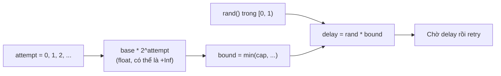
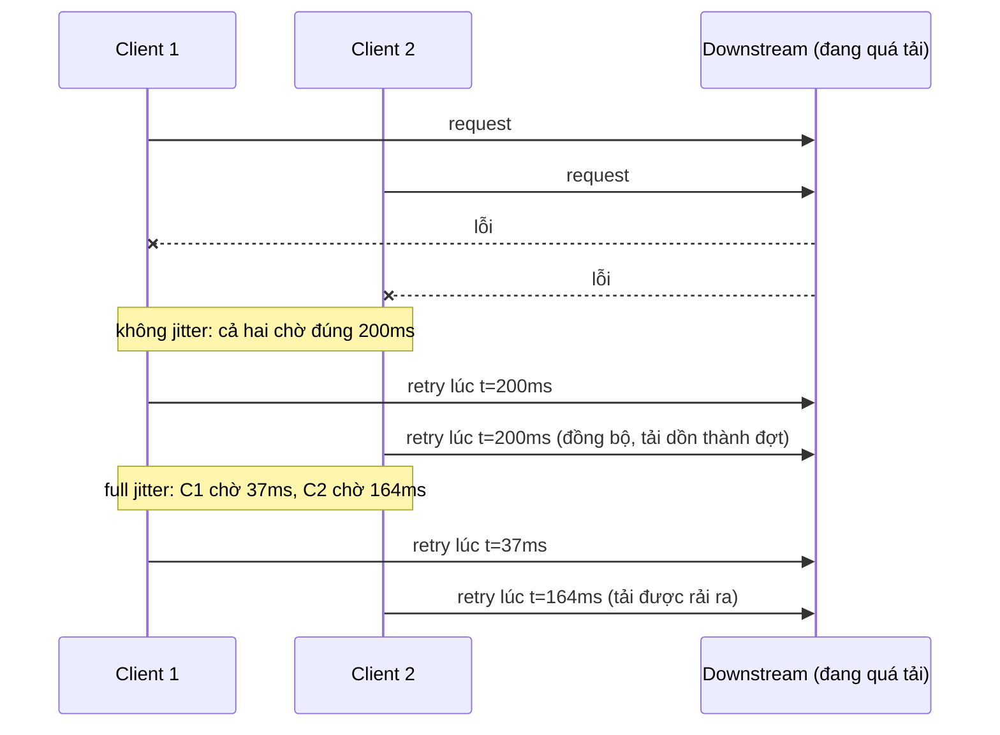

# Lab 02 - Retry với exponential backoff và full jitter

## Mục tiêu

Cài đặt công thức full jitter của AWS Architecture Blog thành một hàm thuần và chứng minh bằng test:

- Delay luôn nằm trong `[0, min(cap, base * 2^attempt))`.
- Delay không bao giờ vượt `cap`, kể cả khi `attempt` rất lớn (không tràn số).
- `attempt = 0` dùng `base` làm cận trên.
- Delay của nhiều client rải đều trên cả khoảng, đó là lý do có jitter.
- Tham số sai (attempt âm, base hoặc cap không dương, `rand` ngoài `[0, 1)`) bị từ chối bằng lỗi rõ ràng.

Lab này không cần broker và không chạm Redis.
Hàm thuần nhận nguồn ngẫu nhiên làm tham số nên test dùng PRNG có seed hoặc `rand` cố định, không phụ thuộc may rủi.
Lý thuyết của cả chương nằm ở theory.md của chủ đề 08 (viết sau khi đủ cả sáu lab).

## Kiến trúc



Vì sao cần jitter: không có jitter, mọi client thất bại cùng lúc sẽ retry cùng lúc và đập vào downstream thành từng đợt đồng bộ.



## Giao diện

TypeScript (`ts/lab.ts`):

```ts
backoffDelay(attempt: number, opts: { baseMs: number; capMs: number }, rand: () => number): number;
backoffBound(attempt: number, opts: BackoffOptions): number; // min(capMs, baseMs * 2^attempt)
```

Go (`go/lab.go`): `BackoffDelay(attempt int, opts Options, rand func() float64) (time.Duration, error)` và `BackoffBound(attempt, opts)`, với `Options{Base, Cap time.Duration}`.
Go trả `time.Duration` và lỗi (bọc `ErrInvalidArgument`, dùng `errors.Is`), TypeScript ném `Error`.

Quyết định về tham số:

- `attempt` phải là số nguyên không âm: attempt âm hoặc không nguyên là bug của caller nên bị từ chối, không đoán ý.
- `baseMs` và `capMs` phải hữu hạn và lớn hơn 0.
  `capMs` nhỏ hơn `baseMs` được chấp nhận, khi đó cận trên là `capMs` ngay từ attempt 0.
- `rand` phải trả về số trong `[0, 1)`.
  Giá trị ngoài khoảng sẽ cho delay âm hoặc lớn hơn cận trên, nên hàm ném lỗi thay vì âm thầm kẹp lại.
- Kết quả không làm tròn: caller tự làm tròn nếu cần số nguyên mili giây.

## Các điểm quan trọng

Công thức Full Jitter: `sleep = random_between(0, min(cap, base * 2 ** attempt))`.

Tràn số.
Trong TypeScript, `2 ** 1100` là `Infinity` và `Math.min(cap, Infinity)` vẫn ra `cap`, nên không cần tự chặn số mũ.
Trong Go, dịch bit trên số nguyên (`base << attempt`) tràn từ attempt 63 và có thể cho kết quả âm, vì vậy lab tính bằng `math.Pow(2, attempt)` trên số thực: `2^1100` là `+Inf` và `math.Min` với cap vẫn đúng.
Test `very_large_attempt_does_not_overflow` thử attempt tới `MAX_SAFE_INTEGER` (TypeScript) và `math.MaxInt` (Go).

Biên của `rand`: `rand = 0` cho delay 0 (retry ngay lập tức, hợp lệ với full jitter), `rand` sát 1 cho delay ngay dưới cận trên nhưng không bao giờ bằng nó.

Ba biến thể jitter trong phân tích của AWS:

- Full Jitter: `sleep = random_between(0, min(cap, base * 2^attempt))`, tốn ít tổng công việc nhất trong các biến thể.
- Equal Jitter: `temp = min(cap, base * 2^attempt); sleep = temp/2 + random_between(0, temp/2)`, giữ lại một nửa backoff cố định.
- Decorrelated Jitter: `sleep = min(cap, random_between(base, sleep * 3))`, delay mới phụ thuộc delay trước thay vì attempt (code simulator của AWS dùng cận dưới `base`, trang blog viết rút gọn).

Kết luận của AWS: tổng công việc của hệ thống tăng theo bình phương số client tranh chấp, jitter giảm đáng kể công việc đó nhưng không đổi bản chất, không jitter là tệ nhất, và jittered backoff nên được xem là cách tiếp cận chuẩn cho remote client.

## Giới hạn thật của pattern

- Backoff giảm tải đồng bộ nhưng không giới hạn tổng tải: nếu có hàng nghìn client thì mỗi client vẫn retry.
  Hãy giới hạn số attempts và tổng tốc độ tới downstream.
- Lab chỉ là công thức, không phải vòng retry hoàn chỉnh: caller vẫn phải quyết định lỗi nào đáng retry (lỗi tạm thời) và lỗi nào không.
- `rand` do caller cung cấp: dùng nguồn có seed trong test, và `Math.random` hoặc `rand.Float64` trong production.

## Chạy

```bash
pnpm vitest run 08-patterns/lab-02-retry-backoff/ts
go test -race ./08-patterns/lab-02-retry-backoff/go/...
make lab-ts LAB=08-patterns/lab-02-retry-backoff
make lab-go LAB=08-patterns/lab-02-retry-backoff
```

## Kết quả mong đợi

Test (cùng tên ở TS và Go, Go dùng CamelCase):

| Test                                                         | Chứng minh                                                                                                               |
| ------------------------------------------------------------ | ------------------------------------------------------------------------------------------------------------------------ |
| `delay_is_within_zero_and_exponential_bound`                 | attempt 0 đến 8, mỗi attempt 500 mẫu có seed: `0 <= delay < base * 2^attempt`, và `rand` cố định cho đúng `rand * bound` |
| `delay_never_exceeds_cap`                                    | Với attempt 6 đến 100 delay luôn nhỏ hơn cap, cận trên bằng đúng cap                                                     |
| `attempt_zero_uses_base`                                     | attempt 0 có cận trên là `base`, và `cap` nhỏ hơn `base` thì `cap` thắng                                                 |
| `very_large_attempt_does_not_overflow`                       | attempt rất lớn (tới 1 triệu, `MAX_SAFE_INTEGER`, `MaxInt`) vẫn cho kết quả hữu hạn đúng bằng `rand * cap`               |
| `delays_spread_across_the_whole_range_instead_of_clustering` | 2000 mẫu: min gần 0, max gần cận trên, trung bình khoảng nửa cận trên, gần như mọi giá trị khác nhau                     |
| `invalid_inputs_are_rejected_with_a_clear_error`             | attempt âm hoặc không nguyên, base hoặc cap không dương, `rand` ngoài `[0, 1)` đều bị từ chối                            |

Demo mô phỏng 1000 client (seed cố định) và in bảng cận trên với min, trung bình, max theo attempt, rồi biểu đồ phân bố ở attempt 5.
Kết quả của TypeScript và Go khác nhau chút vì hai PRNG khác nhau, nhưng hình dạng giống nhau.

## Bài tập mở rộng

1. Cài Equal Jitter và Decorrelated Jitter, rồi mô phỏng tổng số lần gọi khi N client cùng tranh chấp để so với Full Jitter.
2. Thêm hàm `retry(fn, { maxAttempts, ... })` dùng `backoffDelay`, chỉ retry lỗi tạm thời và dừng ngay với lỗi không thể retry.
3. Thêm giới hạn tổng thời gian chờ (deadline) để vòng retry không kéo dài quá timeout của request gốc.
4. Thử `rand` kém (luôn trả 0.999) và quan sát vì sao jitter mất tác dụng khi nguồn ngẫu nhiên bị lệch.

## Nguồn tham khảo

Phiên bản: không có phụ thuộc broker, Node 22, Go 1.26 (kiểm tra ngày 2026-10-06).

- Phân tích Exponential Backoff and Jitter của AWS Architecture Blog (công thức Full, Equal, Decorrelated Jitter và kết luận).
  Nguồn: https://aws.amazon.com/blogs/architecture/exponential-backoff-and-jitter/
- Code simulator của AWS.
  Nguồn: https://github.com/aws-samples/aws-arch-backoff-simulator
- Retry storm và queue-based load leveling.
  Nguồn: https://learn.microsoft.com/en-us/azure/architecture/patterns/queue-based-load-leveling
