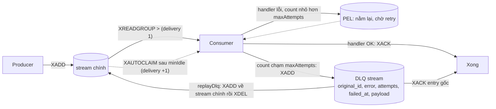
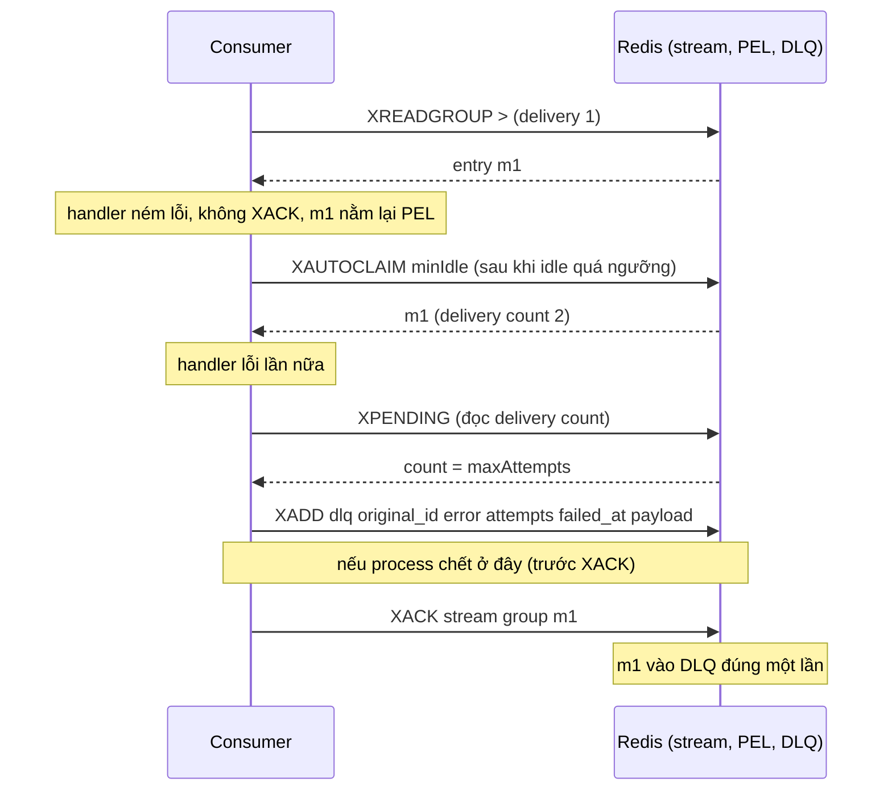
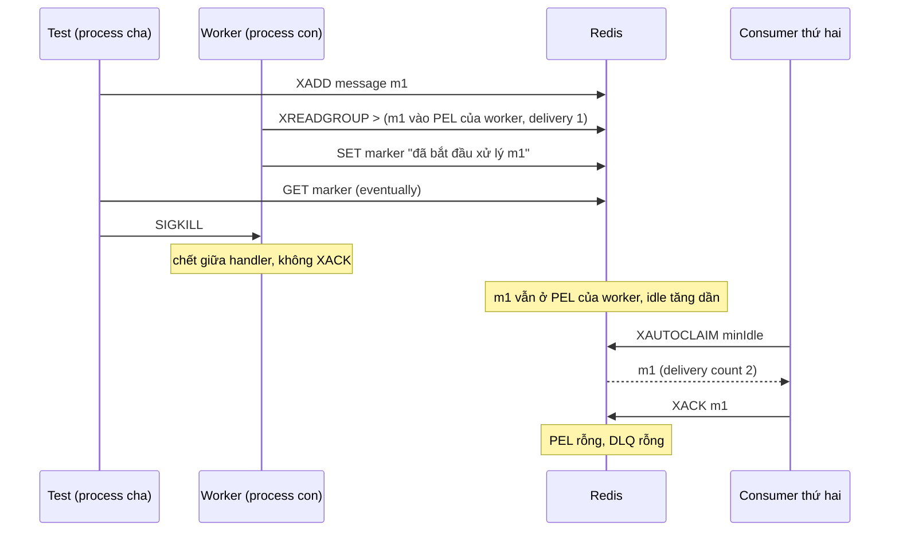

# Lab 03 - Dead-letter queue trên Redis Streams

## Mục tiêu

Tự cài retry và dead-letter queue (DLQ) trên Redis Streams, vì Streams không có DLQ sẵn, và chứng minh bằng test:

- Message lỗi nằm lại trong pending list (PEL), được thử lại bằng `XAUTOCLAIM`, và delivery count lấy từ `XPENDING` dạng extended.
- Khi delivery count chạm `maxAttempts`, consumer `XADD` message vào DLQ stream kèm metadata (id gốc, lỗi, số lần thử, thời điểm lỗi, payload) rồi `XACK` entry gốc.
- `maxAttempts = 1` đưa lần lỗi đầu tiên thẳng vào DLQ.
- `replayDlq(limit)` chuyển tối đa `limit` entry từ DLQ về stream chính và trả số entry thực sự đã chuyển.
- Chaos: một consumer là process con bị `SIGKILL` giữa lúc xử lý, consumer thứ hai tiếp quản message và xử lý thành công.

Lab cần Redis chạy bằng `make up`.
Lab đọc `REDIS_URL` (mặc định `redis://127.0.0.1:6379`), mọi stream, group và marker key có tên duy nhất và bị xóa khi test kết thúc.
Test chaos không dừng container nào, chỉ kill một process con của chính test.
Lý thuyết của cả chương nằm ở theory.md của chủ đề 08 (viết sau khi đủ cả sáu lab).

## Kiến trúc



Đường lỗi 1: poison message đi qua các lần retry rồi vào DLQ, và crash giữa `XADD` vào DLQ với `XACK`.



Nếu process chết giữa `XADD` và `XACK`, entry gốc vẫn pending, được claim lại và lại vào DLQ: DLQ có thể có bản trùng.

Đường lỗi 2 (chaos): consumer bị kill giữa handler.



## Giao diện

TypeScript (`ts/lab.ts`):

```ts
new DlqQueue({ redis, blocking, stream, group, dlqStream, consumer, minIdleMs, blockMs? });
ensureGroup(): Promise<void>;
publish(fields: Record<string, string>): Promise<string>;
consumeWithDlq(opts: { maxAttempts: number; signal?: AbortSignal }, handler: (d: Delivery) => Promise<void>): Promise<ConsumeStats>;
replayDlq(limit: number): Promise<number>;
dlqEntries(): Promise<StreamMessage[]>; // XRANGE - +
pendingEntries(): Promise<PendingEntry[]>; // XPENDING dạng extended
```

Go (`go/lab.go`): `NewQueue(Config{Commands, Blocking, Stream, Group, DLQStream, Consumer, MinIdle, BlockTime})` với `EnsureGroup`, `Publish`, `ConsumeWithDLQ(ctx, Options{MaxAttempts}, handler)`, `ReplayDLQ(ctx, limit)`, `DLQEntries` và `PendingEntries`.
Handler nhận `Delivery{ID, Fields, DeliveryCount}`, trả lỗi (hoặc ném lỗi ở TypeScript) nghĩa là lần xử lý thất bại.

Task gốc quy định `consumeWithDlq({ maxAttempts }, handler)` và `replayDlq(limit)`.
Stream, group, DLQ và consumer nằm trong constructor của `DlqQueue`, nên hai hàm giữ đúng chữ ký của task.
`consumeWithDlq` chạy tới khi hết việc (stream không còn entry mới và PEL của group rỗng) rồi trả `{ succeeded, failed, deadLettered }`.
Với stream rỗng nó trả ngay kết quả toàn 0 sau một lần block, không lỗi.
Một consumer thật chạy lâu có thể gọi hàm này trong vòng lặp, hoặc truyền `signal` (TypeScript) hay `ctx` (Go) để dừng.

## Các điểm quan trọng

Delivery count và thử lại.
`XREADGROUP ... >` giao entry với delivery count 1, mỗi lần `XAUTOCLAIM` cộng thêm 1.
Count được đọc từ `XPENDING` dạng extended (`XPENDING stream group id id 1`), không đếm ở client.
Handler chạy đúng `maxAttempts` lần: lỗi ở lần giao thứ `maxAttempts` đưa message vào DLQ, nên `maxAttempts = 1` cho DLQ ngay lần lỗi đầu.
Test không chạm biên của `min-idle-time`: vòng lặp chỉ claim khi entry đã idle quá `minIdle`, và test chaos chờ bằng `eventually` tới khi `XPENDING` báo idle ít nhất `2 x minIdle` trước khi chạy consumer thứ hai.

Consumer chết ở lần giao cuối.
Nếu delivery count lớn hơn `maxAttempts` ngay lúc claim thì `maxAttempts` lần giao trước đều không ai báo kết quả (consumer chết giữa chừng).
Lab đưa entry đó vào DLQ mà không chạy handler, để một message làm chết consumer không gây vòng lặp chết vô hạn.
Lý do ghi trong field `error` của DLQ entry, test `entry_delivered_more_than_max_attempts_before_handler_runs_goes_to_dlq` đo điều này.

Metadata của DLQ entry (test kiểm tra đúng năm field này):

| Field         | Ý nghĩa                                                                               |
| ------------- | ------------------------------------------------------------------------------------- |
| `original_id` | id của entry gốc trong stream chính                                                   |
| `error`       | message của lỗi cuối cùng                                                             |
| `attempts`    | delivery count lúc vào DLQ                                                            |
| `failed_at`   | thời điểm vào DLQ, ISO 8601 UTC có mili giây                                          |
| `payload`     | các field gốc dạng JSON (JSON để field của message không đụng tên với field metadata) |

Replay.
`replayDlq(limit)` đọc tối đa `limit` entry cũ nhất bằng `XRANGE`, với mỗi entry `XADD` field gốc vào stream chính rồi `XDEL` entry khỏi DLQ.
Entry mới ở stream chính có id mới, nên consumer phải dedup theo business id trong payload chứ không theo id của stream (xem lab 01).
`limit` lớn hơn kích thước DLQ trả số entry thực sự đã chuyển, DLQ rỗng trả 0.
Replay có thể xảy ra rất lâu sau cửa sổ redelivery thông thường, nên consumer nhận lại phải idempotent.

## Giới hạn thật của pattern

Cửa sổ crash giữa `XADD` vào DLQ và `XACK`.
Hai lệnh là hai round trip riêng.
Nếu process chết giữa chúng, entry gốc vẫn pending, được claim lại và vào DLQ lần nữa, nên DLQ có thể có bản trùng (at-least-once, không mất message).
Đảo thứ tự (`XACK` trước) thì crash giữa chừng làm mất message, nên lab chọn thứ tự này.
Đóng cửa sổ bằng `MULTI`/`EXEC` hoặc Lua script là một bài tập (lab chưa đo cách này).

Cửa sổ crash giữa `XADD` về stream chính và `XDEL` khỏi DLQ trong `replayDlq`.
Cùng logic: entry nằm ở cả hai nơi và lần replay sau chuyển nó lần nữa.
Thứ tự `XADD` trước `XDEL` sau chọn trùng thay vì mất.

Redis Streams không có DLQ sẵn: nhận định này suy ra từ danh sách lệnh trong docs, không phải câu khẳng định trực tiếp của docs.
Pattern tự cài này đọc delivery count từ `XPENDING`, quá ngưỡng thì `XADD` sang stream `*:dlq` rồi `XACK`.

Các giới hạn khác:

- Handler phải chạy xong trong thời gian ngắn hơn `minIdle`.
  Nếu không, consumer khác sẽ claim message khi handler đầu còn đang chạy và message bị xử lý song song.
  Đây là cùng đánh đổi với visibility timeout của SQS, và là lý do cần idempotency (lab 01).
- `XACK` chỉ gỡ entry khỏi PEL, không xóa entry khỏi stream chính.
  Hãy `XTRIM` hoặc `XDEL` theo chính sách retention của bạn.
- DLQ chỉ có giá trị khi có người nhìn vào nó: hãy cảnh báo khi `XLEN` của DLQ lớn hơn 0 và theo dõi độ sâu của nó.
- Lab đọc từng message một (`COUNT 1`), đơn giản nhưng không tối ưu throughput.
- `consumeWithDlq` giả định các consumer cùng group đều dùng cùng `maxAttempts`.

## Cách chạy process con trong test chaos

TypeScript: test `spawn(process.execPath, ["--import", "tsx", ts/chaos-worker.ts], { cwd: <repo root> })`.
Cách này chạy được ở local và trên runner CI mà không cần dependency mới, vì `tsx` đã nằm trong devDependencies và Node phân giải `--import tsx` từ thư mục gốc repo.
Worker ghi marker key `<stream>:started` rồi treo ở handler, test chờ marker bằng `eventually` rồi `SIGKILL`.

Go: test chạy lại chính test binary (`os.Args[0]` với `-test.run=^TestHelperProcess$` và biến môi trường `LAB03_HELPER=1`), mẫu helper process chuẩn của Go.
`TestHelperProcess` tự bỏ qua khi không có biến môi trường đó nên không ảnh hưởng lần chạy thường.

Chống process mồ côi: `afterEach` (TypeScript) hoặc `t.Cleanup` (Go) luôn `SIGKILL` và chờ child thoát kể cả khi test fail, và child có thời hạn cứng 60 giây tự thoát nếu process cha chết trước.
Kiểm tra sau khi chạy: `pgrep -fl "chaos-worker|TestHelperProcess"` không in gì.

## Chạy

```bash
make up
pnpm vitest run 08-patterns/lab-03-dlq/ts
go test -race ./08-patterns/lab-03-dlq/go/...
make lab-ts LAB=08-patterns/lab-03-dlq
make lab-go LAB=08-patterns/lab-03-dlq
```

## Kết quả mong đợi

Test (cùng tên ở TS và Go, Go dùng CamelCase):

| Test                                                                     | Chứng minh                                                                                                                            |
| ------------------------------------------------------------------------ | ------------------------------------------------------------------------------------------------------------------------------------- |
| `poison_message_moves_to_dlq_after_max_attempts_with_error_metadata`     | Handler luôn lỗi: chạy đúng 3 lần với delivery count 1, 2, 3, rồi DLQ có đúng một entry với năm field metadata, entry gốc đã XACK     |
| `handler_that_recovers_before_max_attempts_is_not_dead_lettered`         | Handler lỗi hai lần rồi thành công: không có entry nào trong DLQ                                                                      |
| `max_attempts_one_sends_first_failure_straight_to_dlq`                   | `maxAttempts = 1`: handler chạy một lần rồi vào DLQ với `attempts = 1`                                                                |
| `entry_delivered_more_than_max_attempts_before_handler_runs_goes_to_dlq` | Entry bị giao rồi bỏ (consumer chết): lần claim sau đưa nó vào DLQ mà không chạy handler                                              |
| `empty_stream_consume_returns_without_error`                             | Stream rỗng: trả kết quả toàn 0, handler không được gọi                                                                               |
| `max_attempts_must_be_a_positive_integer`                                | `maxAttempts` bằng 0, âm, không nguyên hoặc NaN bị từ chối                                                                            |
| `replay_dlq_returns_messages_to_main_stream`                             | Replay DLQ rỗng trả 0, limit 2 chuyển 2, limit 100 trả 1 (số thực), rồi 0; main stream nhận lại đúng field gốc và consumer xử lý được |
| `replay_dlq_rejects_a_non_positive_limit`                                | `limit` bằng 0, âm hoặc không nguyên bị từ chối                                                                                       |
| `chaos_consumer_killed_mid_processing_message_is_reclaimed`              | Worker là process con bị `SIGKILL` giữa handler: consumer thứ hai claim (delivery count 2), xử lý, PEL và DLQ đều rỗng                |

Thời gian đo trên máy phát triển (một lần, không phải cam kết): test poison khoảng 0,8 đến 1 giây (ba lần giao cách nhau tối thiểu `minIdle` 200 ms), test chaos khoảng 1 giây.

Demo in ba kịch bản: poison message đi hết đường retry rồi vào DLQ (in cả metadata), replay sau khi sửa bug, và consumer chết giữa chừng.

## Bài tập mở rộng

1. Gộp `XADD` vào DLQ và `XACK` thành một `MULTI`/`EXEC` (hoặc Lua script) và viết test cho thấy cửa sổ crash đã đóng.
2. Đưa lỗi không thể retry (ví dụ payload sai định dạng) vào DLQ ngay lần đầu thay vì chờ đủ `maxAttempts`.
3. Thêm `XLEN` của DLQ vào một cảnh báo hoặc metric và thử với nhiều poison message.
4. Thêm `XTRIM MINID` cho stream chính để entry đã XACK không nằm mãi.
5. Làm `replayDlq` nhận một hàm lọc, để chỉ replay các entry có `error` khớp với bug đã sửa.

## Nguồn tham khảo

Phiên bản: Redis 8.10.2 (`XAUTOCLAIM` từ 6.2.0), ioredis 6.0.0, go-redis v9.23.0 (kiểm tra ngày 2026-10-06).

- Consumer group, `XPENDING`, `XAUTOCLAIM`, `XACK` và nhận định Redis Streams không có DLQ sẵn (suy ra từ danh sách lệnh).
  Nguồn: https://redis.io/docs/latest/develop/data-types/streams/
- DLQ, `maxReceiveCount`, redrive, cảnh báo khi có message vào DLQ.
  Nguồn: https://docs.aws.amazon.com/AWSSimpleQueueService/latest/SQSDeveloperGuide/sqs-dead-letter-queues.html
- Poison message, monitor độ sâu DLQ và resubmit khi đã sửa nguyên nhân.
  Nguồn: https://learn.microsoft.com/en-us/azure/architecture/patterns/competing-consumers
- Replay từ DLQ phải đi qua consumer idempotent.
  Nguồn: https://learn.microsoft.com/en-us/azure/architecture/patterns/idempotent-consumer
- Chaos testing: kill consumer giữa lúc xử lý, giữ blast radius nhỏ.
  Nguồn: https://principlesofchaos.org/
