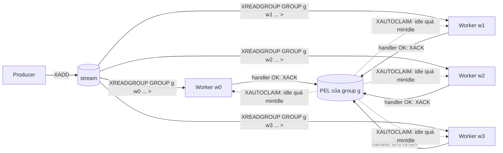
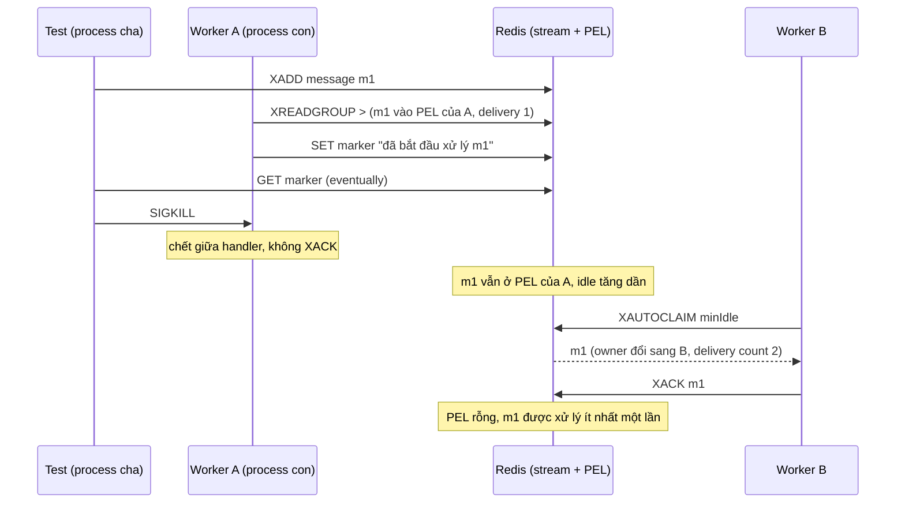

# Lab 04 - Competing consumers trên Redis Streams

## Mục tiêu

Chạy n worker cùng một consumer group để chúng cạnh tranh nhau lấy công việc, và chứng minh bằng test:

- Mỗi message của group chỉ giao cho đúng một worker: với 40 message và 4 worker, mỗi id được xử lý đúng một lần khi không ai lỗi.
- Worker ack sau khi handler thành công.
  Handler lỗi thì message nằm lại pending list (PEL) và được claim lại sau `minIdle`.
- `stop()` chờ handler đang chạy xong và ack nó rồi mới đóng connection.
- Chaos: một worker là process con bị `SIGKILL` giữa lúc xử lý, một worker khác tiếp quản message qua `XAUTOCLAIM`, xử lý và ack.

Lab cần Redis chạy bằng `make up`.
Lab đọc `REDIS_URL` (mặc định `redis://127.0.0.1:6379`), mọi stream, group, consumer và marker key có tên duy nhất và bị xóa khi test kết thúc.
Test chaos không dừng container nào, chỉ kill một process con của chính test.
Lý thuyết của cả chương nằm ở theory.md của chủ đề 08 (viết sau khi đủ cả sáu lab).

## Kiến trúc



Mỗi worker có tên consumer duy nhất và một connection riêng cho `XREADGROUP BLOCK`.
Connection thường (XADD, XACK, XAUTOCLAIM, XPENDING) dùng chung vì chúng không chặn.

Đường lỗi (chaos): worker bị kill giữa handler, worker khác tiếp quản.



Nếu A thực ra chỉ chậm chứ chưa chết (handler chạy quá `minIdle`), B vẫn claim và cả hai cùng xử lý m1: đó là lý do handler phải idempotent.

## Giao diện

TypeScript (`ts/lab.ts`):

```ts
new WorkerGroup({ redis, stream, group, minIdleMs, blockMs?, onError? });
ensureGroup(): Promise<void>;
publish(fields: Record<string, string>): Promise<string>;
startWorkers(n: number, handler: (d: Delivery) => Promise<void>): { consumerNames: string[]; stop(): Promise<void> };
pendingEntries(): Promise<PendingEntry[]>; // XPENDING dạng extended
```

Go (`go/lab.go`): `NewWorkerGroup(Config{Commands, Options, Stream, Group, MinIdle, BlockTime, OnError})` với `EnsureGroup`, `Publish`, `PendingEntries` và `StartWorkers(n, handler) (*Handle, error)`.
`Handle` có `ConsumerNames()` và `Stop() error`.
Handler nhận `Delivery{ID, Fields, Consumer, DeliveryCount}`.

Giao diện chính của lab là `startWorkers(n, handler)` trả về handle có `stop()`.
Stream, group và `minIdle` nằm trong constructor của `WorkerGroup`, nên hàm giữ chữ ký gọn như trên.
`stop()` là idempotent, chờ tối đa `blockMs` cộng thời gian handler còn lại, và reject nếu một worker đã chết vì lỗi Redis (sau khi đã đóng mọi connection).

## Các điểm quan trọng

Mỗi vòng lặp của worker: thử `XAUTOCLAIM` một entry đã pending quá `minIdle` trước, nếu không có thì `XREADGROUP ... > COUNT 1 BLOCK` đọc entry mới, chạy handler, thành công thì `XACK`.
Claim một entry mỗi lần để các entry khác không bị reset idle time rồi nằm chờ trong lúc handler chạy.
Delivery count của entry vừa claim đọc từ `XPENDING` dạng extended, entry mới đọc bằng `>` luôn có delivery count 1.

Test `four_workers_process_each_message_exactly_once_without_failures` không assert cách chia việc giữa các worker (demo cho thấy có lần chia đều 5-5-5-5, có lần 4-5-5-6).
Nó đặt `minIdle` 10 giây để không có lần claim nào xảy ra khi không ai lỗi, rồi kiểm tra mỗi id xử lý đúng một lần và PEL rỗng.
Với `minIdle` quá nhỏ so với thời gian handler, hai worker có thể cùng xử lý một message, và "đúng một lần" không còn đúng.

Test chaos không assert "đúng một lần" vì at-least-once không cho phép khẳng định đó: nó assert message được xử lý ít nhất một lần bởi một consumer khác với worker đã chết (delivery count từ 2 trở lên), và PEL cạn.
Test chờ bằng `eventually` tới khi `XPENDING` báo idle ít nhất `2 x minIdle` trước khi khởi động các worker cứu hộ, nên lần claim không chạm ranh giới `min-idle-time`.

Handler lỗi thì message không được ack, nên nó bị thử lại sau `minIdle` mãi mãi.
Lab này cố ý không giới hạn số lần thử, hãy xem lab 03 cho `maxAttempts` và DLQ.

## Giới hạn thật của pattern

- At-least-once, không phải exactly-once: handler lỗi, worker chết hoặc handler chậm hơn `minIdle` đều dẫn tới xử lý lại.
  Hãy dùng idempotency (lab 01) cho side effect.
- Thứ tự không được bảo toàn giữa các worker: các worker lấy message song song và xử lý với tốc độ khác nhau.
- `XAUTOCLAIM` chỉ tiếp quản entry đã pending quá `minIdle`, nên consumer chết được phát hiện sau ít nhất `minIdle`, không ngay lập tức.
- Chọn `minIdle` phải lớn hơn thời gian xử lý dài nhất của handler, nhưng càng lớn thì việc phục hồi sau khi worker chết càng chậm.
- Lab đọc từng message một (`COUNT 1`), đơn giản nhưng không tối ưu throughput.
- `stop()` chờ handler đang chạy: handler treo thì `stop()` treo, caller nên tự giới hạn thời gian chờ.
- Consumer tên cũ của worker đã chết vẫn nằm trong danh sách consumer của group (`XINFO CONSUMERS`) cho tới khi bạn `XGROUP DELCONSUMER`, và mỗi lần chạy lại tạo tên mới.

## Cách chạy process con trong test chaos

TypeScript: test `spawn(process.execPath, ["--import", "tsx", ts/chaos-worker.ts], { cwd: <repo root> })`.
Cách này chạy được ở local và trên runner CI mà không cần dependency mới, vì `tsx` đã nằm trong devDependencies và Node phân giải `--import tsx` từ thư mục gốc repo.
Worker ghi marker key `<stream>:started` rồi treo ở handler, test chờ marker bằng `eventually` rồi `SIGKILL`.

Go: test chạy lại chính test binary (`os.Args[0]` với `-test.run=^TestHelperProcess$` và biến môi trường `LAB04_HELPER=1`), mẫu helper process chuẩn của Go.
`TestHelperProcess` tự bỏ qua khi không có biến môi trường đó nên không ảnh hưởng lần chạy thường.

Chống process mồ côi: `afterEach` (TypeScript) hoặc `t.Cleanup` (Go) luôn `SIGKILL` và chờ child thoát kể cả khi test fail, và child có thời hạn cứng 60 giây tự thoát nếu process cha chết trước.
Kiểm tra sau khi chạy: `pgrep -fl "chaos-worker|TestHelperProcess"` không in gì.

## Chạy

```bash
make up
pnpm vitest run 08-patterns/lab-04-competing-consumers/ts
go test -race ./08-patterns/lab-04-competing-consumers/go/...
make lab-ts LAB=08-patterns/lab-04-competing-consumers
make lab-go LAB=08-patterns/lab-04-competing-consumers
```

## Kết quả mong đợi

Test (cùng tên ở TS và Go, Go dùng CamelCase):

| Test                                                                 | Chứng minh                                                                                                                 |
| -------------------------------------------------------------------- | -------------------------------------------------------------------------------------------------------------------------- |
| `four_workers_process_each_message_exactly_once_without_failures`    | 40 message, 4 worker có tên duy nhất: mỗi id xử lý đúng một lần, PEL rỗng, không assert cách chia việc                     |
| `failed_handler_leaves_message_pending_until_reclaimed`              | Handler lỗi ở lần giao đầu: message nằm lại PEL, một worker claim lại sau `minIdle` (delivery count 2) và thành công       |
| `stop_waits_for_in_flight_handler_and_acks_it`                       | `stop()` chưa trả về khi handler còn chạy, sau đó message được ack                                                         |
| `start_workers_rejects_a_non_positive_worker_count`                  | `n` bằng 0, âm hoặc không nguyên bị từ chối                                                                                |
| `chaos_worker_killed_mid_processing_message_is_processed_by_another` | Worker là process con bị `SIGKILL` giữa handler: worker khác claim (delivery count từ 2), xử lý ít nhất một lần và PEL cạn |

Demo in hai kịch bản: bốn worker chia 20 message (số message mỗi worker thay đổi theo lần chạy), và một consumer chết bỏ lại một message trong PEL để worker còn sống claim.
Demo không chạy process con: nó mô phỏng consumer chết bằng `XREADGROUP` trực tiếp rồi bỏ đó.

## Bài tập mở rộng

1. Thêm `maxAttempts` và DLQ cho `startWorkers` (xem lab 03), rồi kiểm tra một poison message không bị thử lại mãi.
2. Đọc theo lô (`COUNT 10`) và đo ảnh hưởng tới throughput cũng như tới số lần claim nhầm.
3. Thêm `XGROUP DELCONSUMER` khi worker dừng sạch, và quan sát `XINFO CONSUMERS`.
4. Làm handler chậm hơn `minIdle` và đếm số message bị xử lý hai lần.
5. Thêm gia hạn (heartbeat) bằng `XCLAIM` cùng consumer để handler dài không bị claim nhầm.

## Nguồn tham khảo

Phiên bản: Redis 8.10.2 (`XAUTOCLAIM` từ 6.2.0), ioredis 6.0.0, go-redis v9.23.0 (kiểm tra ngày 2026-10-06).

- Consumer group: mỗi message chỉ giao cho một consumer của group, `XREADGROUP >`, `XACK`, `XPENDING`, `XAUTOCLAIM`.
  Nguồn: https://redis.io/docs/latest/develop/data-types/streams/
- Competing consumers pattern.
  Nguồn: https://learn.microsoft.com/en-us/azure/architecture/patterns/competing-consumers
- Handler phải idempotent vì delivery là at-least-once.
  Nguồn: https://learn.microsoft.com/en-us/azure/architecture/patterns/idempotent-consumer
- Chaos testing: kill consumer giữa lúc xử lý, giữ blast radius nhỏ.
  Nguồn: https://principlesofchaos.org/
