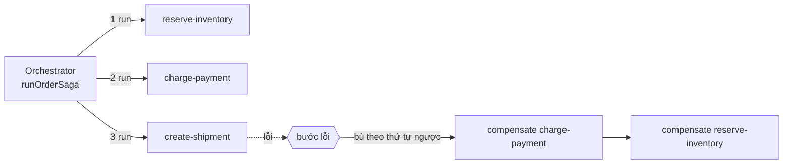
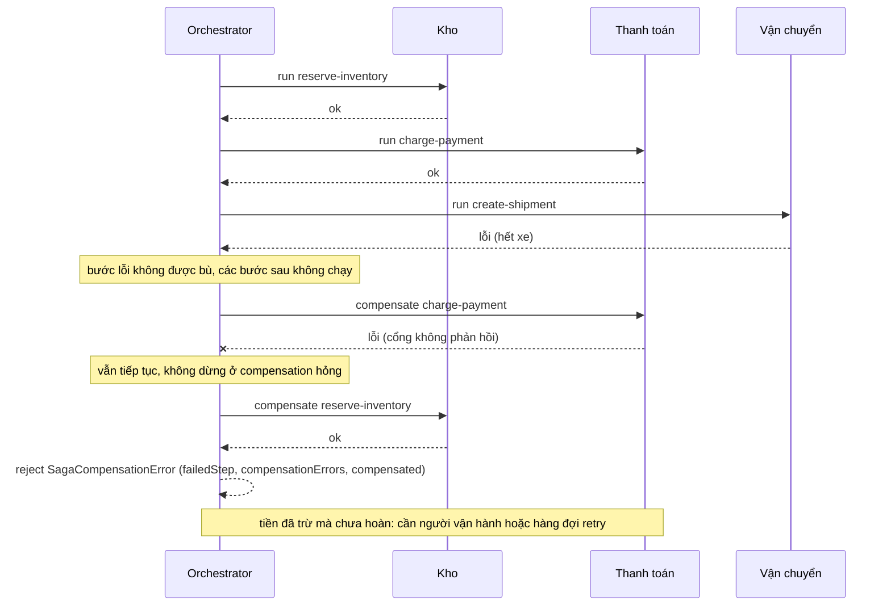

# Lab 06 - Saga: orchestration và compensation

## Mục tiêu

Cài một orchestrator saga tối giản và chốt hành vi khi giao dịch bù (compensation) cũng lỗi, chứng minh bằng test:

- Mọi bước thành công thì kết quả là `completed`, các bước chạy đúng thứ tự khai báo.
- Một bước lỗi thì các bước sau nó không chạy, các bước đã xong được bù theo thứ tự ngược, bước lỗi không được bù, kết quả là `compensated`.
- Compensation lỗi: các compensation còn lại vẫn chạy (mỗi bước đúng một lần) và lỗi được báo ra, không bị nuốt.
- Saga không có bước nào trả `completed`, bước đầu lỗi thì không có gì để bù, và tên bước xuất hiện trong thông báo lỗi.

Lab không cần broker hay database: orchestrator là hàm thuần chạy các bước do caller truyền vào.
Demo dùng ba service giả lập trong bộ nhớ (kho, thanh toán, vận chuyển).
Lý thuyết của cả chương nằm ở [theory.md](../theory.md) của chủ đề 08.

## Kiến trúc



Đường lỗi: bước thanh toán lỗi sau khi kho đã giữ hàng, rồi một giao dịch bù cũng lỗi.



## Giao diện

TypeScript (`ts/lab.ts`):

```ts
interface SagaStep { name: string; run(): Promise<void>; compensate(): Promise<void> }
runOrderSaga(steps: SagaStep[]): Promise<"completed" | "compensated">;
class SagaCompensationError extends Error {
  failedStep: string; stepError: unknown;
  compensationErrors: { step: string; error: unknown }[]; compensated: string[];
}
```

Go (`go/lab.go`): `RunOrderSaga(ctx, steps []SagaStep) (Outcome, error)` với `SagaStep{Name, Run(ctx) error, Compensate(ctx) error}`, `Outcome` là `Completed` hoặc `Compensated`, và `*CompensationError{FailedStep, StepErr, CompensationErrors, Compensated}`.
Tên field giống nhau ở hai ngôn ngữ.

## Quyết định: compensation lỗi được báo thế nào

Chọn MỘT cách và dùng nhất quán ở cả hai ngôn ngữ: khi có bước chạy lỗi VÀ ít nhất một compensation lỗi, `runOrderSaga` KHÔNG trả `compensated`.
TypeScript reject với `SagaCompensationError`, Go trả outcome rỗng cùng `*CompensationError`.
Lỗi này mang tên bước lỗi, lỗi gốc, mọi lỗi bù (theo thứ tự bù) và danh sách bước đã bù được.
Go còn cho `errors.Is` và `errors.As` tìm thấy lỗi gốc lẫn từng lỗi bù qua `Unwrap() []error`.

Vì sao không resolve `compensated` kèm một object kết quả:

- `compensated` là một lời khẳng định "đã hoàn tác hết".
  Nó chỉ nên được trả khi đúng, nếu không caller đọc kiểu trả về như brief (`'completed' | 'compensated'`) sẽ tin sai.
- Lỗi bị reject buộc caller phải xử lý (alert, ghi vào hàng đợi retry), còn một field phụ rất dễ bị bỏ qua.
- Kiểu trả về `'completed' | 'compensated'` của brief giữ nguyên cho mọi trường hợp sạch sẽ.

Trường hợp compensated sạch sẽ không trả nguyên nhân của bước lỗi (kiểu trả về chỉ là một chuỗi).
Nếu cần, bước tự ghi log nguyên nhân trước khi ném lỗi, như demo làm, hoặc mở rộng hàm để nhận một callback quan sát (bài tập 4).

Các quy tắc khác của orchestrator:

- Bước lỗi không được bù: ta coi local transaction của nó đã tự rollback.
  Nếu một bước có thể xong dở thì phải tự dọn bên trong `run`.
- Mỗi bước đã xong được thử bù đúng một lần, theo thứ tự ngược.
  Lab không retry compensation, đó là việc của hệ thống thật (xem bên dưới).
- Go chạy compensation với `context.WithoutCancel(ctx)`: ctx bị hủy thường chính là lý do một bước lỗi, và việc bù vẫn phải chạy tới cùng.
  Test chỉ có ở Go: `TestCompensationRunsEvenWhenTheContextIsCancelled`.

## Orchestration và choreography

Saga là chuỗi local transaction: mỗi bước cập nhật DB của một service và kích hoạt bước kế tiếp.
Microservices.io mô tả hai cách phối hợp:

- Choreography: mỗi local transaction publish một domain event kích hoạt local transaction ở service khác, không có bên điều phối trung tâm.
- Orchestration: một orchestrator chỉ định participant nào chạy local transaction nào.

Lab này là orchestration: logic "chạy gì, bù gì, theo thứ tự nào" nằm gọn ở một hàm nên dễ đọc, dễ test và dễ thấy trạng thái.
Đổi lại orchestrator trở thành một thành phần phải đáng tin cậy (nó cần ghi lại tiến độ để resume sau khi chết, lab này không làm).
Choreography bớt một thành phần trung tâm nhưng luồng bị rải ra nhiều service, khó theo dõi và khó biết saga đang ở bước nào.
Lab không cài choreography.

## Vì sao compensation phải idempotent và retry được

Compensating transaction cũng là eventually consistent và có thể lỗi.
Khi nó lỗi hoặc không rõ kết quả (timeout), cách duy nhất để chắc chắn là gọi lại, nên các bước bù phải là idempotent command: gọi hai lần cho cùng kết quả như một lần.
Các bước bù của demo viết theo kiểu đó: chúng xóa khỏi tập trạng thái của service, nên gọi lại không đổi kết quả.
Tài liệu của Microsoft còn khuyên hệ thống ghi lại tiến độ để resume từ điểm lỗi, và retry bước lỗi như lỗi tạm thời trước, chỉ compensate khi retry cạn hoặc lỗi không tạm thời.
Lab chưa làm các việc đó, và cũng chưa xác định các bước "point of no return" không thể hoàn tác (nên đặt chúng sau các bước validate quan trọng).

## Khi compensation lỗi vĩnh viễn

Nếu compensation vẫn lỗi sau khi retry, saga không thể tự phục hồi: tiền đã trừ mà chưa hoàn, hàng đã giữ mà chưa nhả.
Theo Microsoft, đôi khi chỉ can thiệp thủ công mới phục hồi được, và lúc đó cần alert kèm chi tiết lỗi.
Đó là lý do lỗi của lab mang đủ chi tiết (bước nào lỗi, lỗi gì, bước nào đã bù được) để một hàng đợi retry hoặc người vận hành tiếp tục đúng chỗ dở.

## Khác gì distributed transaction

Outbox và saga cùng xuất phát từ một bài toán: cập nhật nhiều nơi nguyên tử mà two-phase commit (2PC) thường không khả dụng.
Saga thay 2PC bằng chuỗi local transaction cộng compensation, và phải chấp nhận những khác biệt sau:

- Compensation khác với rollback của ACID: mỗi local transaction đã commit thật, và việc hoàn tác là một giao dịch mới có thể lỗi.
- Saga thiếu Isolation: các saga chạy đồng thời có thể thấy trạng thái trung gian của nhau, nên cần countermeasure cho các anomaly đó.
  Lab này không cài countermeasure nào.
- Hệ quả là chỉ có eventual consistency: giữa hai bước, hệ thống ở trạng thái trung gian nhìn thấy được.

## Giới hạn thật của pattern

- Saga cho eventual consistency, không phải atomicity: giữa hai bước, hệ thống ở trạng thái trung gian nhìn thấy được.
- Lab chạy trong một process, không bền: process chết giữa saga thì tiến độ mất, không có resume.
- Không có retry, timeout hay ghi tiến độ (các bước này là bài tập).
- Compensation lỗi vĩnh viễn cần người hoặc hàng đợi retry: lab chỉ báo lỗi, không tự xử lý.
- Không có countermeasure cho anomaly của saga chạy đồng thời.
- Lab không gửi message qua broker: kết hợp saga với outbox (lab 05) để mỗi bước publish event đáng tin cậy là bài tập.

## Chạy

```bash
pnpm vitest run 08-patterns/lab-06-saga/ts
go test -race ./08-patterns/lab-06-saga/go/...
make lab-ts LAB=08-patterns/lab-06-saga
make lab-go LAB=08-patterns/lab-06-saga
```

Lab này không cần `make up`.

## Kết quả mong đợi

Test (cùng tên ở TS và Go, Go dùng CamelCase):

| Test                                                                     | Chứng minh                                                                                                                                        |
| ------------------------------------------------------------------------ | ------------------------------------------------------------------------------------------------------------------------------------------------- |
| `all_steps_succeed_returns_completed`                                    | Mọi bước chạy đúng thứ tự, kết quả `completed`, không có compensation                                                                             |
| `failure_compensates_completed_steps_in_reverse_order`                   | Bước thứ ba lỗi: bước thứ tư không chạy, hai bước đầu được bù theo thứ tự ngược, bước lỗi không được bù, kết quả `compensated`                    |
| `compensation_failure_is_reported_and_remaining_compensations_still_run` | Hai compensation lỗi: các bước còn lại vẫn được bù, lỗi được báo với `failedStep`, `compensationErrors` và `compensated`, không trả `compensated` |
| `compensation_errors_name_the_steps_in_the_error_message`                | Thông báo lỗi chứa tên bước lỗi, lỗi gốc, tên bước không bù được và lỗi bù                                                                        |
| `saga_with_zero_steps_returns_completed`                                 | Không có bước nào thì kết quả là `completed`                                                                                                      |
| `first_step_failing_compensates_nothing`                                 | Bước đầu lỗi: không có gì để bù, kết quả `compensated`                                                                                            |

Demo chạy ba kịch bản: thành công, thanh toán lỗi (chỉ kho được bù, in vết bù bằng tiếng Việt), và vận chuyển lỗi cùng lúc hoàn tiền lỗi (saga báo lỗi, tiền còn bị trừ).

## Bài tập mở rộng

1. Retry bước lỗi như lỗi tạm thời (backoff có jitter, lab 02) trước khi bù.
2. Retry compensation với backoff, rồi đẩy bước bù thất bại vào một hàng đợi retry thay vì chỉ báo lỗi.
3. Ghi tiến độ saga vào Postgres để resume sau khi orchestrator chết, và kiểm tra bằng cách kill process giữa saga (như test chaos của lab 05).
4. Thêm callback quan sát để trả nguyên nhân của bước lỗi trong trường hợp `compensated`.
5. Cài choreography cho cùng luồng đặt hàng bằng event qua outbox (lab 05) và so sánh với orchestration.

## Nguồn tham khảo

Phiên bản: không phụ thuộc broker, TypeScript chạy trên Node 22 với vitest 5.0.3, Go 1.26.0 (kiểm tra ngày 2026-10-06).

- Saga là chuỗi local transaction, hai cách phối hợp (choreography và orchestration), compensating transaction, thiếu Isolation nên cần countermeasure.
  Nguồn: https://microservices.io/patterns/data/saga.html
- Compensating transaction: có thể lỗi, cần ghi tiến độ để resume, các bước bù phải idempotent, đôi khi cần can thiệp thủ công, retry bước lỗi trước khi bù, bước point of no return.
  Nguồn: https://learn.microsoft.com/en-us/azure/architecture/patterns/compensating-transaction
