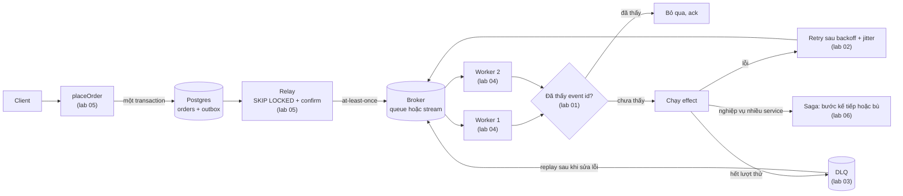
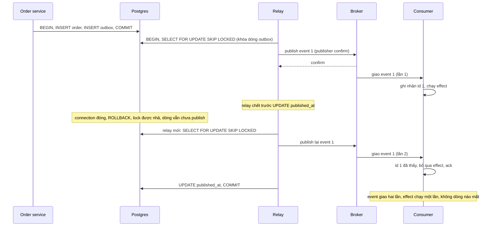
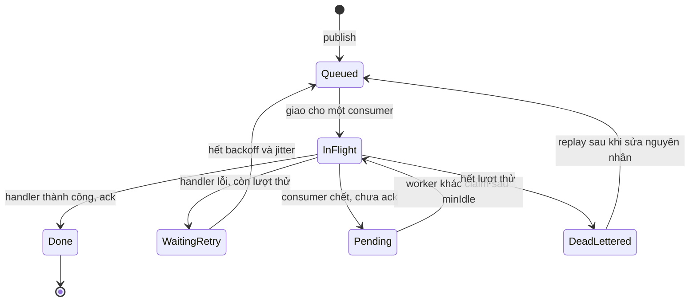

# Chủ đề 08 - Patterns: tin cậy giữa consumer, database và broker

Các chương trước cho thấy mỗi broker đều giao message ít nhất một lần (at-least-once) và hiếm khi đúng một lần.
Chương này gom sáu pattern biến "ít nhất một lần" thành hệ thống chạy đúng ngoài đời: consumer chịu được bản trùng, retry không làm sập downstream, message hỏng không chặn queue, nhiều worker chia việc an toàn, ghi DB và gửi message không lệch nhau, và nhiều service cùng hoàn tất hoặc cùng hoàn tác một nghiệp vụ.

Sáu lab đi kèm, mỗi lab có test cùng tên ở TypeScript và Go:

- [Lab 01 - Idempotent consumer với Redis `SET NX EX`](./lab-01-idempotency/README.md)
- [Lab 02 - Retry với exponential backoff và full jitter](./lab-02-retry-backoff/README.md)
- [Lab 03 - Dead-letter queue và replay trên Redis Streams](./lab-03-dlq/README.md)
- [Lab 04 - Competing consumers trên Redis Streams](./lab-04-competing-consumers/README.md)
- [Lab 05 - Transactional outbox: Postgres và RabbitMQ](./lab-05-outbox/README.md)
- [Lab 06 - Saga: orchestration và compensation](./lab-06-saga/README.md)

Phiên bản đã dùng: Redis 8.10.2 (lab 01 đến 04), RabbitMQ 4.3.6 và PostgreSQL 18.6 (lab 05), kiểm tra ngày 2026-10-06.
Lab 02 và lab 06 không cần broker.

## Các pattern trong một luồng đặt hàng

Đọc từ trái sang phải: outbox bảo đảm event không lệch với dữ liệu, broker và competing consumers chuyển và chia việc, idempotent consumer làm bản trùng vô hại, retry và DLQ xử lý lỗi, saga phối hợp nhiều service.
Mỗi pattern giải đúng một bài toán và để lại một rủi ro mà pattern khác phải đỡ.

## Idempotent consumer

Hầu hết broker (Service Bus, Event Hubs, Kafka, RabbitMQ) cung cấp at-least-once, và exactly-once delivery trên hệ thống phân tán là không thực tế.
Ngay cả broker có exactly-once cũng chỉ đảm bảo các thao tác nó kiểm soát, không kiểm soát side effect ở hệ thống ngoài.
At-least-once cộng consumer bỏ qua bản trùng cho ra effectively-once processing.

Lab 01 ([thư mục](./lab-01-idempotency/)) dùng `SET key 1 NX EX ttl` của Redis làm trọng tài: lệnh này atomic, trả `OK` khi key chưa có và nil khi đã có.
Dedup key phải ổn định qua mọi lần redeliver: message id do producer gán hoặc business idempotency key, không dùng id transport do broker sinh lại, không dùng timestamp nhận, không dùng correlation id dùng chung.
Khi nhiều consumer độc lập cùng đọc một channel, key phải gồm cả consumer identity và message identity.

Các điểm lab đo được:

- 20 lời gọi đồng thời cùng một id: đúng một lời gọi chạy effect.
- Effect lỗi thì key bị xóa để lần redeliver sau còn áp dụng được.
- TTL của key là bộ nhớ của pattern: nó phải lớn hơn cửa sổ broker còn có thể giao lại (số lần giao tối đa, visibility hoặc lock timeout, message TTL) và cả message do operator replay từ DLQ.
  Xóa sớm thì bản trùng đến muộn được áp dụng lại.
- Cửa sổ "đang xử lý": bản trùng đến lúc effect đầu còn chạy nhận `duplicate`, và nếu effect đầu rồi lỗi thì bản trùng đã bị ack đó mất.
  Cách giảm thiểu là hai trạng thái `processing` (TTL ngắn) rồi `done` (TTL dài), và chỉ ack bản trùng khi key đã `done`.

Cách chuẩn khi effect nằm trong database là ghi dedup marker và side effect trong cùng một transaction (inbox pattern, bạn đồng hành phía consumer của outbox) và dùng unique constraint làm trọng tài cho bản trùng đồng thời.
Trên cache phải dùng atomic set-if-absent thay vì check rồi set riêng.
Dedup key bằng Redis chỉ bền bằng độ bền của Redis.
Key có thể mất khi Redis restart mà không bật persistence (suy luận, chưa xác minh bằng nguồn riêng), khi chỉ có RDB hoặc AOF `everysec` (tài liệu Redis ghi có thể mất vài phút hoặc khoảng 1 giây dữ liệu gần nhất), khi bị eviction dưới `maxmemory` (mọi `maxmemory-policy` khác `noeviction` có thể xóa key), và khi failover vì replication là bất đồng bộ nên một ghi đã ack vẫn có thể mất.
Key mất thì bản trùng đến sau đó được áp dụng lại, nên với effect quan trọng hãy đặt dedup marker trong database cùng transaction với effect.

Nên ưu tiên operation idempotent tự nhiên (upsert theo business key, ghi giá trị tuyệt đối thay vì tăng) trước khi dùng dedup.

## Retry với exponential backoff và jitter

Retry ngay lập tức khi downstream đang chậm làm nó chậm thêm.
Công thức Full Jitter của AWS: `sleep = random_between(0, min(cap, base * 2 ** attempt))`.
Hai biến thể còn lại: Equal Jitter (`temp = min(cap, base * 2 ** attempt)`, `sleep = temp/2 + random_between(0, temp/2)`) và Decorrelated Jitter (`sleep = min(cap, random_between(base, sleep * 3))`).

Phân tích của AWS: tổng công việc của hệ thống khi N client tranh chấp tăng theo bình phương N, jitter giảm đáng kể công việc đó nhưng không đổi bản chất, Full Jitter tốn ít công việc hơn các biến thể còn lại và không jitter là tệ nhất.
Kết luận của họ là jittered backoff nên được xem là cách tiếp cận chuẩn cho remote client.

Lab 02 ([thư mục](./lab-02-retry-backoff/)) là hàm thuần nhận nguồn ngẫu nhiên làm tham số, nên test dùng PRNG có seed.
Nó đo ba điều dễ sai: delay luôn trong `[0, min(cap, base * 2^attempt))`, không tràn số với attempt rất lớn (Go dùng `math.Pow` trên số thực thay vì dịch bit), và delay của nhiều client rải đều trên cả khoảng.
Backoff không giới hạn tổng tải: vẫn phải giới hạn số attempts và tổng tốc độ tới downstream, và autoscale consumer mà không giới hạn tốc độ downstream chỉ chuyển quá tải sang dependency phía sau.
Tùy chọn của thư viện job queue (BullMQ có jitter, `DefaultRetryDelayFunc` của asynq có phần ngẫu nhiên nhưng không phải full jitter) thuộc chương 09.

## Dead-letter queue và replay

Message lỗi mãi (poison message) phải bị chặn không quay lại queue vô hạn, nếu không nó ăn tài nguyên hoặc, với queue có thứ tự, chặn các message phía sau.
DLQ cô lập message đó để debug: giới hạn số lần giao (SQS dùng `maxReceiveCount`), chuyển vào DLQ kèm chi tiết lỗi, cảnh báo khi DLQ có message, và đặt retention của DLQ dài hơn queue gốc.
Sau khi sửa nguyên nhân thì replay (SQS gọi là redrive) đưa message về queue nguồn.

Redis Streams không có DLQ sẵn (suy ra từ danh sách lệnh trong docs, không phải câu khẳng định trực tiếp), nên lab 03 ([thư mục](./lab-03-dlq/)) tự cài: đọc delivery count từ `XPENDING`, quá `maxAttempts` thì `XADD` sang stream DLQ kèm metadata (id gốc, lỗi, số lần thử, thời điểm lỗi, payload) rồi `XACK`.
Ba điểm lab đo:

- Entry được giao nhiều hơn `maxAttempts` trước khi handler chạy (consumer chết ở các lần trước) vào DLQ mà không chạy handler, để một message làm chết consumer không gây vòng lặp chết vô hạn.
- `XADD` vào DLQ rồi mới `XACK`: crash giữa hai lệnh để lại bản trùng trong DLQ thay vì mất message.
- `replayDlq(limit)` chuyển entry về stream chính với id mới, nên consumer phải dedupe theo business id chứ không theo id của stream.

Replay có thể xảy ra rất lâu sau cửa sổ redelivery thông thường, nên consumer nhận lại phải idempotent và TTL của dedup key phải bao được cửa sổ đó.
Không dùng DLQ với FIFO queue nếu cần giữ thứ tự tuyệt đối.
Với RabbitMQ, dead-lettering là tính năng của broker (chương 05, `05-rabbitmq/lab-03-retry-dlx`).

## Competing consumers

Nhiều worker cùng đọc một queue để chia việc: mỗi message chỉ giao cho một worker (khác pub/sub, nơi mọi subscriber nhận mọi message).
Thứ tự nhận không được bảo đảm và không nhất thiết phản ánh thứ tự tạo, nên consumer nên được thiết kế idempotent để bỏ phụ thuộc thứ tự.
Muốn strict ordering phải gom message của cùng một key về một consumer (Azure Service Bus gọi là message sessions).

Trên Redis Streams, lab 04 ([thư mục](./lab-04-competing-consumers/)) dùng consumer group: `XREADGROUP ... >` giao entry mới cho đúng một consumer, `XACK` rút nó khỏi pending list (PEL), và `XAUTOCLAIM` (từ Redis 6.2.0) chuyển entry đã pending quá `minIdle` sang worker khác khi một worker chết.
Lab đo: 40 message với 4 worker (tên consumer duy nhất) mỗi id xử lý đúng một lần, handler lỗi thì message nằm lại PEL và được claim lại, và `stop()` chờ handler đang chạy rồi mới đóng connection.
Chọn `minIdle` lớn hơn thời gian xử lý dài nhất của handler: nhỏ hơn thì hai worker có thể cùng xử lý một message.
Consumer chết chỉ được phát hiện sau ít nhất `minIdle`, không ngay lập tức.

## Transactional outbox

Bài toán: cập nhật DB và gửi message lên broker phải nguyên tử, mà two-phase commit thường không khả dụng.
Giải pháp: ghi message vào bảng outbox trong cùng transaction với thay đổi business, và một relay riêng đọc bảng đó rồi publish.
Message được gửi nếu và chỉ nếu transaction DB commit.

Hai kiểu relay: polling publisher (truy vấn định kỳ bảng outbox) và transaction log tailing (CDC, ví dụ Debezium với Outbox Event Router: cột `id` vào header để consumer phát hiện trùng, `aggregateid` làm message key để giữ thứ tự theo partition, chỉ xử lý INSERT).
Lab 05 ([thư mục](./lab-05-outbox/)) cài polling relay trên Postgres và RabbitMQ quorum queue:

- `placeOrder` ghi `orders` và `outbox` trong một transaction (test kiểm tra hai dòng cùng `xmin`), và một lỗi sau câu INSERT order làm cả hai dòng biến mất.
- `runRelay` chọn dòng chưa publish theo id với `FOR UPDATE SKIP LOCKED`, publish có publisher confirm, đặt `published_at` rồi commit, tất cả trong một transaction.
- Relay có thể publish một event nhiều lần nếu crash trước khi ghi nhận hoàn tất: transaction rollback, lock được nhả và lượt sau publish lại.
  Đó là at-least-once theo thiết kế, nên consumer phải dedupe theo event id.
- Publish lỗi ở một dòng thì cả batch rollback và lỗi được ném ra, những dòng đã publish trước đó sẽ được publish lại.
  Đổi lại transaction và lock mở suốt thời gian publish (đánh đổi suy luận từ code, kèm hai thiết kế thay thế là claim column và CDC trong README của lab).

Thứ tự: thứ tự publish theo thứ tự service gửi (microservices.io), và một relay duy nhất publish theo thứ tự id.
Thứ tự id chỉ trùng thứ tự chèn khi các transaction commit theo đúng thứ tự id: `bigserial` cấp id lúc INSERT nhưng dòng chỉ hiện ra lúc COMMIT, nên ngay cả một relay vẫn có thể publish id nhỏ sau id lớn khi hai transaction commit đảo thứ tự.
Nghiên cứu của handbook ghi "với nhiều relay chạy song song thì thứ tự bị mất" là chưa xác minh bằng nguồn riêng.
Lab 05 đo nó: relay A khóa dòng 1 và 2 rồi đứng chờ, relay B publish dòng 3 và 4 trước vì `SKIP LOCKED` bỏ qua dòng đang bị khóa, nên thứ tự publish là 3, 4, 1, 2.
Kết luận chỉ áp dụng cho thiết kế này: muốn giữ thứ tự theo entity thì dùng một relay hoặc claim theo aggregate.

## Saga

Saga là chuỗi local transaction: mỗi bước cập nhật DB của một service và publish message hoặc event để kích hoạt bước tiếp theo.
Hai cách phối hợp: choreography (mỗi local transaction publish domain event kích hoạt local transaction ở service khác) và orchestration (một orchestrator chỉ định participant nào chạy local transaction nào).
Khi một bước lỗi, compensating transaction hoàn tác các bước đã xong.
Compensation khác với rollback của ACID, và saga thiếu Isolation nên cần countermeasure cho anomaly do các saga chạy đồng thời.

Lab 06 ([thư mục](./lab-06-saga/)) là orchestration tối giản: chạy các bước theo thứ tự, bước đầu tiên lỗi thì bù các bước đã xong theo thứ tự ngược (bước lỗi không được bù).
Hành vi đã chốt khi compensation cũng lỗi: các compensation còn lại vẫn chạy mỗi bước một lần, và saga không trả `compensated` mà báo lỗi (TypeScript reject `SagaCompensationError`, Go trả `*CompensationError`) mang tên bước lỗi, lỗi gốc, mọi lỗi bù và các bước đã bù được.
Lý do: `compensated` là lời khẳng định đã hoàn tác hết và chỉ nên được trả khi đúng.

Compensating transaction cũng là eventually consistent và có thể lỗi.
Hệ thống phải ghi tiến độ để resume từ điểm lỗi, các bước bù phải là idempotent command để lặp lại được, và đôi khi chỉ can thiệp thủ công mới phục hồi được, lúc đó cần alert kèm chi tiết lỗi.
Nên retry bước lỗi như lỗi tạm thời trước, chỉ compensate khi retry cạn hoặc lỗi không tạm thời, và đặt các bước "point of no return" không thể hoàn tác sau các bước validate quan trọng.
Lab 06 chưa làm retry, ghi tiến độ hay countermeasure cho saga chạy đồng thời.

## Ghép các pattern lại

Luồng đặt hàng trong một service: `placeOrder` ghi order và outbox, relay publish, broker giao cho worker (competing consumers), worker dedupe theo event id rồi chạy effect, effect lỗi thì retry sau backoff và jitter, hết lượt thử thì vào DLQ, sau khi sửa lỗi thì replay qua cùng consumer idempotent.
Mỗi mắt xích chấp nhận trùng thay vì mất, và mắt xích kế tiếp loại trùng.
Khi nghiệp vụ trải qua nhiều service (giữ hàng, trừ tiền, giao hàng) thì saga phối hợp các bước, và mỗi bước publish event của nó qua outbox của service đó.

Đường lỗi tiêu biểu: relay chết giữa publish và đánh dấu.

Lab 05 chạy đúng kịch bản này bằng một relay là process con bị `SIGKILL`.

## Vòng đời message qua retry, DLQ và replay

`Pending` là trạng thái message nằm trong PEL của consumer đã chết.
Mọi mũi tên quay về `InFlight` hoặc `Queued` đều có thể tạo bản trùng, nên consumer ở `InFlight` phải idempotent.

## Chaos testing consumer và relay

Nguyên tắc của chaos engineering: định nghĩa steady state bằng output đo được, đưa vào biến cố thực tế, tự động hóa thí nghiệm và giữ blast radius nhỏ.
Test thường ném exception trong handler không tái hiện được cái chết đột ngột: process bị `SIGKILL` không chạy `finally`, không ack, không dọn gì, và đó chính là cửa sổ mà at-least-once phải xử lý.

Những gì các lab giết:

- Lab 03: một consumer là process con bị `SIGKILL` giữa handler, consumer thứ hai tiếp quản message qua `XAUTOCLAIM` và xử lý thành công.
- Lab 04: một worker là process con bị `SIGKILL` giữa handler, một worker khác trong group claim message, xử lý và ack.
- Lab 05: một relay là process con bị `SIGKILL` sau khi publish và trước khi đánh dấu, relay mới publish lại, consumer dedupe theo event id.

Cách làm chung: process con chạy code thật của lab, ghi marker (Redis) khi đã tới đúng điểm cần giết, test chờ marker bằng `eventually` (không sleep), `SIGKILL`, rồi kiểm tra steady state (message được xử lý ít nhất một lần, PEL cạn hoặc không dòng outbox nào mất).
Child có thời hạn cứng tự thoát, test luôn kill và reap child kể cả khi fail, và stderr của child được in ra khi test fail.
Test chaos không bao giờ dừng container dùng chung, nên blast radius chỉ là process con của chính test.

Những gì các lab KHÔNG bao phủ:

- Broker chết hoặc restart: lab không kiểm tra persistence (ví dụ AOF của Redis), reconnect, hay publish chưa được confirm khi RabbitMQ chết.
- Network partition, latency hay mất kết nối giữa các thành phần: nghiên cứu nêu Toxiproxy là công cụ cho loại thí nghiệm này, nhưng chi tiết tính năng chưa xác minh trong handbook và lab không dùng nó.
- Disk full, và message bị duplicate hoặc reorder do hạ tầng mạng.
- Consumer chậm chứ chưa chết (handler chạy quá `minIdle`): chỉ được nêu thành bài tập trong lab 04.
- Postgres chết giữa transaction của relay: lab chỉ giết relay, và kết quả "lock được nhả khi connection của relay chết" chỉ đo trên một Postgres cục bộ.

## So sánh các pattern

| Pattern              | Vấn đề giải quyết                            | Chi phí                                                          | Rủi ro còn lại                                                             | Lab chứng minh                          |
| -------------------- | -------------------------------------------- | ---------------------------------------------------------------- | -------------------------------------------------------------------------- | --------------------------------------- |
| Idempotent consumer  | Bản trùng của at-least-once làm lặp effect   | Một bước dedup (Redis hoặc DB), TTL phải bao cửa sổ redeliver    | Cửa sổ "đang xử lý", TTL hết sớm, effect ngoài hệ thống                    | [Lab 01](./lab-01-idempotency/)         |
| Retry backoff jitter | Retry đồng bộ làm downstream sập thêm        | Thêm độ trễ, phải giới hạn attempts                              | Không giới hạn tổng tải, caller phải phân biệt lỗi tạm thời                | [Lab 02](./lab-02-retry-backoff/)       |
| DLQ và replay        | Poison message chặn queue                    | Phải tự cài (Redis Streams) hoặc cấu hình, phải có người xem DLQ | Bản trùng trong DLQ khi crash giữa hai lệnh, replay muộn sau cửa sổ dedupe | [Lab 03](./lab-03-dlq/)                 |
| Competing consumers  | Chia việc cho nhiều worker, chịu worker chết | Tên consumer duy nhất, chọn `minIdle`                            | Mất thứ tự, xử lý trùng khi handler chậm hơn `minIdle`                     | [Lab 04](./lab-04-competing-consumers/) |
| Transactional outbox | Ghi DB và gửi message lệch nhau              | Bảng outbox, relay riêng, transaction giữ lock khi publish       | At-least-once, mất thứ tự với nhiều relay, bảng outbox lớn dần             | [Lab 05](./lab-05-outbox/)              |
| Saga                 | Nghiệp vụ nhiều service không có 2PC         | Mỗi bước cần compensation idempotent, cần ghi tiến độ            | Thiếu Isolation, compensation lỗi vĩnh viễn cần người xử lý                | [Lab 06](./lab-06-saga/)                |

Không pattern nào đứng một mình: idempotent consumer là điều kiện để retry, replay, competing consumers và outbox an toàn.

## Lỗi thường gặp

- Relay outbox crash giữa publish và đánh dấu đã gửi: sau khi restart cùng một event xuất hiện hai lần, và consumer không idempotent sẽ tạo bản ghi hoặc tính tiền hai lần.
  Đây là at-least-once theo thiết kế, không phải bug.
  Hãy chấp nhận duplicate ở phía publish, gán event id ổn định (cột `id` của outbox, đặt vào header) và dedupe theo id đó.
  Với Kafka, idempotent producer giảm duplicate do retry của producer nhưng không thay thế được idempotent consumer.
- Duplicate effect (trừ tiền hai lần, gửi email hai lần): xảy ra khi consumer crash sau khi ghi DB và trước khi ack, khi visibility timeout hết hạn, hoặc khi hai consumer nhận cùng bản sao cùng lúc.
  Hãy dùng dedup key ổn định, ghi marker và effect trong cùng transaction, dùng unique constraint hoặc atomic set-if-absent thay vì check rồi set, TTL marker lớn hơn cửa sổ redeliver và replay, và truyền idempotency key xuống service gọi tiếp.
  Với Redis `SET NX EX`: chiếm key rồi effect lỗi mà không nhả key thì retry bị bỏ qua nhầm (mất effect).
- Retry storm: downstream vừa chậm lại thì tải tăng vọt thành từng đợt đồng bộ và dịch vụ không hồi phục.
  Hãy dùng exponential backoff có cap kèm full jitter, giới hạn số attempts, và đừng autoscale consumer mà không giới hạn tổng tốc độ tới downstream.
- Poison message chặn queue: một message luôn làm consumer lỗi, được trả lại queue và xử lý vô hạn.
  Hãy giới hạn số lần giao rồi chuyển vào DLQ, cảnh báo khi DLQ có message, và đặt retention của DLQ dài hơn queue gốc.
- Thứ tự bị mất khi chạy nhiều relay hoặc nhiều worker: lab 04 và lab 05 đều không giữ thứ tự giữa các consumer hoặc relay.
  Hãy dùng một relay, claim theo aggregate, hoặc để broker giữ thứ tự theo key.
- Saga báo thành công giả: compensation lỗi bị nuốt khiến hệ thống lệch mà không ai biết.
  Hãy báo lỗi compensation, retry compensation rồi chuyển cho người vận hành, và viết compensation idempotent.
- Lock hết hạn khi đang giữ lock cũng gây xử lý trùng, nhưng chủ đề này thuộc chương 09 (distributed lock).

## Nguồn tham khảo

Phiên bản đã dùng, kiểm tra ngày 2026-10-06: Redis 8.10.2, RabbitMQ 4.3.6, PostgreSQL 18.6, ioredis 6.0.0, go-redis v9.23.0, amqplib 2.2.0, amqp091-go v1.15.0, `pg` 8.23.1, `pgx` v5.11.0.
Các lab đo trực tiếp trên broker thật: tranh chấp `SET NX` đồng thời, delivery count của `XPENDING`, `XAUTOCLAIM` sau khi worker bị `SIGKILL`, relay bị `SIGKILL` giữa publish và đánh dấu, và thứ tự publish của hai relay với `SKIP LOCKED`.
Điểm chưa xác minh bằng nguồn riêng và được đo trong lab 05: thứ tự publish khi nhiều relay chạy song song.
Chi tiết tính năng của Toxiproxy chưa xác minh trong handbook.

- Idempotent consumer: at-least-once cộng bỏ qua trùng, dedup key ổn định, inbox và atomicity, hai pha cho side effect ngoài transaction, TTL của dedup key.
  Nguồn: https://learn.microsoft.com/en-us/azure/architecture/patterns/idempotent-consumer
  Nguồn: https://microservices.io/patterns/communication-style/idempotent-consumer.html
- Redis `SET key value NX EX seconds`.
  Nguồn: https://redis.io/docs/latest/commands/set/
- Idempotency key ở mức API (Stripe lưu kết quả của request đầu tiên theo key).
  Nguồn: https://docs.stripe.com/api/idempotent_requests
- Exponential backoff và jitter (Full, Equal, Decorrelated) cùng phân tích tổng công việc.
  Nguồn: https://aws.amazon.com/blogs/architecture/exponential-backoff-and-jitter/
  Nguồn: https://github.com/aws-samples/aws-arch-backoff-simulator
- Dead-letter queue, `maxReceiveCount`, retention và redrive.
  Nguồn: https://docs.aws.amazon.com/AWSSimpleQueueService/latest/SQSDeveloperGuide/sqs-dead-letter-queues.html
- Competing consumers và queue-based load leveling (thứ tự không bảo đảm, poison message).
  Nguồn: https://learn.microsoft.com/en-us/azure/architecture/patterns/competing-consumers
  Nguồn: https://learn.microsoft.com/en-us/azure/architecture/patterns/queue-based-load-leveling
- Redis Streams: consumer group, `XREADGROUP`, `XACK`, `XPENDING`, `XAUTOCLAIM`.
  Nguồn: https://redis.io/docs/latest/develop/data-types/streams/
- Transactional outbox: polling publisher và transaction log tailing, at-least-once.
  Nguồn: https://microservices.io/patterns/data/transactional-outbox.html
- Debezium Outbox Event Router: `id` trong header, `aggregateid` làm message key.
  Nguồn: https://debezium.io/documentation/reference/stable/transformations/outbox-event-router.html
- Publisher confirms của RabbitMQ.
  Nguồn: https://www.rabbitmq.com/docs/confirms
- Saga: choreography, orchestration, compensating transaction, thiếu Isolation.
  Nguồn: https://microservices.io/patterns/data/saga.html
- Compensating transaction: compensation có thể lỗi, idempotent, ghi tiến độ, can thiệp thủ công, point of no return.
  Nguồn: https://learn.microsoft.com/en-us/azure/architecture/patterns/compensating-transaction
- Delivery semantics và effectively-once.
  Nguồn: https://docs.confluent.io/kafka/design/delivery-semantics.html
  Nguồn: https://bravenewgeek.com/you-cannot-have-exactly-once-delivery/
- Chaos engineering: steady state, biến cố thực tế, blast radius nhỏ.
  Nguồn: https://principlesofchaos.org/
- Toxiproxy (chỉ dùng như tên công cụ, chi tiết tính năng chưa xác minh).
  Nguồn: https://github.com/Shopify/toxiproxy
