# Chủ đề 09 - Production: chọn công nghệ và ghép các mảnh thành hệ thống

Tám chủ đề trước dạy từng viên gạch: Redis, RabbitMQ, Kafka, NATS và các pattern để at-least-once chạy đúng ngoài đời.
Chương cuối này làm hai việc.
Việc thứ nhất là so sánh các công nghệ trên cùng một bảng để chọn đúng công cụ cho từng bài toán.
Việc thứ hai là ghép các viên gạch thành bốn hệ thống nhỏ chạy được, mỗi hệ thống có test chạy với broker thật và một danh sách giới hạn thật.

Bốn use case, mỗi use case có test TypeScript và Go cùng ý nghĩa:

- [Use case 1 - Background job queue: BullMQ và asynq](./usecase-01-job-queue/README.md)
- [Use case 2 - Order và payment hướng sự kiện: outbox, Kafka, consumer idempotent và saga](./usecase-02-order-events/README.md)
- [Use case 3 - Redis làm hạ tầng: rate limiter, distributed lock và cache-aside](./usecase-03-ratelimit-lock-cache/README.md)
- [Use case 4 - Realtime: fan-out chat qua nhiều instance bằng Redis Pub/Sub và leaderboard](./usecase-04-realtime/README.md)

Phiên bản đã dùng, kiểm tra ngày 2026-10-06: Redis 8.10.2 (use case 1, 3, 4), Kafka 4.3.1 và Postgres 18.6 (use case 2).
RabbitMQ 4.3.6 và NATS 2.15.0 không có use case riêng ở chương này, nhưng nằm trong bảng chọn công nghệ.

Quy ước đánh dấu trong chương này: câu nào là lập luận riêng của handbook mà không có nguồn trực tiếp thì ghi "suy luận", câu nào research ghi là chưa kiểm chứng thì ghi "chưa xác minh".
Mọi con số thời gian lấy từ README của use case là kết quả của một lần đo trên một máy, không phải cam kết.

## Bốn use case trên bản đồ các chương

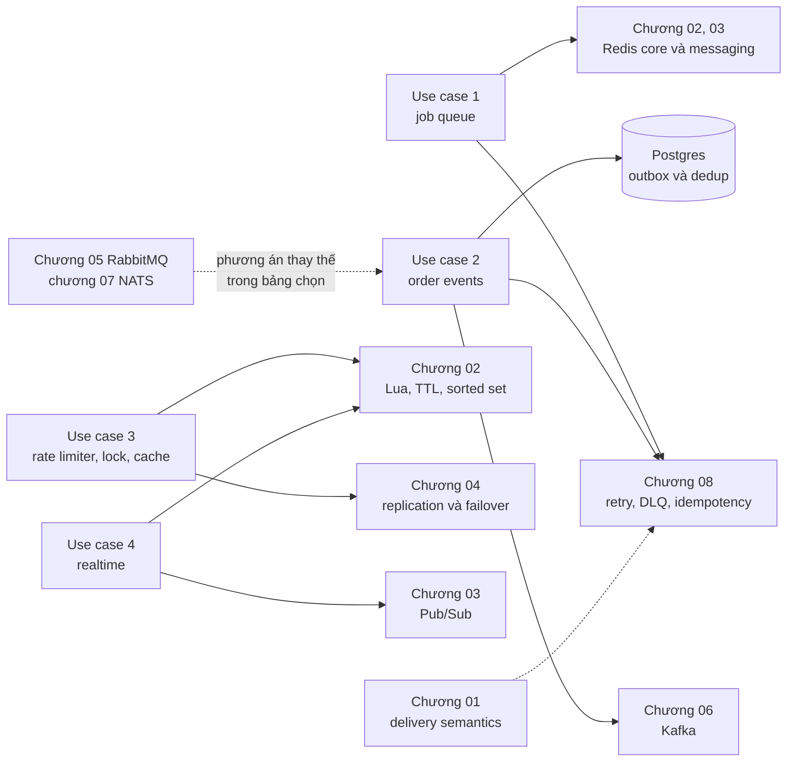

| Use case                                                                     | Công nghệ                            | Dựa trên chương                                                                                                                            | Điều use case chứng minh                                                                                  |
| ---------------------------------------------------------------------------- | ------------------------------------ | ------------------------------------------------------------------------------------------------------------------------------------------ | --------------------------------------------------------------------------------------------------------- |
| [1 - job queue](./usecase-01-job-queue/README.md)                            | BullMQ 6.3.11, asynq v0.26.0, Redis  | [02](../02-redis-core/), [03](../03-redis-messaging/), [08](../08-patterns/) (retry, jitter, DLQ, idempotency)                             | Retry với backoff, failed set hoặc archive, job hoãn, graceful shutdown, counter `jobs_processed_total`   |
| [2 - order events](./usecase-02-order-events/README.md)                      | Postgres, Kafka, consumer idempotent | [06](../06-kafka/) (consumer group, offset, key), [08](../08-patterns/) (outbox, idempotency, saga), [01](../01-fundamentals/) (semantics) | Outbox một transaction, relay chết vẫn một effect, dedup trong transaction, saga hoàn kho, consumer lag   |
| [3 - rate limiter, lock, cache](./usecase-03-ratelimit-lock-cache/README.md) | Redis, Lua                           | [02](../02-redis-core/) (Lua, TTL, sorted set), [04](../04-redis-advanced/) (replication bất đồng bộ làm lock mất)                         | Limiter nguyên tử, lock có token, lock hết hạn khi đang giữ, cache-aside chống stampede trong một process |
| [4 - realtime](./usecase-04-realtime/README.md)                              | Redis Pub/Sub, sorted set, WebSocket | [03](../03-redis-messaging/) (Pub/Sub), [02](../02-redis-core/) (sorted set), [04](../04-redis-advanced/) (Pub/Sub trên Cluster)           | Fan-out qua hai instance, vòng đời subscription theo phòng, client chậm, heartbeat, leaderboard           |

Hai chương còn lại của bảng chọn không có use case riêng nhưng vẫn là nền: chương [05 RabbitMQ](../05-rabbitmq/) và chương [07 NATS JetStream](../07-nats-jetstream/) cho các phương án thay thế ở use case 2 (chương 08 lab 05 chạy outbox trên RabbitMQ).

Cách ánh xạ khái niệm của use case 1 là suy luận, không phải mô tả cài đặt bên trong thư viện: job `active` mà worker mất tích giống entry nằm trong PEL của consumer đã chết (chương 03), và cơ chế stalled checker hoặc lease thay cho `XAUTOCLAIM`.

## Chọn công nghệ

Ba bảng dưới đây gom các công nghệ của handbook theo cùng một danh sách hàng.
Mọi ô lấy từ research hoặc từ theory của các chương trước, hoặc được gắn nhãn "suy luận" hay "chưa xác minh".
Research không có số throughput so sánh giữa các hệ thống, nên bảng không xếp hạng tốc độ và handbook cũng không đo.

### Bảng 1 - Mô hình, đảm bảo giao, thứ tự, replay

| Công nghệ                          | Mô hình                                             | Đảm bảo giao                                                   | Thứ tự                                                   | Replay và retention                                                                                                                                                                                                             |
| ---------------------------------- | --------------------------------------------------- | -------------------------------------------------------------- | -------------------------------------------------------- | ------------------------------------------------------------------------------------------------------------------------------------------------------------------------------------------------------------------------------- |
| Redis Pub/Sub                      | Pub/sub, không lưu message                          | At-most-once                                                   | Đúng thứ tự publish trên một channel                     | Không, subscriber vào muộn không đọc lại được gì                                                                                                                                                                                |
| Redis List (`BLMOVE` + processing) | Queue tự dựng trên list                             | At-least-once, phần recover tự viết                            | FIFO                                                     | Không, message bị lấy ra khỏi queue                                                                                                                                                                                             |
| Redis Streams (consumer group)     | Log kèm consumer group                              | At-least-once mặc định, at-most-once với `NOACK`               | Theo ID tăng dần của stream                              | Có, entry giữ tới khi trim hoặc `XDEL`                                                                                                                                                                                          |
| RabbitMQ (quorum queue)            | Exchange route vào queue, message xóa sau ack       | At-least-once với manual ack và publisher confirms             | Trong một queue với một consumer, requeue làm đổi thứ tự | Queue không replay, stream type replay theo offset và giữ theo `x-max-age` hoặc `x-max-length-bytes`                                                                                                                            |
| Kafka                              | Log chia partition, consumer giữ offset             | At-least-once mặc định, exactly-once chỉ trong phạm vi Kafka   | Trong một partition, cùng key thì cùng partition         | Có, broker mặc định giữ 168 giờ (`log.retention.hours`, topic đặt bằng `retention.ms`), retention xóa theo segment nên dữ liệu có thể sống lâu hơn (chưa xác minh bằng chạy thật), hoặc compaction giữ giá trị cuối của mỗi key |
| NATS core                          | Pub/sub theo subject, không lưu message             | At-most-once                                                   | Chưa xác minh trong research                             | Không, không có subscriber thì message bị bỏ                                                                                                                                                                                    |
| NATS JetStream                     | Stream theo subject, consumer là cursor phía server | At-least-once với ack explicit, dedup phía publish có giới hạn | Theo sequence của stream, redelivery có thể đảo thứ tự   | Có, theo retention policy `limits`, `interest` hoặc `workqueue`, consumer mới đọc lại bằng deliver policy                                                                                                                       |

Nguồn của bảng 1: bảng so sánh ở chương [03](../03-redis-messaging/theory.md), chương [05](../05-rabbitmq/theory.md) (mục quorum, classic và stream), chương [06](../06-kafka/theory.md) (mục thứ tự, retention, transaction) và chương [07](../07-nats-jetstream/theory.md) (hai bảng so sánh).
Các ô thứ tự của Pub/Sub và Streams cũng nằm trong [use case 4](./usecase-04-realtime/README.md).
Ô thứ tự của NATS core không có trong research nên được đánh dấu chưa xác minh.

### Bảng 2 - Throughput, chi phí vận hành, HA

| Công nghệ      | Throughput (đòn bẩy đã ghi, không có số)                                                                                                                                | Chi phí vận hành                                                                                                                          | Câu chuyện HA                                                                                                                                                     |
| -------------- | ----------------------------------------------------------------------------------------------------------------------------------------------------------------------- | ----------------------------------------------------------------------------------------------------------------------------------------- | ----------------------------------------------------------------------------------------------------------------------------------------------------------------- |
| Redis Pub/Sub  | Không có số trong research; chi phí mỗi `PUBLISH` theo số subscriber của channel: chưa xác minh                                                                         | Thấp nhất, đã có Redis thì không thêm gì                                                                                                  | Là HA của Redis: replication bất đồng bộ, Sentinel hoặc Cluster; subscriber đứt kết nối là mất message                                                            |
| Redis List     | Pipelining giảm round trip, tới khoảng 10 lần so với không pipeline (chương 02); lệnh chạy tuần tự nên lệnh hoặc script chậm chặn mọi client                            | Trung bình, phải tự viết reaper cho processing list (nhận định của handbook ở chương 03)                                                  | Như trên; trên Cluster, `BLMOVE` cần hai key cùng hash slot                                                                                                       |
| Redis Streams  | Như List (pipelining áp dụng chung cho lệnh Redis)                                                                                                                      | Cao hơn Pub/Sub và List: phải quản PEL, trim và giám sát (nhận định của handbook ở chương 03); không thêm hệ thống nếu đã có Redis        | Replication bất đồng bộ nên ghi đã ack vẫn có thể mất khi failover; Sentinel cần 3 Sentinel và ít nhất 1 replica, Cluster cần tối thiểu 3 master                  |
| RabbitMQ       | Prefetch 100 đến 300 thường cho throughput tối ưu theo tài liệu; stream protocol riêng (cổng 5552) cho throughput cao hơn AMQP 0-9-1; quorum queue chặn prefetch ở 2000 | Một broker riêng, phải tinh chỉnh ack, prefetch, channel; series 4.3 hết community support ngày 2026-11-30 nên phải theo dõi series mới   | Quorum queue (Raft) và stream là hai cấu trúc replicated còn lại trên 4.3, mirrored classic queue đã bị gỡ từ 4.0                                                 |
| Kafka          | Số partition là mức song song tối đa của một group, producer gom batch theo `linger.ms` và `batch.size`, `acks` đổi độ bền lấy độ trễ                                   | Nhiều quyết định phải chốt sớm (số partition, `acks`, `min.insync.replicas`), chỉ KRaft từ 4.0, transaction mặc định cần ít nhất 3 broker | Replication theo partition với tập ISR; khuyến nghị replication factor 3, `min.insync.replicas=2`, `acks=all`; lab chạy một broker nên chưa kiểm chứng mất leader |
| NATS core      | Fire-and-forget, không xác nhận; không có số trong research                                                                                                             | Thấp, không có trạng thái                                                                                                                 | Không lưu gì nên không có dữ liệu để bảo vệ, clustering cơ bản nằm ở chương 07                                                                                    |
| NATS JetStream | Async publish chồng round trip nhưng phải kiểm tra từng `PubAck`; replica không tăng throughput, R=3 tốn gấp ba lưu trữ và lưu lượng ghi                                | Có trạng thái: stream, consumer, storage, replication; nhiều cấu hình cố định lúc tạo                                                     | R=3 (Raft) chịu mất một server, R=5 chịu mất hai, mặc định R=1; `PubAck` trả khi đa số replica đã lưu; lab chạy một server nên chưa kiểm chứng failover           |

Nguồn của bảng 2: throughput lấy từ research (`docs/research/redis.md` về pipelining, `docs/research/rabbitmq.md` về prefetch và stream protocol, `docs/research/kafka.md` về partition và producer, `docs/research/nats.md` về `MaxAckPending`, async publish và replica), chi phí vận hành lấy từ các mục "Lỗi thường gặp" và "So sánh" của chương 03 đến 07, HA lấy từ chương [04](../04-redis-advanced/theory.md) (so sánh ba mô hình HA), chương 05, 06, 07 và research của RabbitMQ về ngày hết community support.
Ô "mất message khi failover" của Redis là hệ quả của replication bất đồng bộ, đã được nêu ở chương 04.
Cột "Chi phí vận hành" là nhận định của handbook (suy luận), giống cách chương 03 đã ghi, không phải câu trong tài liệu của nhà cung cấp.

### Bảng 3 - Hợp với và không nên dùng khi

| Công nghệ      | Hợp với                                                                                                                                                                    | Không nên dùng khi                                                                                                                                                                                           |
| -------------- | -------------------------------------------------------------------------------------------------------------------------------------------------------------------------- | ------------------------------------------------------------------------------------------------------------------------------------------------------------------------------------------------------------ |
| Redis Pub/Sub  | Chat trực tiếp, cập nhật chấp nhận mất, invalidate cache, tín hiệu "có việc mới" ([use case 4](./usecase-04-realtime/README.md))                                           | Dùng làm job queue, hoặc khi message phải tới nơi, hoặc khi client vào muộn cần lịch sử                                                                                                                      |
| Redis List     | Job queue đơn giản, một nhóm worker, chấp nhận tự viết phần recover                                                                                                        | Cần theo dõi pending, claim và replay (dùng Streams), hoặc cần retry theo lịch và DLQ đầy đủ (dùng thư viện job queue hoặc broker chuyên dụng)                                                               |
| Redis Streams  | At-least-once, nhiều consumer chia việc, claim worker chết, replay gần realtime                                                                                            | Dữ liệu lớn hơn RAM của Redis (suy luận), cần retention dài với nhiều consumer độc lập (Kafka hợp hơn), hoặc không chấp nhận mất ghi gần nhất khi failover                                                   |
| RabbitMQ       | Task queue, routing linh hoạt, retry và delay bằng DLX và TTL                                                                                                              | Cần giữ lịch sử event cho nhiều bên đọc độc lập rồi đọc lại (log hợp hơn, trừ khi dùng stream type), hoặc cần giữ thứ tự khi có nhiều consumer hay requeue (thứ tự chỉ giữ trong một queue với một consumer) |
| Kafka          | Event stream, replay, nhiều consumer độc lập, retention dài, thứ tự theo key; thông lượng chưa có số đo trong research ([use case 2](./usecase-02-order-events/README.md)) | Task queue cần retry, delay và dead letter tinh vi (không có sẵn, phải tự dựng topic retry), hoặc cần thứ tự giữa các partition, hoặc exactly-once ra database                                               |
| NATS core      | Request/reply, tín hiệu tạm, dữ liệu mất cũng được                                                                                                                         | Cần persistence: subscriber vắng mặt không nhận lại gì và publisher không báo lỗi                                                                                                                            |
| NATS JetStream | Việc không được mất, replay, nhiều consumer độc lập, một server nhỏ gọn cho cả request/reply và stream                                                                     | Cần dead-letter queue có sẵn (không có, chỉ có advisory sau MaxDeliver), hoặc cần routing kiểu exchange                                                                                                      |

Nguồn của bảng 3: cột "Hợp với" lấy từ dòng "Khi chọn" của các bảng so sánh ở chương 03, 05, 06, 07 (bỏ ý "thông lượng lớn" của Kafka, vì research không có số đo để xếp hạng) và bảng so sánh Pub/Sub, Streams và broker chuyên dụng ở [use case 4](./usecase-04-realtime/README.md).
Cột "Không nên dùng khi" lấy từ các mục "Lỗi thường gặp" của chương tương ứng.
Hai ô là suy luận của handbook: "dữ liệu lớn hơn RAM" của Streams (Redis giữ dữ liệu trong RAM, chương 02) và "cần routing kiểu exchange" của JetStream (RabbitMQ có exchange và binding, chương 05, còn JetStream route theo subject).

### Hướng dẫn chọn nhanh

Sơ đồ dưới đây là cách đọc ba bảng trên theo từng câu hỏi.
Đây là suy luận của handbook từ các bảng, không phải khuyến nghị của nhà cung cấp nào.

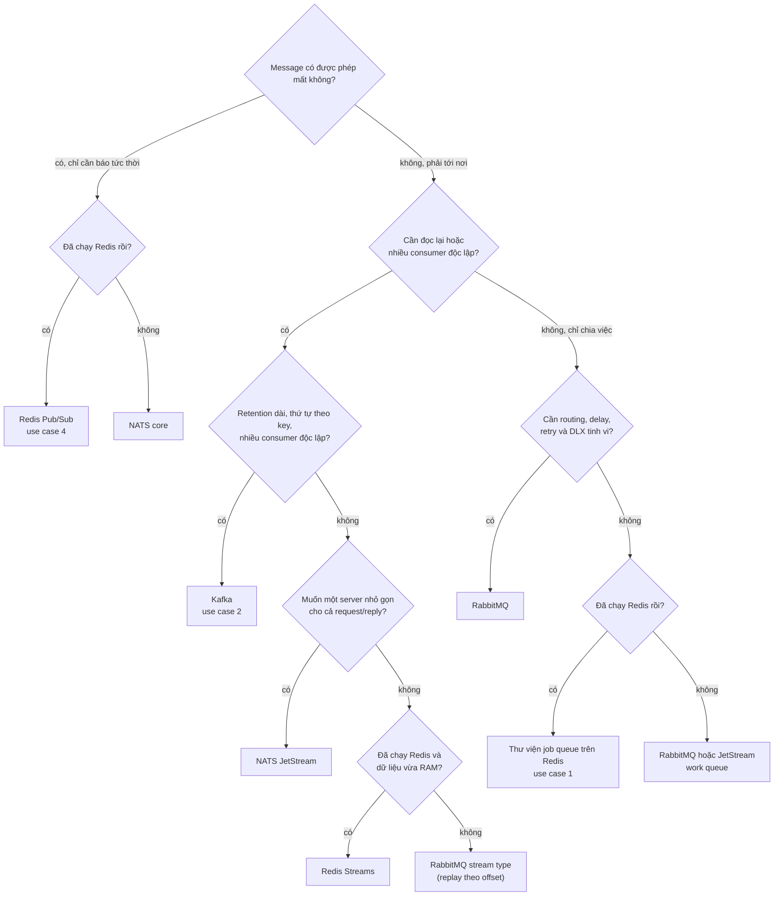

Ba lời nhắc đi kèm sơ đồ:

- Không có nhánh nào cho kết quả "nhanh nhất", vì research không có số đo để so sánh.
  Hãy đo trên tải thật của bạn trước khi quyết định theo throughput.
- Có thể dùng nhiều công nghệ trong một hệ thống, và use case 2 là ví dụ: nó dùng Postgres giữ trạng thái và Kafka giữ log event.
  Một hệ thống thật có thể thêm Redis cho cache và limiter như use case 3.
- Chọn theo mô hình trước, vận hành sau: queue xóa sau ack khác log giữ lại để đọc lại, và đổi mô hình giữa chừng đắt hơn đổi sản phẩm cùng mô hình.
  Câu cuối là suy luận của handbook.

## Use case 1 - Job queue: thư viện trên Redis

Kịch bản: web app không gửi email trong request.
`enqueueEmail` đẩy một job vào Redis rồi trả lời người dùng, một worker chạy nền lấy job ra gửi, retry khi lỗi và giữ lại bằng chứng khi hết lượt thử.
Chi tiết, bảng đo và bài tập nằm trong [README của use case 1](./usecase-01-job-queue/README.md).

Vì sao một thư viện job queue trên Redis: chương 03 kết luận rằng khi cần retry theo lịch, DLQ và rate limit đầy đủ thì nên cân nhắc broker chuyên dụng hoặc thư viện job queue xây trên Redis, vì List và Streams chỉ cho phần nền và phải tự viết phần còn lại.
Suy luận: một web app đã có Redis cho cache sẽ không thêm một hệ thống mới nếu nhu cầu chỉ là email, thumbnail hay webhook.
Hai thư viện cùng chạy trên một Redis để so sánh hành vi: BullMQ cho TypeScript, asynq cho Go.

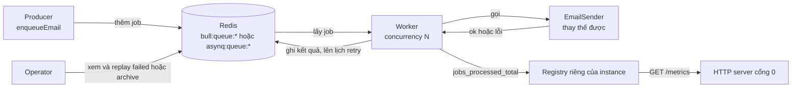

### Vòng đời của một job

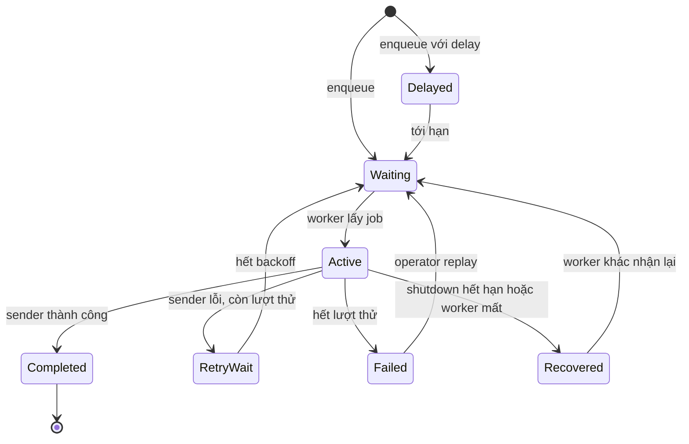

Tên trạng thái trong thư viện khác nhau.
BullMQ dùng `delayed` set và failed set, asynq dùng `scheduled`, `retry` và archive, nhưng hình dạng vòng đời giống nhau.
Mũi tên `Recovered` là chỗ hai thư viện khác nhau nhất: BullMQ giữ job ở `active` cho tới khi lock hết hạn rồi stalled checker của worker khác nhặt lại, còn asynq đẩy task về `pending` ngay lúc `Shutdown()` hết hạn.
Mọi mũi tên quay về `Waiting` đều có thể làm job chạy lại, nên sender phải idempotent.

### Đường lỗi: retry, hết lượt thử, replay

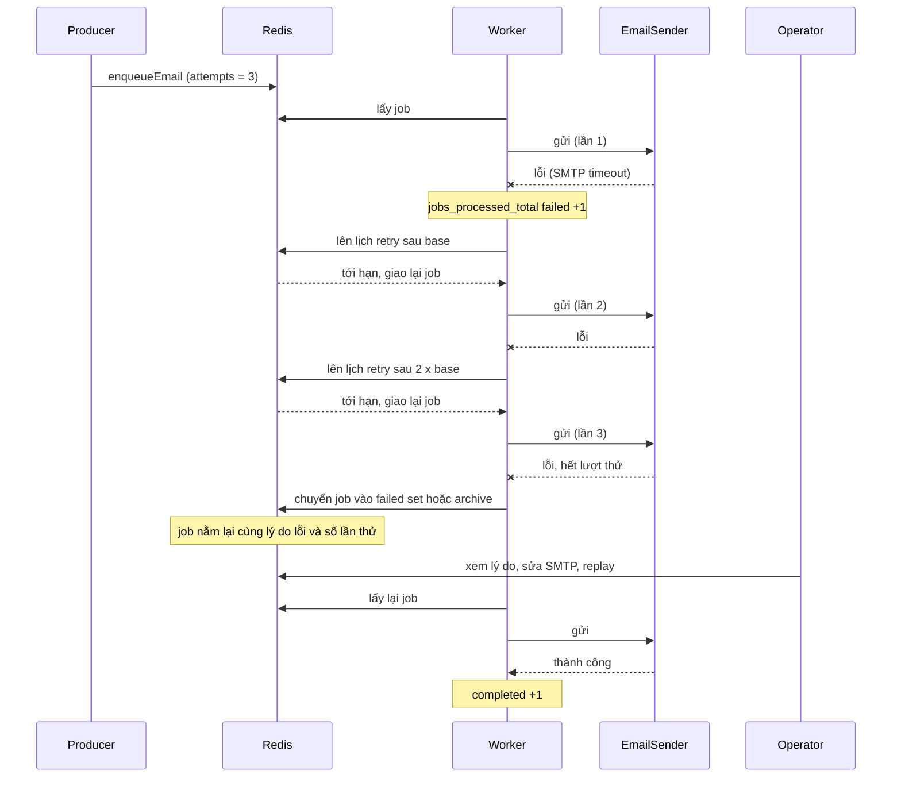

### Quyết định và bẫy đã đo trong lab

- `attempts` không cùng nghĩa ở hai thư viện: BullMQ đếm tổng số lần chạy, còn asynq đếm số lần RETRY (`MaxRetry(2)` cho 3 lần chạy).
  Lab đặt `MaxRetry = attempts - 1` để hai bên cùng ý nghĩa, và số truyền vào hàm backoff cũng lệch nhau một đơn vị.
- asynq lên lịch theo giây nguyên (Unix giây, cắt phần lẻ).
  Lab đo một lần: `ProcessIn(2s)` chạy sau 1,86 giây và retry đầu với base 1 giây chạy sau chỉ 0,3 giây.
  Cận dưới đúng của test là `floor_to_second(lần trước + delay)`, nếu cần độ chính xác mili giây thì dùng BullMQ.
- `worker.close()` của BullMQ chờ job đang chạy và KHÔNG có timeout.
  Gọi `close(true)` sau `close()` không có tác dụng (đọc từ source 6.3.11), nên lab tự `pause(true)`, chờ tới hạn rồi mới chọn close thường hoặc force.
- Shutdown hết hạn không làm mất job nhưng làm job chạy hai lần.
  BullMQ ghi `stalledCounter = 1`, `attemptsStarted = 2`, `attemptsMade = 1` sau khi stalled checker nhặt lại, asynq giữ `Retried = 0` (không tính là lần fail).
- Metric `jobs_processed_total{status}` đếm từng lần chạy sender chứ không đếm job: job lỗi hai lần rồi thành công cho `failed = 2` và `completed = 1`.
  Muốn đếm "thất bại hẳn" phải chỉ tăng counter ở lần thử cuối.
- Mặc định retention khác nhau và đều là quyết định phải chọn: BullMQ giữ completed và failed vô thời hạn, asynq xóa task thành công ngay và giới hạn archive 10000 task trong 90 ngày.

### Giới hạn thật

- At-least-once và không có outbox: nếu transaction của app commit rồi crash trước khi enqueue thì email mất.
  [Chương 08, lab 05](../08-patterns/lab-05-outbox/) là cách đóng cửa sổ này, use case 1 không làm.
- Backoff của lab là `base * 2^n` thuần để test xác định, không có jitter.
  Production nên bật jitter (chương 08 [lab 02](../08-patterns/lab-02-retry-backoff/)).
- Lab chưa kill worker bằng SIGKILL, nên đường worker chết đột ngột chưa được đo.
  Hành vi của asynq (lease 30 giây, recoverer, tính là một lần retry) chỉ đọc từ source v0.26.0, chưa xác minh bằng lab.

## Use case 2 - Order và payment hướng sự kiện

Kịch bản: `POST /orders` nhận một order, sau đó `inventory` giữ hàng và `payment` thanh toán mà request không phải chờ.
Thanh toán lỗi thì kho được hoàn và order bị hủy.
Chi tiết ở [README của use case 2](./usecase-02-order-events/README.md).

Vì sao Kafka (lý do thiết kế): hai consumer độc lập (`inventory`, `payment`) cùng đọc một event nên mỗi bên cần group riêng với offset riêng, event của một order phải giữ thứ tự (cùng key thì cùng partition), và lag đo được bằng offset.
Đó là các tiêu chí "event stream, nhiều consumer độc lập, thứ tự theo key" ở bảng chọn công nghệ.
RabbitMQ vẫn là phương án hợp lệ cho một outbox (chương 08 lab 05 làm đúng việc đó), nhưng use case này muốn minh họa offset, key partition và consumer lag của Kafka.
Câu này là suy luận thiết kế, không phải khẳng định rằng RabbitMQ không làm được.

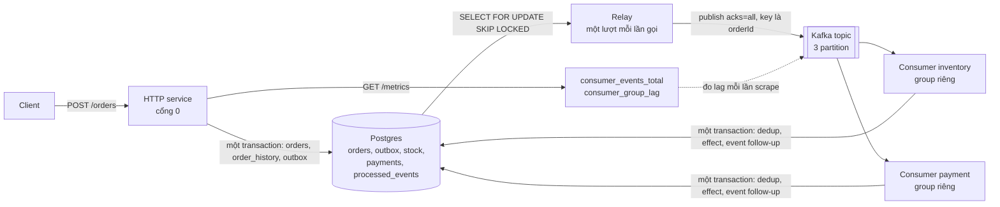

### Trạng thái của order

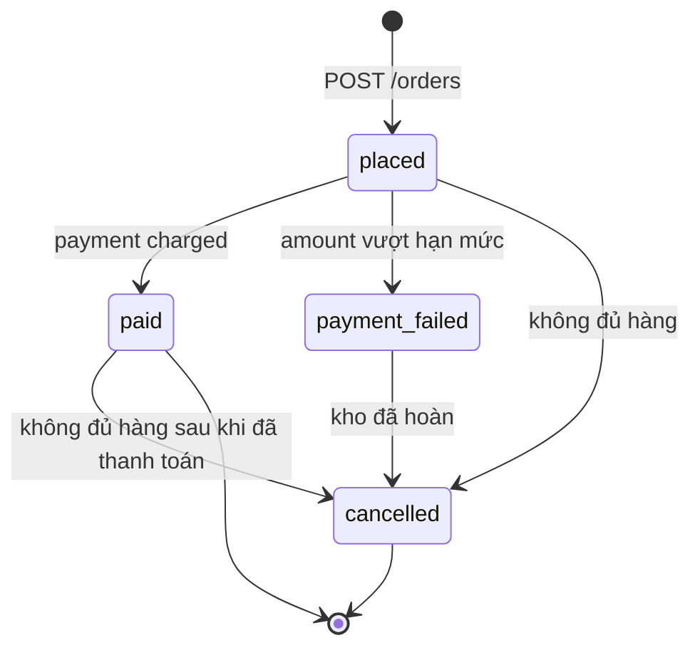

Mỗi bước đổi trạng thái có guard dạng `UPDATE orders ... WHERE status = ...`, nên một event lặp không kéo order lùi về trạng thái cũ.

### Đường lỗi 1: relay chết giữa publish và đánh dấu

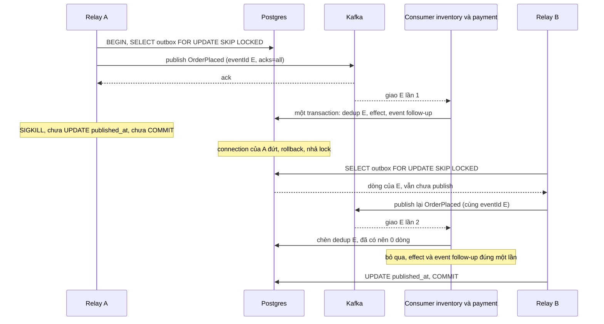

Đây là sơ đồ của chương 08 ([lab 05](../08-patterns/lab-05-outbox/)) đặt vào hệ thống đầy đủ hơn: topic Kafka thay cho RabbitMQ, và dedup nằm ở hai consumer.
Test chaos của use case giết relay bằng SIGKILL thật (process con), và đo rằng event nằm trên topic ít nhất hai lần nhưng mỗi consumer có `applied = 1` và `duplicate >= 1`.

### Đường lỗi 2: thanh toán lỗi và compensation

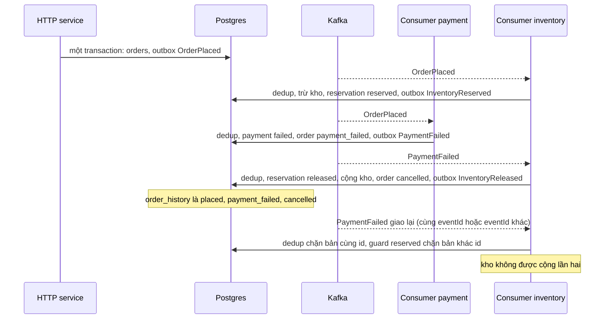

### Quyết định và bẫy đã đo trong lab

- Dedup nằm trong CÙNG transaction Postgres với effect và event follow-up, khóa là `(consumer, event_id)`.
  Lỗi chen giữa dòng dedup và effect rollback cả hai nên lần giao lại áp dụng được, và cửa sổ "đang xử lý" của dedup bằng Redis ở chương 08 lab 01 không còn.
- `event_id` được sinh một lần bằng `gen_random_uuid()` lúc INSERT dòng outbox, nên mọi lần relay publish lại đều mang cùng id.
  Id phải ổn định qua mọi lần redeliver, không phải id do broker hay thời điểm nhận sinh ra.
- Offset chỉ được commit SAU khi transaction của effect commit.
  Crash giữa hai bước cho một bản trùng (lag còn 1, consumer thay thế nhận lại và dedup bỏ qua), không bao giờ làm mất event.
  Hook `crashBeforeCommit` của test khác kill -9 thật ở chỗ `stop()` gửi LeaveGroup, còn crash thật phải chờ `session.timeout.ms`, nhưng offset group lưu giống nhau.
- Consumer lag là tổng theo partition của `log end offset - offset đã commit`.
  Partition chưa có commit tính từ offset đầu, và message đang xử lý mà chưa commit vẫn tính là lag.
  `kafka-go` `Reader.Lag()` luôn trả -1 khi dùng `GroupID`, nên Go dùng admin API.
- Poison event (không phải JSON, thiếu trường) được đếm là `poison`, bị bỏ qua và offset được commit để một message hỏng không chặn partition mãi.
  Use case không có DLQ topic nên nội dung hỏng chỉ nằm trong log và không replay được.
- Saga là choreography: mỗi bước ghi effect cùng event follow-up vào outbox.
  Lý do chọn (lý do thiết kế): chỉ hai participant và một đường bù, và tiến độ đã nằm sẵn trong database và event.
  Khi số bước tăng lên thì orchestrator dễ đọc hơn.

### Giới hạn thật

- Hết hàng chưa được xử lý trọn vẹn: `inventory` ghi `rejected`, hủy order và phát `InventoryRejected`, nhưng `payment` chạy song song nên vẫn charge cho order bị hủy và không có bước hoàn tiền.
  Cả hai thứ tự xen kẽ đều kết thúc ở `cancelled` với một payment `charged`.
  Muốn đóng chỗ này thì `payment` phải chờ `InventoryReserved` hoặc có compensation hoàn tiền (bài tập 3 của use case).
- Exactly-once của Kafka (idempotent producer, transaction, `read_committed`) chỉ bao phủ chuỗi đọc, xử lý, ghi trong Kafka, không bao phủ ghi vào Postgres hay API ngoài.
  Use case chọn dedup theo `eventId`, và không dùng transaction của Kafka vì kafka-go v0.4.51 không có API transaction trong `Writer` (chưa xác minh tuyệt đối).
- Dedup trong transaction chỉ bảo vệ effect nằm cùng database.
  Với cổng thanh toán thật (HTTP ra ngoài) lời gọi phải mang idempotency key ổn định (header `Idempotency-Key` của Stripe) và cần thêm trạng thái "đang xử lý".
- Chỉ MỘT relay mới giữ thứ tự publish: chương 08 lab 05 đo rằng hai relay với `SKIP LOCKED` publish theo thứ tự 3, 4, 1, 2.
- Compensation cũng có thể lỗi: ở đây nó là event handler, nên lỗi vĩnh viễn chặn partition và làm lag tăng.
  Use case không có ngưỡng thử lại tối đa hay đường escalate cho người vận hành.

## Use case 3 - Redis làm hạ tầng: rate limiter, distributed lock, cache

Kịch bản: một API đông người dùng cần chặn client gọi quá nhiều, cần bảo đảm chỉ một instance chạy một việc (cron trên nhiều pod), và cần giữ kết quả truy vấn đắt mà không để hàng trăm request cùng chạy lại khi key nóng hết hạn.
Ba mảnh độc lập, không dùng chung key, nằm trong [README của use case 3](./usecase-03-ratelimit-lock-cache/README.md).

Vì sao Redis: cả ba cần trạng thái dùng chung giữa nhiều process, có TTL và các thao tác nguyên tử.
Một Lua script chạy nguyên tử trên server nên gộp được read, decide, write thành một lệnh (chương 02), và `SET key value NX PX ttl` là set-if-absent kèm TTL trong một lệnh.
TTL làm trạng thái tự dọn khi client chết.

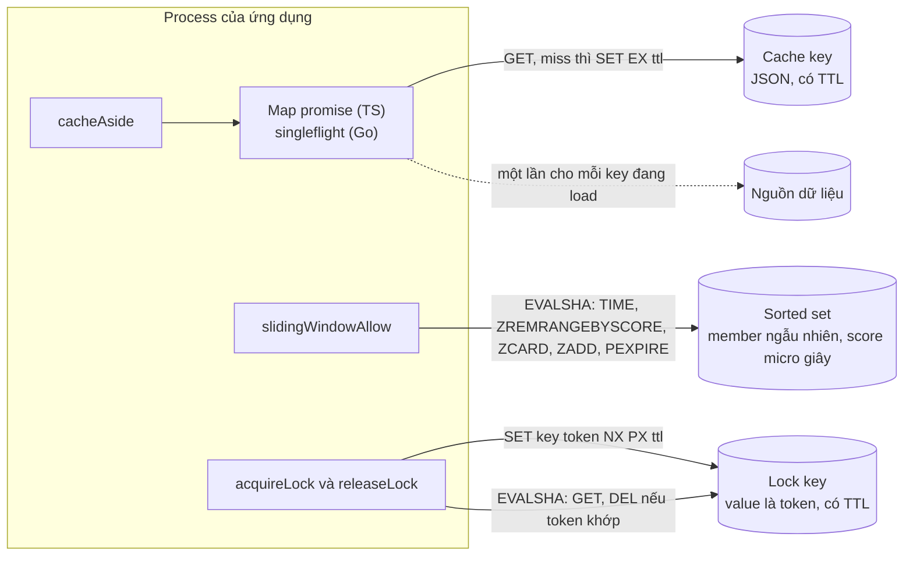

### Rate limiter: sliding window log trong một Lua script

- Cả bốn bước (đọc `TIME`, bỏ entry cũ, `ZCARD`, `ZADD`) nằm trong một script, nên 50 caller đồng thời với limit 10 cho đúng 10 allowed.
  Bản naive viết bằng nhiều lệnh cho 20 allowed trên limit 5 trong demo, và kết quả của bản naive phụ thuộc may rủi của race.
- Thời gian lấy từ `TIME` của SERVER trong script, nên nhiều instance lệch đồng hồ vẫn đồng ý về cùng một cửa sổ.
  Score là micro giây và member là chuỗi ngẫu nhiên, vì nếu member chỉ là thời gian thì hai request cùng micro giây ghi đè nhau và limiter đếm thiếu.
- Request bị từ chối KHÔNG ghi gì, nếu không một client cứ thử lại liên tục sẽ làm cửa sổ trượt mãi và không bao giờ vào lại được.
- Bộ nhớ là O(limit) mỗi key, nên với limit lớn thì sliding window counter (hai STRING, Cloudflare đo sai 0,003% trong thử nghiệm của họ) hoặc token bucket (Stripe) hợp hơn.
  Fixed window rẻ nhất nhưng cho burst gấp đôi ở ranh giới cửa sổ.
- Production nên fail open khi Redis lỗi (khuyến nghị của Stripe), còn lab trả lỗi cho caller để quyết định, và không tính `Retry-After`.

### Distributed lock: token, hết hạn và fencing

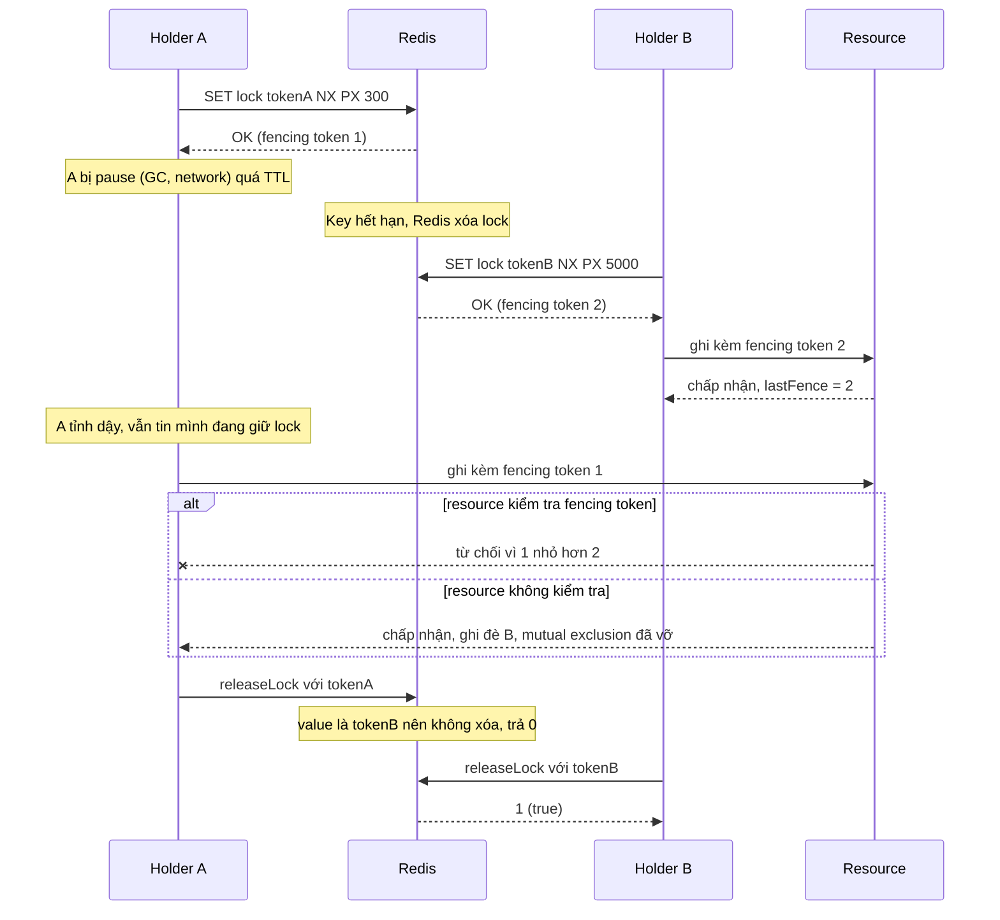

- Token chỉ ngăn A xóa nhầm lock của B (release bằng Lua so sánh rồi xóa, hoặc từ Redis 8.4 là `DELEX key IFEQ token`, có trên server 8.10.2 của lab).
  Token KHÔNG ngăn A ghi vào resource trong lúc đó: test `expired_holder_still_believes_it_holds_the_lock` chứng minh Redis không báo gì cho holder cũ.
- Fencing token (số tăng đơn điệu gửi kèm mỗi lần ghi, resource từ chối số nhỏ hơn số đã thấy) chỉ có trong demo, không có trong thư viện, vì phần quan trọng nằm ở resource được bảo vệ (cột version, unique constraint, check-and-set).
  Demo cho kết quả: resource không kiểm tra thì giá trị cuối là của A (sai), resource kiểm tra fencing token thì giá trị cuối là của B (đúng).
- Failover làm mất lock: replication của Redis là bất đồng bộ, client A lấy lock trên master, master chết trước khi ghi sang replica, replica lên master và client B lấy được lock cho cùng resource.
  Redis không dùng monotonic clock cho TTL nên đổi giờ hệ thống cũng có thể làm hai process cùng giữ lock.
  Lab chạy trên một node nên không đo được điều này.

### Tranh luận Redlock

Redlock là thuật toán của Redis dùng 5 master độc lập và coi lock hợp lệ khi lấy được đa số (ít nhất 3) trong thời gian nhỏ hơn validity time.

| Chủ đề                   | Kleppmann (2016-02-08)                                                                                                                  | antirez (phản hồi)                                                                                                            |
| ------------------------ | --------------------------------------------------------------------------------------------------------------------------------------- | ----------------------------------------------------------------------------------------------------------------------------- |
| Hai mục đích của lock    | Efficiency (lỗi chỉ tốn chi phí) và correctness (lỗi làm hỏng dữ liệu)                                                                  | Ứng dụng không cần lock nếu có cách khác tránh race khi mutual exclusion bị vi phạm (token ngẫu nhiên lớn cộng check-and-set) |
| Pause, delay, clock jump | Làm client vẫn ghi được sau khi lock hết hạn, Redlock cần mô hình đồng bộ (độ trễ, pause, sai số đồng hồ có giới hạn)                   | Redlock chỉ cần mô hình semi synchronous và đồng ý monotonic clock sẽ tốt hơn                                                 |
| Pause trong lúc acquire  | Không nói riêng trong tóm tắt của handbook                                                                                              | Redlock kiểm tra thời gian trước và sau khi lấy đa số nên pause trong lúc acquire không phá safety                            |
| Pause sau khi acquire    | Fencing token là giải pháp, Redlock không sinh được fencing token                                                                       | Vẫn là vấn đề mà phản hồi này không giải quyết bằng fencing                                                                   |
| Khuyến nghị              | Efficiency thì một node Redis và chấp nhận là xấp xỉ, correctness thì hệ consensus như ZooKeeper cùng fencing token, không dùng Redlock | Không có khuyến nghị tương đương trong tóm tắt                                                                                |

Chính tài liệu Redis cũng chưa thống nhất: trang lệnh `SET` ghi mẫu `SET NX EX` làm lock là "discouraged in favor of Redlock", còn trang distributed locks nói phương án một instance dùng được khi chấp nhận thỉnh thoảng có race và nói rằng nếu quan tâm correctness thì phải implement fencing token.
Handbook theo khuyến nghị thứ hai: lock một node cho efficiency, còn correctness thì đưa fencing hoặc optimistic concurrency xuống chính resource, hoặc dùng hệ consensus (ZooKeeper, etcd).
Handbook không dạy Redlock như giải pháp cho correctness, nên lab không cài nó.

### Cache-aside và stampede

- 100 caller đồng thời cùng miss một key lạnh: không bảo vệ thì loader bị gọi 100 lần, có map promise đang chạy (TS) hoặc `singleflight` (Go) thì đúng 1 lần.
  Entry chỉ bị xóa SAU khi đã ghi cache, nên không có khe hở cho lần load thứ hai, và loader lỗi thì mọi waiter nhận cùng lỗi, không cache gì và lần sau thử lại.
- Chống stampede này chỉ có tác dụng trong MỘT process: demo cho hai instance gọi loader 2 lần, nên N instance là N lần load.
  Muốn một lần trên toàn cụm phải kết hợp với lock (thừa hưởng giới hạn của lock ở trên), hoặc dùng TTL có jitter hay XFetch (suy luận thiết kế, lab không cài).
- Map promise của TS là cách cài tự thiết kế tương đương `singleflight`, không có nguồn chính thức cho pattern này, và độ tin cậy của nó đến từ test đếm số lần gọi loader dưới tải đồng thời kèm một test đối chứng.
- Go chạy loader với `ctx` của caller ĐẦU TIÊN, nên caller đó hủy thì mọi waiter nhận lỗi hủy.
  Hướng xử lý là `DoChan` kết hợp `select` (suy luận từ semantics của `Do`).
- Giá trị `null` được cache (negative caching), còn ví dụ cache-aside của Microsoft chọn không cache null, nên đây là quyết định có thể đổi.
  Lab không invalidate khi ghi, mà thứ tự đúng là cập nhật store trước rồi mới xóa key cache.

### Giới hạn thật

- Lock một node không bảo đảm mutual exclusion, hãy dùng cho efficiency và đừng dùng nó để bảo vệ tính đúng đắn của dữ liệu.
- Thư viện không có fencing token, gia hạn lock hay Redlock.
- Limiter không fail open, không tính `Retry-After`, và script một key nên chạy được trên Redis Cluster, nhưng mở rộng sang nhiều key thì phải dùng hash tag.
- Số liệu thời gian của test bị ảnh hưởng khi máy bận, vì mọi test chạy trên một Redis dùng chung.

## Use case 4 - Realtime: chat nhiều instance và leaderboard

Kịch bản: ứng dụng chat có phòng chạy trên nhiều máy phía sau load balancer.
Client giữ WebSocket với đúng một instance, nhưng người cùng phòng có thể nối vào instance khác nhau, và message phải tới mọi người bất kể máy nào.
Chi tiết ở [README của use case 4](./usecase-04-realtime/README.md).

Vì sao Pub/Sub: mỗi instance subscribe channel của các phòng có client cục bộ và mỗi message là một `PUBLISH`, nên không phải tạo hay dọn gì phía Redis.
Cái giá là Pub/Sub at-most-once: chỉ giao cho subscriber ĐANG nối lúc publish.
Với chat trực tiếp hoặc "có người đang gõ" thì mất một message hiếm hoi là chấp nhận được, còn với hóa đơn hay lệnh giao dịch thì không (bảng chọn công nghệ).
Bảng so sánh Pub/Sub, Streams và broker chuyên dụng cho fan-out nằm trong README của use case 4.

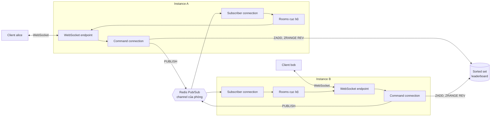

### Vòng đời subscription theo phòng

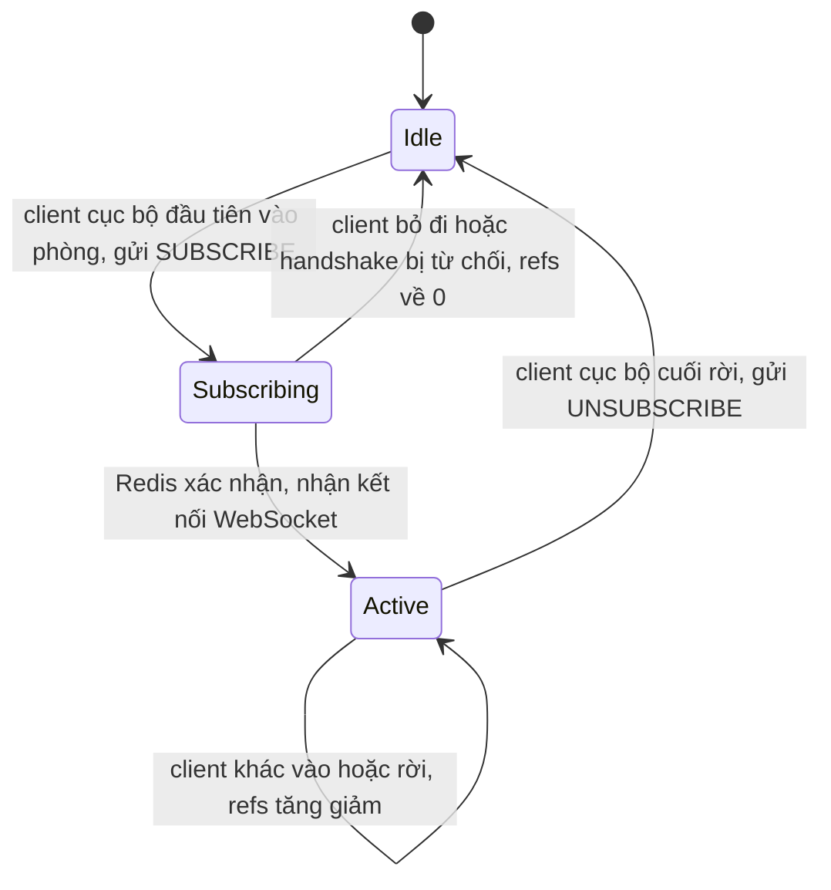

Số subscription của một instance bằng số phòng đang có người, không phải số client.
Instance CHỈ nhận kết nối WebSocket sau khi Redis đã xác nhận subscribe, nên khi client thấy `open` thì mọi message publish sau đó chắc chắn tới được instance của nó.
Mọi đường rời phòng (đóng lịch sự, đứt đột ngột, heartbeat, bị hủy vì chậm) đi qua cùng một đường dọn.

### Đường lỗi: message mất vì Pub/Sub là at-most-once

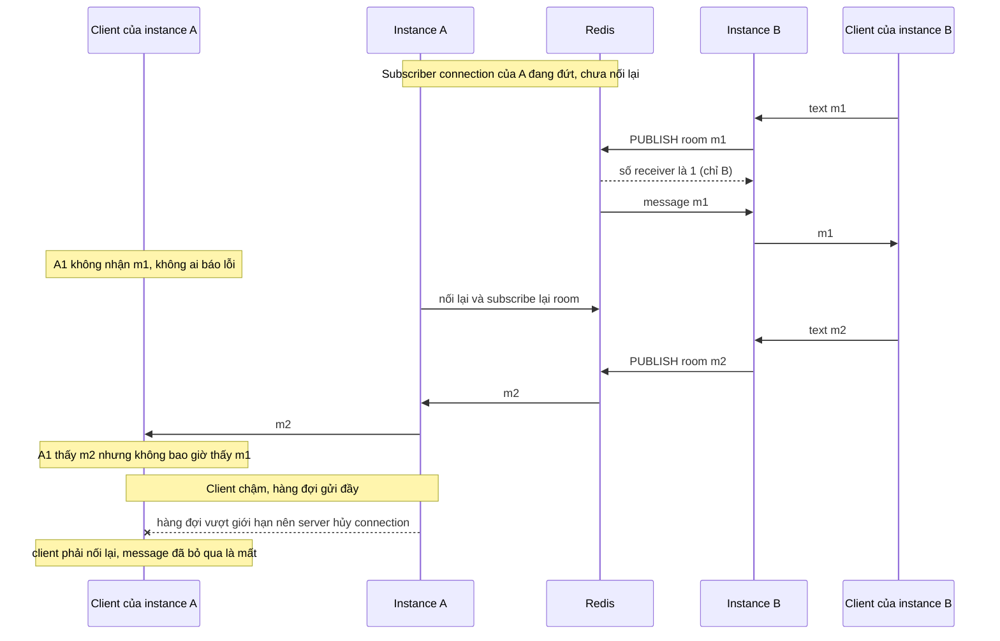

Lab có test cho client đóng đột ngột, heartbeat, client chậm và shutdown, nhưng KHÔNG có test cho đứt subscriber connection và cho phương án Streams với `last-event-id`: hai việc đó nằm trong bài tập.
Phương án Streams (ghi mỗi message bằng `XADD ... MAXLEN ~ N`, client nhớ id cuối và gửi lại khi nối lại) là thiết kế để so sánh, chưa được kiểm chứng trong lab.

### Quyết định và bẫy đã đo trong lab

- Mọi message của client đều đi vòng qua Redis, kể cả khi người nhận cùng instance với người gửi.
  Nếu giao cục bộ rồi mới publish thì người nhận cùng instance nhận hai lần, và cách làm hiện tại cho mọi client trong phòng thấy cùng một thứ tự (thứ tự publish trên channel).
- Lỗi rò subscription có thật: `ws` từ chối handshake sai mà không gọi callback, nên lỗi này từng làm bản TypeScript giữ subscription của phòng mãi mãi.
  Test `rejected_or_abandoned_handshake_does_not_leak_a_room_subscription` gửi request upgrade thô sai rồi khẳng định `roomCount()` và `PUBSUB NUMSUB` về 0.
- Sau shutdown, `PUBSUB NUMSUB` về 0 sau một khoảng ngắn vì Redis dọn subscription bất đồng bộ khi đọc tới EOF, nên test dùng `eventually`.
  Phát hiện này đến từ chạy `-count` lặp lại, khi một assertion ngay-sau-shutdown thỉnh thoảng thấy NUMSUB bằng 1.
- Client chậm bị HỦY connection thay vì để hàng đợi tăng vô hạn (chính sách `closeSlow` của ví dụ chat trong `coder/websocket`).
  TS kiểm tra `bufferedAmount`, Go dùng channel có đệm 16 message, và client chậm thấy socket đứt (close code 1006) rồi phải nối lại.
- Giới hạn kích thước message phải đặt tường minh: mặc định của `ws` 8.22.0 là 100 MiB, của `coder/websocket` v1.8.15 là 32 KiB.
  Lab đặt 4096 byte cho cả hai, và vượt giới hạn thì thư viện đóng connection với code 1009.
- Heartbeat do lab tự viết vì `coder/websocket` chưa có helper, và kết nối chết trong im lặng (rút dây, NAT timeout) chỉ heartbeat mới phát hiện được.
- Leaderboard: `POST` chạy `ZADD` nên ĐẶT score thay vì cộng dồn, và với score bằng nhau thì `ZRANGE ... REV` cho thứ tự từ điển đảo (`dave, carol, alice`).
  ioredis trả mảng lồng hoặc mảng phẳng tùy cách gọi `ZRANGE ... WITHSCORES`, nên `toEntries` xử lý cả hai dạng.

### Giới hạn thật

- At-most-once và không có lịch sử: client mới chỉ thấy message từ lúc nó `open`, và ứng dụng thật tải lịch sử từ DB hoặc Streams khi vào phòng.
- Upgrade chờ xác nhận subscribe mà không có timeout riêng, nên khi subscriber connection đang đứt thì upgrade mới treo cho tới khi Redis nối lại hoặc client bỏ cuộc.
- Chi phí khi số channel lớn (hàng chục nghìn phòng) và hành vi trên Redis Cluster (sharded Pub/Sub `SSUBSCRIBE`, `SPUBLISH`) chưa được lab đo.
  Phần chi phí mỗi `PUBLISH` theo số subscriber là chưa xác minh, vì không nằm trong research.
- Không xác thực, không danh sách Origin, không rate limit message: xem mục bảo mật bên dưới.

## Cross-cutting: những điều mọi use case đều cần

### Observability

Hai use case đầu có endpoint `GET /metrics` theo định dạng Prometheus với registry riêng cho từng instance (không dùng registry mặc định toàn cục).
Use case 3 và 4 không có metric nào.

| Use case | Tín hiệu có sẵn                                                                                                             | Nên cảnh báo khi                                                                                                                                            |
| -------- | --------------------------------------------------------------------------------------------------------------------------- | ----------------------------------------------------------------------------------------------------------------------------------------------------------- |
| 1        | `jobs_processed_total{status}` với `status` là `completed` hoặc `failed`, đếm từng lần chạy sender                          | Queue depth và độ trễ tăng liên tục (cần metric của chính thư viện), failed set hoặc archive có job mới (tương tự cảnh báo DLQ), `failed` tăng đột biến     |
| 1        | Metric của thư viện: `bullmq_job_count{queue, state}` (đo trên 6.3.11), `asynq_queue_size`, `asynq_queue_latency_seconds`   | Như trên, vì counter của lab cho biết worker đang làm gì còn chiều sâu queue do queue báo, alert thực tế cần cả hai                                         |
| 2        | `consumer_group_lag{group, topic}`, đo mỗi lần scrape bằng admin API                                                        | Lag tăng liên tục lâu hơn thời gian rebalance hoặc batch bình thường, hoặc committed offset đứng yên trong khi lag lớn hơn 0 (nguồn thứ cấp, chưa xác minh) |
| 2        | `consumer_events_total{consumer, result}` với `result` là `applied`, `duplicate`, `ignored`, `poison`                       | `poison` tăng (suy luận: không có DLQ nên counter là dấu vết duy nhất), `/metrics` trả 500 hoặc `up = 0` khi Kafka không với tới                            |
| 3        | Không có metric trong lab; từ Redis: `used_memory` so với `maxmemory`, `evicted_keys`, `keyspace_hits` và `keyspace_misses` | `used_memory` gần `maxmemory`, `evicted_keys` tăng; tỷ lệ limiter từ chối và tỷ lệ cache miss phải tự thêm counter (suy luận)                               |
| 4        | Không có metric trong lab; `PUBSUB NUMSUB` (đếm subscriber connection, không đếm client)                                    | Số client bị hủy vì chậm và số kết nối hiện tại phải tự thêm counter (suy luận)                                                                             |

Quy tắc cảnh báo lag đáng nhớ: một ngưỡng cố định ("lag lớn hơn 1000") dễ báo sai khi traffic có đỉnh, và Burrow của LinkedIn đánh giá lag theo cửa sổ trượt.
Cách cảnh báo là nguồn thứ cấp và use case không kiểm chứng nó bằng test, mà chỉ cung cấp con số lag chính xác.
Consumer Java xuất `records-lag-max`, `records-lag` và `records-lag-avg` qua JMX, còn gauge ở use case 2 đo từ phía admin nên không cần consumer nào đang chạy.

Các tín hiệu khác đã học ở chương trước: `XPENDING` và `XINFO GROUPS` cho Redis Streams (chương 03), `messages_unacknowledged` của RabbitMQ (chương 05), advisory `MAX_DELIVERIES` của JetStream (chương 07), và cảnh báo khi DLQ có message (chương 08).

### Graceful shutdown

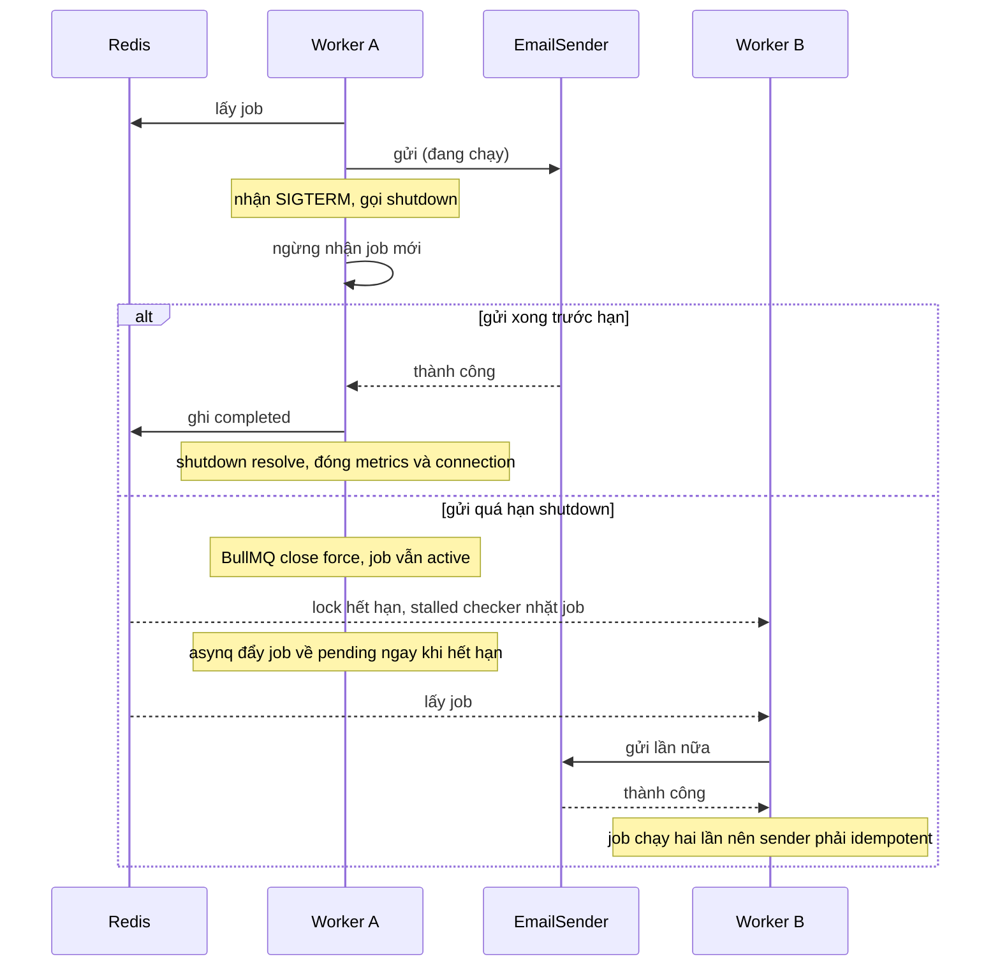

- BullMQ `worker.close()` chờ job đang chạy và không có timeout, còn asynq chờ tối đa `ShutdownTimeout` (mặc định 8 giây).
  Cả hai chỉ bảo vệ lúc tắt êm và không thay thế `terminationGracePeriod` của orchestrator.
- Use case 4 shutdown theo bốn pha tuần tự, mỗi pha chạy dù pha trước lỗi và lỗi được gom lại: ngừng nhận kết nối, đóng WebSocket bằng 1001, đóng hai connection Redis, đóng nốt HTTP.
  Gọi lại (kể cả đồng thời) cho cùng một kết quả.
- Test dọn dẹp của các use case dùng cùng nguyên tắc: các pha chạy tuần tự và gom lỗi, song song chỉ trong một pha.
- Shutdown hết hạn luôn có thể làm một message chạy hai lần, nên graceful shutdown giảm số bản trùng chứ không thay thế idempotency.

### Idempotency ở mọi nơi

| Use case | Chỗ có thể trùng                                            | Cách xử lý trong lab                                                                                         |
| -------- | ----------------------------------------------------------- | ------------------------------------------------------------------------------------------------------------ |
| 1        | Job chạy lại sau shutdown hết hạn hoặc lock hết hạn         | Chưa làm: hàm gửi email phải idempotent theo `jobId` (bài tập 6), tham khảo chương 08 lab 01                 |
| 2        | Relay publish lại, Kafka giao lại, `PaymentFailed` giao lại | Dòng `processed_events` trong cùng transaction với effect, guard trạng thái, unique constraint               |
| 3        | Release lock muộn, loader gọi nhiều lần                     | Release bằng token, gộp load trong một process; cross-instance chưa làm                                      |
| 4        | Pub/Sub at-most-once nên không có bản trùng                 | Mất thay vì trùng; leaderboard `ZADD` đặt giá trị tuyệt đối nên tự nhiên idempotent, còn `ZINCRBY` thì không |
| 2 (HTTP) | Client gửi lại `POST /orders`                               | Chưa làm: gửi lại cùng `id` trả 409, gửi lại không `id` tạo order thứ hai                                    |

Chương 08 nói rõ: ưu tiên operation idempotent tự nhiên (upsert theo business key, ghi giá trị tuyệt đối) trước khi dùng dedup.

### Backpressure

- Queue không giới hạn chỉ che giấu quá tải: khi producer nhanh hơn consumer thì queue tăng dần và latency tăng, nên phải theo dõi queue depth và shed work hoặc giới hạn ở producer.
  Autoscale consumer mà không giới hạn tốc độ tới downstream chỉ chuyển quá tải sang dependency phía sau.
- Use case 1: `concurrency` của worker chặn số job chạy cùng lúc, và queue depth là tín hiệu chính.
- Use case 2: Kafka dùng mô hình pull nên consumer tự kéo theo nhịp của mình, và lag là thước đo của backlog.
- Use case 3: rate limiter đóng vai backpressure phía producer, chặn client trước khi vào hệ thống (suy luận của handbook).
- Use case 4: hàng đợi gửi có giới hạn cho mỗi client và chính sách hủy client chậm.
  Chính sách khác (bỏ message cũ nhất, gộp message, giảm tần suất) cũng hợp lệ và tùy ứng dụng.
- Nhắc lại từ chương trước: RabbitMQ dùng prefetch, Redis Streams giới hạn bằng `MAXLEN` nhưng trim có thể xóa message chưa xử lý.

### Dung lượng và chi phí bộ nhớ Redis

Mọi use case 1, 3, 4 chạy trong RAM của Redis, nên chi phí chính là bộ nhớ.
Handbook không có số sizing, nên phần này chỉ liệt kê các nguồn phình và cách chặn đã nêu trong lab.

| Nguồn phình                                                                 | Use case | Cách chặn                                                                                               |
| --------------------------------------------------------------------------- | -------- | ------------------------------------------------------------------------------------------------------- |
| Completed và failed job giữ vô hạn                                          | 1        | `removeOnComplete` và `removeOnFail` của BullMQ (lab đặt `count: 100` và `1000`), `Retention` của asynq |
| Archive của asynq                                                           | 1        | Giới hạn 10000 task và 90 ngày, nên bằng chứng lỗi có hạn sử dụng                                       |
| Sliding window log                                                          | 3        | O(limit) mỗi key, đo bộ nhớ trước khi chọn, hoặc đổi sang counter hay token bucket                      |
| Cache key và negative caching                                               | 3        | TTL cho mọi key, và quyết định có cache `null` hay không                                                |
| Bảng subscription của Pub/Sub                                               | 4        | Số subscription bằng số phòng đang có người, chưa xác minh chi phí khi hàng chục nghìn phòng            |
| Dedup key bằng Redis, nếu bạn tự thêm (bài tập 6 của use case 1, chương 08) | 1        | TTL phải lớn hơn cửa sổ redeliver, đặt TTL có chủ đích                                                  |

- `maxmemory-policy` mặc định là `noeviction`: ghi mới trả `OOM`, đọc vẫn chạy.
  Đừng đặt queue chung instance với cache dùng `allkeys-lru`, vì job hoặc stream có thể bị evict.
  Hãy tách instance, hoặc dùng `noeviction` cho instance chứa queue.
- Buffer của replica và AOF không được tính vào `maxmemory`, nên phải chừa RAM trống.
  Research ghi triệu chứng khi đặt `maxmemory` sát tổng RAM là process bị OOM killer, nhưng trang tài liệu chỉ nói buffer không được tính, nên phần hệ quả OOM killer là suy luận.
- Giám sát `used_memory` trên `maxmemory` và đặt cảnh báo trước khi chạm trần.
- Lab chạy Redis với `--save "" --appendonly no`, nên persistence (RDB, AOF) chỉ là lý thuyết ở chương 02 và dữ liệu mất khi Redis restart.

### Bảo mật cơ bản mà lab cố ý bỏ qua

Lab chạy trên localhost, nên các việc sau bị bỏ qua có chủ đích.
Production phải làm đủ và handbook không dạy cấu hình chi tiết (research không đi vào chúng):

- Xác thực broker: compose bind mọi port vào `127.0.0.1` với credential mặc định (RabbitMQ guest, Postgres handbook, Redis và NATS không đặt mật khẩu, Kafka listener PLAINTEXT).
  File compose tự ghi rằng không bao giờ publish các port này ra ngoài.
- TLS: không có TLS nào giữa client và broker, giữa instance và Redis, hay giữa client và server WebSocket (`ws://`).
- Xác thực người dùng: use case 4 cho client tự nhận `name` và vào mọi phòng, các endpoint HTTP của use case 2 không có xác thực.
- Origin: use case 4 áp chính sách mặc định (không có `Origin` thì nhận, cùng host thì nhận, khác thì 403).
  Production phải liệt kê chính xác origin được phép (`OriginPatterns`) và không bật `InsecureSkipVerify`.
  Cảnh báo CSRF khi mở Origin sai là lời của `accept.go` trong `coder/websocket`, còn mức độ thực tế với `ws` là chưa xác minh.
- Endpoint `/metrics` mở, không rate limit message của client (use case 3 có limiter dùng được cho việc này).
- Phiên bản: research ghi Redis 8.10 sửa một lỗi ACL bypass của `XREAD` và `XREADGROUP`, nên tránh image cũ hơn khi dùng ACL.

### Sizing và vận hành production

Lab không bao phủ: kích thước cụm, số partition cần có, số worker và `concurrency` hợp lý, thời gian failover thật, và chi phí tiền.
Mọi số đo trong các README là một lần đo trên một máy.
Hãy đo lại trên tải và hạ tầng của bạn.

## Lỗi thường gặp khi ghép nhiều mảnh

- Dùng Pub/Sub cho thứ không được mất: use case 4 chấp nhận mất vì là chat trực tiếp, còn job hay đơn hàng thì phải dùng queue hoặc log.
- Quên rằng at-least-once nghĩa là có bản trùng ở MỌI tầng: relay, broker, retry của job queue, redelivery sau shutdown.
  Mỗi tầng nhận bản trùng cần một chỗ loại trùng, và chỗ chắc nhất là dedup trong cùng transaction với effect.
- Tin rằng lock Redis một node bảo vệ dữ liệu: nó chỉ giảm việc làm trùng, còn correctness cần fencing hoặc optimistic concurrency ở resource.
- Tin rằng exactly-once của Kafka bao phủ database: nó chỉ bao phủ chuỗi đọc, xử lý, ghi trong Kafka.
- Gắn nhãn thất bại sai chỗ: `jobs_processed_total{status="failed"}` đếm cả lần lỗi sẽ được retry, nên đừng dùng nó như "job đã thất bại hẳn".
- Đặt queue và cache chung một Redis với `allkeys-lru`: job bị evict mất.
- Kiểm tra chỉ happy path: mọi use case ở đây có test cho đường lỗi (relay bị SIGKILL, lock hết hạn, client chậm, shutdown hết hạn), và đó là phần đáng chép nhất.
- Coi kết quả đo của lab là cam kết: các con số là một lần đo trên một máy, chưa phải benchmark.

## Lộ trình học tiếp

Hướng đi tiếp theo, theo thứ tự nên làm:

1. Làm các bài tập mở rộng còn để trống trong README của bốn use case, đặc biệt các đường lỗi chưa có test: đứt subscriber connection và phương án Streams ở use case 4, đường worker chết đột ngột của use case 1 (đoạn chưa kiểm chứng trong README, chưa có bài tập riêng), hoàn tiền khi hết hàng ở use case 2, fencing token và cache cross-instance ở use case 3.
2. Dựng topology nhiều node cho các chủ đề lab chỉ chạy một node: Sentinel hoặc Cluster để đo lock bị mất khi failover (use case 3), Kafka nhiều broker với `min.insync.replicas=2`, NATS JetStream R=3.
3. Thay relay polling bằng CDC (Debezium Outbox Event Router) và so sánh về thứ tự và độ trễ với use case 2.
4. Đọc sâu các nguồn gốc của những tranh luận trong chương: bài của Kleppmann và phản hồi của antirez về Redlock, bài của AWS về backoff và jitter, tài liệu Kafka về delivery semantics và design.
5. Thử chaos nặng hơn: broker chết hoặc restart, network partition và latency (Toxiproxy là công cụ được nêu trong research, chi tiết tính năng chưa xác minh).
6. Dùng các bảng chọn công nghệ ở trên cho một bài toán của riêng bạn rồi viết lại bảng bằng số đo của bạn.

Các đường dẫn đọc tiếp được gom ở mục nguồn bên dưới.

## Nguồn tham khảo

Phiên bản đã dùng, kiểm tra ngày 2026-10-06: Redis 8.10.2, RabbitMQ 4.3.6 (patch mới nhất của series 4.3, community support đến 2026-11-30), Kafka 4.3.1, NATS 2.15.0, Postgres 18.6, BullMQ 6.3.11, asynq v0.26.0, `ws` 8.22.0, `coder/websocket` v1.8.15, ioredis 6.0.0, go-redis v9.23.0.
Các use case đo trực tiếp trên broker thật: retry và shutdown của BullMQ và asynq, relay bị SIGKILL giữa publish và đánh dấu, consumer lag, lock hết hạn, stampede dưới 100 caller đồng thời, fan-out qua hai instance, client chậm và heartbeat.
Các phần chưa xác minh được nêu rõ trong bài: thứ tự của NATS core, chi phí `PUBLISH` theo số subscriber, hành vi worker chết của asynq (chỉ đọc source), quy tắc cảnh báo lag, kafka-go không có transaction, và cấu hình bảo mật của từng broker.

- Chọn công nghệ và so sánh: Redis Streams, Pub/Sub, `BLMOVE`, consumer group.
  Nguồn: https://redis.io/docs/latest/develop/pubsub/
  Nguồn: https://redis.io/docs/latest/develop/data-types/streams/
  Nguồn: https://redis.io/docs/latest/commands/lmove/
  Nguồn: https://redis.io/docs/latest/develop/using-commands/pipelining/
- RabbitMQ: quorum queue, stream, release information và ngày hết community support.
  Nguồn: https://www.rabbitmq.com/docs/quorum-queues
  Nguồn: https://www.rabbitmq.com/docs/streams
  Nguồn: https://www.rabbitmq.com/docs/consumer-prefetch
  Nguồn: https://www.rabbitmq.com/release-information
- Kafka: design, replication, KRaft và vận hành cơ bản.
  Nguồn: https://kafka.apache.org/43/design/design/
  Nguồn: https://kafka.apache.org/43/operations/kraft/
  Nguồn: https://kafka.apache.org/43/operations/basic-kafka-operations/
- NATS JetStream: stream, consumer, replication và mất node.
  Nguồn: https://docs.nats.io/learn/jetstream/your-first-stream
  Nguồn: https://docs.nats.io/learn/jetstream/surviving-node-loss
  Nguồn: https://docs.nats.io/learn/clustering/replication-and-r3
- Redis replication, Sentinel, Cluster (chương 04).
  Nguồn: https://redis.io/docs/latest/operate/oss_and_stack/management/replication/
  Nguồn: https://redis.io/docs/latest/operate/oss_and_stack/management/sentinel/
  Nguồn: https://redis.io/docs/latest/operate/oss_and_stack/reference/cluster-spec/
- Redis persistence và eviction.
  Nguồn: https://redis.io/docs/latest/operate/oss_and_stack/management/persistence/
  Nguồn: https://redis.io/docs/latest/develop/reference/eviction/
- Use case 1: BullMQ (retry, retention, stalled, graceful shutdown, metrics) và asynq (retry, source v0.26.0).
  Nguồn: https://docs.bullmq.io/guide/retrying-failing-jobs
  Nguồn: https://docs.bullmq.io/guide/queues/auto-removal-of-jobs
  Nguồn: https://docs.bullmq.io/guide/jobs/stalled
  Nguồn: https://docs.bullmq.io/guide/workers/graceful-shutdown
  Nguồn: https://docs.bullmq.io/guide/metrics
  Nguồn: https://github.com/hibiken/asynq/wiki/Task-Retry
  Nguồn: https://github.com/hibiken/asynq/blob/v0.26.0/server.go
  Nguồn: https://github.com/hibiken/asynq/blob/v0.26.0/internal/rdb/rdb.go
  Nguồn: https://github.com/hibiken/asynq/blob/v0.26.0/x/metrics/metrics.go
- Use case 2: outbox, Debezium, idempotent consumer, saga, compensating transaction, delivery semantics, consumer lag, Burrow.
  Nguồn: https://microservices.io/patterns/data/transactional-outbox.html
  Nguồn: https://debezium.io/documentation/reference/stable/transformations/outbox-event-router.html
  Nguồn: https://learn.microsoft.com/en-us/azure/architecture/patterns/idempotent-consumer
  Nguồn: https://microservices.io/patterns/data/saga.html
  Nguồn: https://learn.microsoft.com/en-us/azure/architecture/patterns/compensating-transaction
  Nguồn: https://docs.confluent.io/kafka/design/delivery-semantics.html
  Nguồn: https://docs.stripe.com/api/idempotent_requests
  Nguồn: https://kafka.apache.org/41/operations/monitoring/ (trang của Kafka 4.1, research chưa có bản 4.3 của trang này)
  Nguồn: https://github.com/linkedin/Burrow
- Use case 3: rate limiting, lock, tranh luận Redlock, cache-aside, singleflight.
  Nguồn: https://redis.io/tutorials/howtos/ratelimiting/
  Nguồn: https://blog.cloudflare.com/counting-things-a-lot-of-different-things/
  Nguồn: https://stripe.com/blog/rate-limiters
  Nguồn: https://redis.io/docs/latest/develop/clients/patterns/distributed-locks/
  Nguồn: https://redis.io/docs/latest/commands/set/
  Nguồn: https://martin.kleppmann.com/2016/02/08/how-to-do-distributed-locking.html
  Nguồn: http://antirez.com/news/101
  Nguồn: https://learn.microsoft.com/en-us/azure/architecture/patterns/cache-aside
  Nguồn: https://pkg.go.dev/golang.org/x/sync/singleflight
- Use case 4: Pub/Sub, sorted set, WebSocket (`ws`, `coder/websocket`).
  Nguồn: https://redis.io/docs/latest/develop/data-types/sorted-sets/
  Nguồn: https://github.com/websockets/ws/blob/master/README.md
  Nguồn: https://github.com/coder/websocket/blob/v1.8.15/README.md
  Nguồn: https://github.com/coder/websocket/blob/v1.8.15/accept.go
  Nguồn: https://github.com/coder/websocket/blob/v1.8.15/internal/examples/chat/chat.go
- Backpressure và load leveling, retry với jitter, chaos engineering.
  Nguồn: https://learn.microsoft.com/en-us/azure/architecture/patterns/queue-based-load-leveling
  Nguồn: https://aws.amazon.com/blogs/architecture/exponential-backoff-and-jitter/
  Nguồn: https://principlesofchaos.org/
  Nguồn: https://github.com/Shopify/toxiproxy
