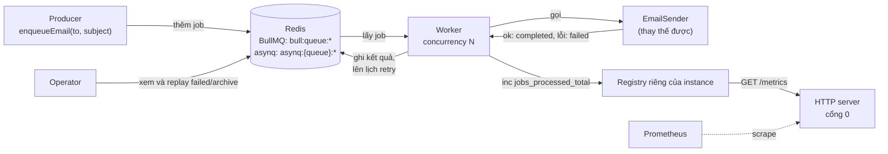
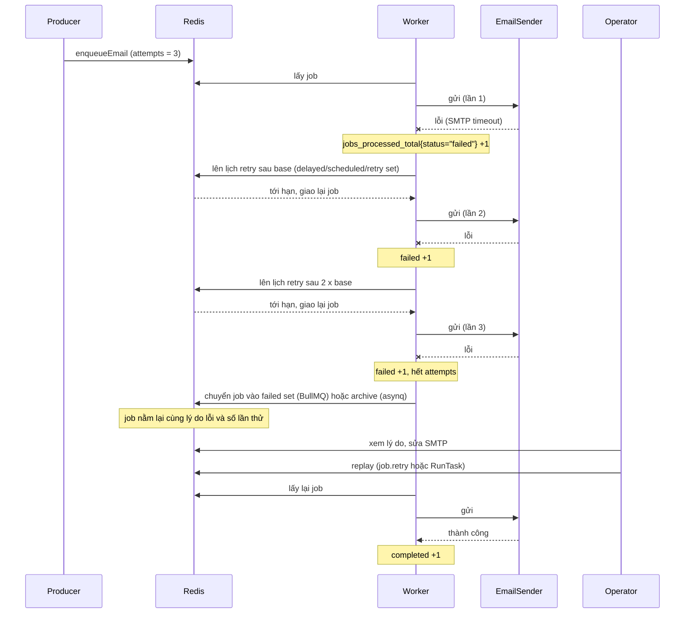
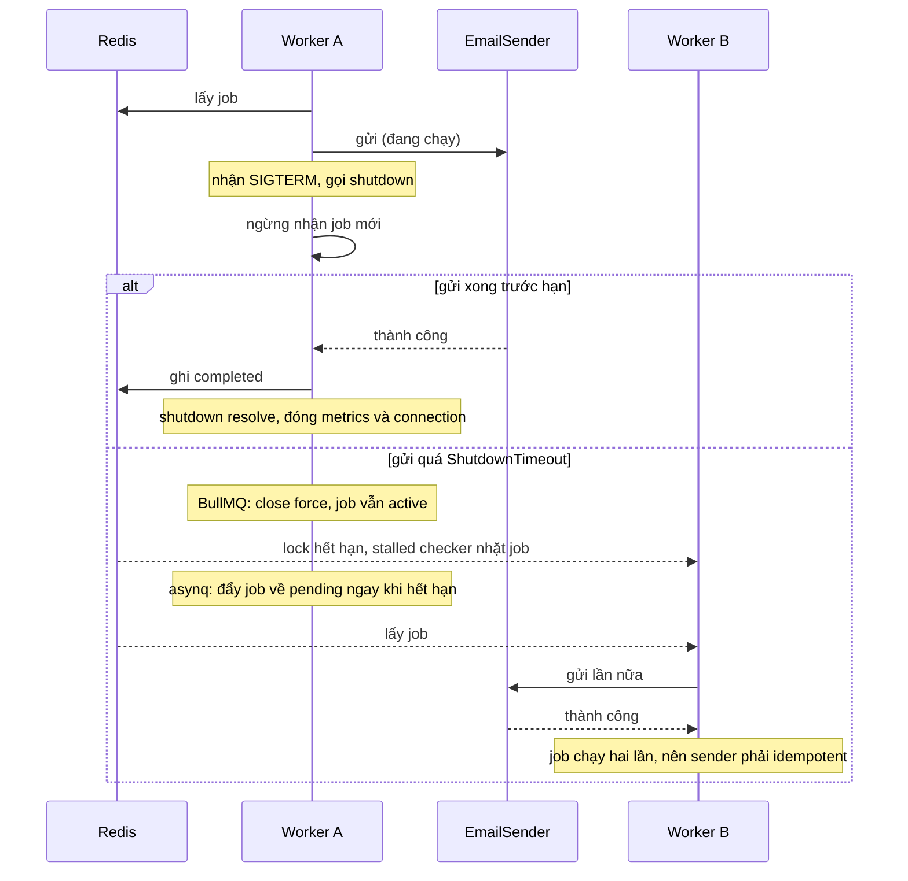

# Use case 1 - Background job queue: gửi email với BullMQ và asynq

## Mục tiêu và kịch bản

Một web app không được gửi email ngay trong request: SMTP chậm hoặc lỗi sẽ kéo cả request xuống.
App chỉ `enqueueEmail(to, subject)` rồi trả lời người dùng, còn một worker chạy nền lấy job ra gửi.
Use case này dựng đúng đường đi đó bằng BullMQ (TypeScript) và asynq (Go) trên cùng một Redis, rồi chứng minh bằng test các hành vi mà production cần:

- Job lỗi được retry với exponential backoff, tối đa `attempts` lần.
- Job hết attempts không biến mất: nó nằm trong failed set (BullMQ) hoặc archive (asynq) để điều tra và replay.
- Job hoãn (`delay` hoặc `ProcessIn`) không chạy trước hạn.
- Graceful shutdown chờ job đang chạy xong, và khi job chạy quá `ShutdownTimeout` thì job không bị mất.
- Endpoint `GET /metrics` theo định dạng Prometheus có counter `jobs_processed_total{status="completed|failed"}`.

"Email sender" là một hàm có thể thay thế, nên test cho nó thành công, lỗi N lần hoặc bị giữ lại bởi một gate.
Lab không gửi email thật.
Lab cần Redis chạy bằng `make up`, đọc `REDIS_URL` (mặc định `redis://127.0.0.1:6379`).
Mọi tên queue có tên duy nhất và bị xóa khi test kết thúc, test không bao giờ khẳng định trên trạng thái toàn server.
Lý thuyết của cả chương nằm ở theory.md của chủ đề 09.

## Kiến trúc



Mỗi `JobSystem` (TypeScript: `createJobSystem`, Go: `NewJobSystem`) nối một queue, một worker, một registry metrics riêng và một HTTP server trên cổng do hệ điều hành chọn.
Registry riêng cho từng instance (không dùng registry mặc định toàn cục) để các test không ảnh hưởng nhau.

## Đường lỗi

Đường lỗi 1: một lần gửi thất bại, backoff, retry, hết attempts, vào failed set hoặc archive, rồi operator replay.



Đường lỗi 2: worker dừng giữa lúc đang gửi (graceful shutdown, shutdown hết hạn, worker chết).



## Giao diện

TypeScript (`ts/lab.ts`):

```ts
createJobSystem({ redisUrl, queueName, sender, concurrency?, attempts?, backoffDelayMs?, lockDurationMs?, stalledIntervalMs?, onError? }): Promise<JobSystem>;
system.enqueueEmail(to, subject, { delayMs?, attempts? }?): Promise<string>; // id của job
system.shutdown(timeoutMs): Promise<void>;
system.queue; // Queue của BullMQ để kiểm tra trạng thái
system.metricsUrl; // http://127.0.0.1:<cổng>/metrics
destroyQueue(redisUrl, queueName): Promise<void>; // queue.obliterate({ force: true })
```

Go (`go/lab.go`): `NewJobSystem(Options{RedisURL, Queue, Sender, Concurrency, Attempts, RetryBase, PollInterval, ShutdownTimeout})` với `EnqueueEmail(ctx, to, subject, ...asynq.Option) (string, error)`, `Shutdown() error`, `Inspector()`, `MetricsURL()` và `DestroyQueue`.

Khác biệt cố ý giữa hai bên:

- Go không có tham số `timeoutMs` cho `Shutdown()`.
  asynq cố định `ShutdownTimeout` khi tạo server, nên nó là một option của `JobSystem`.
- TypeScript tự cài timeout cho shutdown (xem phần bên dưới), vì `worker.close()` của BullMQ không có timeout.
- `attempts` là tổng số lần chạy ở cả hai bên.
  Go đặt `MaxRetry = attempts - 1` vì asynq đếm số lần retry (xem bảng đo).

## Định nghĩa metric

`jobs_processed_total{status}` đếm kết quả của TỪNG LẦN chạy sender, ở cả hai ngôn ngữ:

- `completed` là số lần sender thành công.
- `failed` là số lần sender lỗi (hoặc panic ở Go), kể cả lần lỗi sẽ được retry.
- Job lỗi hai lần rồi thành công cho `failed = 2` và `completed = 1`.

Đếm ở mức sender chứ không ở mức broker, nên job chạy lại sau khi worker chết hoặc shutdown hết hạn được đếm lại.
Muốn đếm "job thất bại hẳn" thì chỉ tăng counter ở lần thử cuối (so `attemptsMade` với `attempts`, hoặc `asynq.GetRetryCount` với `GetMaxRetry`).
Cả hai nhãn được khởi tạo bằng 0, nên endpoint luôn in ra cả `completed` và `failed`.

Metric của chính BullMQ và asynq khác với metric của lab:

- Lab chỉ xuất counter của tiến trình worker (kết quả từng lần chạy).
- BullMQ có `queue.exportPrometheusMetrics()` (đo trên 6.3.11: trả `bullmq_job_count{queue, state}` cho từng trạng thái) và `Worker` option `metrics` để gom completed/failed theo phút, đọc bằng `queue.getMetrics`.
- asynq có package `x/metrics`, một Prometheus collector đọc Redis qua Inspector, với các metric prefix `asynq_` như `asynq_queue_size` và `asynq_queue_latency_seconds`.
- Chiều sâu queue (queue depth) và độ trễ do chính queue báo, còn counter của lab cho biết worker đang làm gì.
  Alert thực tế cần cả hai.

## Chạy

```bash
make up
pnpm vitest run 09-production/usecase-01-job-queue/ts
go test -race ./09-production/usecase-01-job-queue/go/...
make lab-ts LAB=09-production/usecase-01-job-queue
make lab-go LAB=09-production/usecase-01-job-queue
```

Demo in ba kịch bản: retry với backoff, job hết attempts vào failed set hoặc archive rồi được replay, và graceful shutdown chờ một email chậm.
Cả hai demo dọn queue của chúng ở cuối.

## Kết quả mong đợi

Test (cùng ý nghĩa ở TS và Go, Go dùng CamelCase):

| Test                                                                              | Chứng minh                                                                                                                                                        |
| --------------------------------------------------------------------------------- | ----------------------------------------------------------------------------------------------------------------------------------------------------------------- |
| `failed_job_is_retried_with_exponential_backoff_up_to_attempts`                   | Sender lỗi các lần đầu rồi thành công: đúng số lần chạy, job completed, khoảng cách giữa các lần không nhỏ hơn mốc tối thiểu của backoff, metric đếm từng lần thử |
| `job_exceeding_attempts_is_kept_in_failed_set_or_archive`                         | Sender luôn lỗi: sau `attempts` lần job nằm trong failed set / archive cùng lý do lỗi và số lần thử                                                               |
| `scheduled_job_runs_not_before_its_delay`                                         | Job hoãn ở trạng thái `delayed` / `scheduled` trước hạn, sender chưa được gọi, và chạy không sớm hơn cận dưới của delay                                           |
| `graceful_shutdown_waits_for_in_flight_job_to_finish`                             | Shutdown không resolve khi job còn chạy, metrics vẫn truy cập được lúc đó, sau khi gate mở job completed (không retry, không fail) và endpoint đóng               |
| `in_flight_job_outlasting_shutdown_timeout_is_recovered_by_another_worker`        | Job chạy quá timeout: shutdown vẫn resolve sau timeout, job không mất và worker khác chạy lại (Go: `TestInFlightJobOutlastingShutdownTimeoutIsRequeued`)          |
| `metrics_endpoint_reports_jobs_processed_total`                                   | `GET /metrics` thật trả `jobs_processed_total{status="completed"} 3` và `{status="failed"} 2` kèm dòng HELP và TYPE                                               |
| `two_workers_do_not_process_the_same_job_twice`                                   | Hai worker cùng queue xử lý 30 job: mỗi job đúng một lần                                                                                                          |
| `job_with_single_attempt_fails_straight_to_failed_set`                            | `attempts = 1`: một lần chạy rồi vào failed set / archive (Go: `TestJobWithSingleAttemptFailsStraightToArchive`)                                                  |
| `sender_throwing_a_non_error_value_counts_as_failed`                              | Sender ném chuỗi (TS) hoặc panic với chuỗi (Go) vẫn tính là thất bại có lý do lỗi                                                                                 |
| `shutdown_with_no_job_in_flight_resolves_immediately_and_closes_metrics_endpoint` | Không có job đang chạy: shutdown resolve ngay, endpoint đóng, gọi lần hai an toàn (Go còn kiểm tra không rò goroutine)                                            |

Thời gian đo trên máy phát triển (một lần, không phải cam kết): bộ test TypeScript khoảng 7 giây, bộ test Go khoảng 13 đến 15 giây (retry của asynq tính bằng giây).

## Kết quả đo (BullMQ 6.3.11 và asynq v0.26.0)

Các con số dưới đây do test và demo của lab đo, không lấy từ tài liệu.

| Chủ đề                        | BullMQ 6.3.11                                                                                                                                                                                                                | asynq v0.26.0                                                                                                                                                                                           |
| ----------------------------- | ---------------------------------------------------------------------------------------------------------------------------------------------------------------------------------------------------------------------------- | ------------------------------------------------------------------------------------------------------------------------------------------------------------------------------------------------------- |
| `attempts` nghĩa là gì        | Tổng số lần chạy. `attempts = 4` cho 4 lần chạy, `job.attemptsMade` bằng 4 khi completed                                                                                                                                     | Số lần RETRY: `MaxRetry(2)` cho 3 lần chạy, `TaskInfo.Retried` bằng 2. Lab đặt `MaxRetry = attempts - 1`                                                                                                |
| Số trong hàm backoff          | `attemptsMade` sau lần fail: lần fail đầu là 1. Exponential trả `delay * 2^(attemptsMade - 1)`: 200, 400, 800 ms với base 200                                                                                                | `RetryDelayFunc(n, ...)` với `n` là số lần đã retry: lần fail đầu là 0. Lab trả `base << n`: 1 s, 2 s, 4 s. Cùng chuỗi giá trị với BullMQ                                                               |
| Độ phân giải của delay        | Mili giây: test khẳng định cận dưới `gap >= base * 2^(i - 1)` và pass                                                                                                                                                        | 1 GIÂY: asynq ghi thời điểm chạy bằng Unix giây (cắt phần lẻ). Đo: `ProcessIn(2s)` chạy sau 1,86 s, và retry đầu với base 1 s chạy sau chỉ 0,3 s. Cận dưới đúng là `floor_to_second(lần trước + delay)` |
| Task hoãn                     | `delay` (ms) đưa job vào delayed set, `getState()` trả `delayed`                                                                                                                                                             | `ProcessIn` / `ProcessAt` đưa task vào scheduled set, `State` là `scheduled`, `NextProcessAt` đã bị cắt về giây                                                                                         |
| Job hết attempts              | Failed set (`getFailed()`), kèm `failedReason` và `attemptsMade`                                                                                                                                                             | Archive (`ListArchivedTasks`), kèm `LastErr`, `Retried`, `MaxRetry`. `MaxRetry(0)` vào archive ngay lần fail đầu                                                                                        |
| Retention thành công          | Mặc định giữ vô thời hạn. Lab đặt `removeOnComplete: { count: 100 }` và `removeOnFail: { count: 1000 }`                                                                                                                      | Mặc định xóa ngay khi handler trả nil. Lab đặt `Retention(1h)` để còn đọc được trạng thái completed                                                                                                     |
| Ném giá trị không phải Error  | Lab chuẩn hóa thành `Error(String(value))`, nên luôn có `failedReason`                                                                                                                                                       | Handler panic được lab bắt, đếm là failed và trả lỗi `sender panic: ...`                                                                                                                                |
| `worker.close()` / `Shutdown` | Chờ job đang chạy và KHÔNG có timeout. Gọi `close(true)` sau `close()` không có tác dụng (promise đang đóng được lưu lại, đọc từ source 6.3.11), nên lab tự `pause(true)`, chờ tới hạn rồi mới chọn close thường hoặc force  | `Shutdown()` chờ tối đa `ShutdownTimeout` (mặc định 8 s, cố định lúc tạo server)                                                                                                                        |
| Job chạy quá hạn shutdown     | Sau `close(true)` job vẫn `active` cho tới khi lock hết hạn (`lockDuration`), rồi stalled checker của worker khác nhặt lại: `stalledCounter = 1`, `attemptsStarted = 2`, `attemptsMade = 1`. `maxStalledCount` mặc định là 1 | Task được đẩy về `pending` ngay trong lúc `Shutdown()`, `Retried` vẫn 0 (không tính là fail), worker khác chạy lại với lần chạy 1                                                                       |
| Sender cũ xong sau khi bị bỏ  | Kết quả bị bỏ qua êm: không có event lỗi, job giữ nguyên trạng thái của lần chạy lại                                                                                                                                         | Goroutine của handler vẫn chạy tới khi sender trả về, nhưng kết quả không còn ảnh hưởng task                                                                                                            |
| Kết nối Redis                 | Cần `ioredis` (peer dependency tùy chọn ở v6). Worker bắt buộc `maxRetriesPerRequest: null`: mặc định của ioredis (20) làm Worker ném `BullMQ: Your redis options maxRetriesPerRequest must be null.`                        | asynq tự quản connection pool từ `RedisClientOpt`                                                                                                                                                       |
| Dọn queue                     | `queue.obliterate({ force: true })` xóa sạch mọi key `bull:<queue>:*`                                                                                                                                                        | `Inspector.DeleteQueue(name, true)` bỏ sót `completed` (khi có Retention), hash của task đã completed và bộ đếm `processed`. Lab dọn thêm theo `SCAN asynq:{<queue>}*`                                  |

Key toàn cục của asynq sau khi chạy lab: `DeleteQueue` đã `SREM` tên queue khỏi `asynq:queues`, còn `asynq:servers` và `asynq:workers` về 0 phần tử khi `Shutdown()` xong.
Sau khi chạy xong cả hai bộ test và cả hai demo, không còn key `bull:*` hoặc `asynq:*` nào trong Redis dùng chung.

## Giới hạn thật của use case

- At-least-once.
  Worker chết giữa chừng, `Shutdown` hết hạn hoặc lock hết hạn đều làm job chạy lại, nên một email có thể gửi hai lần.
  Hàm gửi email phải idempotent (chương 08, lab 01 `08-patterns/lab-01-idempotency`: dedup theo key ổn định, ghi marker và effect cùng nhau).
- Không có outbox.
  `enqueueEmail` ghi thẳng vào Redis, nên nếu giao dịch của app commit rồi crash trước khi enqueue thì email bị mất.
  Chương 08, lab 05 là cách đóng cửa sổ này, use case này không làm.
- Retry không có jitter.
  Backoff của lab là `base * 2^n` thuần để test xác định.
  Production nên bật `jitter` của BullMQ hoặc tự cộng ngẫu nhiên trong `RetryDelayFunc` của asynq, nếu không nhiều job lỗi cùng lúc sẽ retry đồng bộ (retry storm).
- asynq lên lịch theo giây.
  Delay nhỏ hơn 1 giây không có nghĩa, và một delay có thể chạy sớm tới gần 1 giây so với mốc mong muốn.
  Nếu cần độ chính xác mili giây thì dùng BullMQ.
- `ShutdownTimeout` (asynq) và timeout tự cài (BullMQ) chỉ bảo vệ lúc tắt êm.
  Chúng không thay thế `terminationGracePeriod` của orchestrator, và sender phải tôn trọng `ctx` (Go) để dừng sớm.
- Retention là quyết định phải chọn.
  Giữ completed và failed vô thời hạn làm Redis phình dần (mặc định BullMQ).
  Archive của asynq giới hạn 10000 task và xóa sau 90 ngày nên bằng chứng lỗi có hạn sử dụng.
- Metric đếm ở mức sender, không phải ở mức broker (xem phần định nghĩa metric).
- BullMQ có thể mất lock vào stalled nếu event loop bị chặn hơn `lockDuration`: tránh tác vụ CPU dài trong processor.
- Lab không cài scheduler cho job định kỳ (BullMQ Job Schedulers, asynq `Scheduler`).
  Với asynq phải đảm bảo chỉ một scheduler chạy cho mỗi lịch.

Lab dùng `@prometheus-io/client` 0.16.1 thay vì `prom-client`: npm đánh dấu `prom-client` là deprecated và trỏ sang gói này, API giống nhau.

## Bài tập mở rộng

1. Bật `jitter` cho backoff của BullMQ và viết lại test để khẳng định cận dưới mới (`delay * (1 - jitter)`).
2. Thêm `Worker` option `metrics` và đọc `queue.getMetrics("completed")`, rồi so với counter của lab trong một lần worker bị kill.
3. Đổi counter để `failed` chỉ đếm lần thất bại cuối (hết attempts), cập nhật cả hai ngôn ngữ và README.
4. Thêm `UnrecoverableError` (BullMQ) hoặc `asynq.SkipRetry` cho địa chỉ email sai định dạng để job vào failed set / archive ngay.
5. Đăng ký `x/metrics` của asynq và `exportPrometheusMetrics` của BullMQ trên endpoint `/metrics`, rồi dựng một alert theo chiều sâu queue.
6. Làm `sender` idempotent theo `jobId` bằng một key Redis `SET NX` có trạng thái in-progress và completed, và viết test cho thấy job chạy lại sau shutdown hết hạn không gửi hai lần.

## Nguồn tham khảo

Phiên bản: bullmq 6.3.11, asynq v0.26.0, ioredis 6.0.0, @prometheus-io/client 0.16.1, prometheus/client_golang v1.24.1, Redis 8.10.2 (kiểm tra ngày 2026-10-06).

- BullMQ: `attempts`, exponential backoff `2^(attempts-1) * delay`, jitter, custom backoff.
  Nguồn: https://docs.bullmq.io/guide/retrying-failing-jobs
- BullMQ: retention mặc định (giữ vô thời hạn) và `removeOnComplete` / `removeOnFail`.
  Nguồn: https://docs.bullmq.io/guide/queues/auto-removal-of-jobs
- BullMQ: delayed job.
  Nguồn: https://docs.bullmq.io/guide/jobs/delayed
- BullMQ: stalled job, `maxStalledCount`, `stalledInterval`.
  Nguồn: https://docs.bullmq.io/guide/jobs/stalled
- BullMQ: `worker.close()` chờ job đang chạy, không có timeout nội bộ.
  Nguồn: https://docs.bullmq.io/guide/workers/graceful-shutdown
- BullMQ: metrics và export Prometheus.
  Nguồn: https://docs.bullmq.io/guide/metrics
- BullMQ 6: `ioredis` là optional peer dependency, các breaking change.
  Nguồn: https://github.com/taskforcesh/bullmq/releases/tag/v6.0.0
- asynq: retry, `MaxRetry` mặc định 25, archive, `SkipRetry`.
  Nguồn: https://github.com/hibiken/asynq/wiki/Task-Retry
- asynq: `RetryDelayFunc`, `ShutdownTimeout`, `DelayedTaskCheckInterval`, `TaskCheckInterval` (source v0.26.0).
  Nguồn: https://github.com/hibiken/asynq/blob/v0.26.0/server.go
- asynq: giới hạn archive (10000 task, 90 ngày) và lên lịch theo Unix giây.
  Nguồn: https://github.com/hibiken/asynq/blob/v0.26.0/internal/rdb/rdb.go
- asynq: timeout mặc định 30 phút, `Retention`, `ProcessIn`.
  Nguồn: https://github.com/hibiken/asynq/blob/v0.26.0/client.go
- asynq: collector Prometheus `x/metrics`.
  Nguồn: https://github.com/hibiken/asynq/blob/v0.26.0/x/metrics/metrics.go
- asynq: scheduler chỉ nên chạy một instance cho mỗi lịch.
  Nguồn: https://github.com/hibiken/asynq/wiki/Periodic-Tasks
- Backoff với jitter để tránh retry storm.
  Nguồn: https://aws.amazon.com/blogs/architecture/exponential-backoff-and-jitter/
- Idempotent consumer: job chạy lại phải cho cùng kết quả.
  Nguồn: https://learn.microsoft.com/en-us/azure/architecture/patterns/idempotent-consumer
