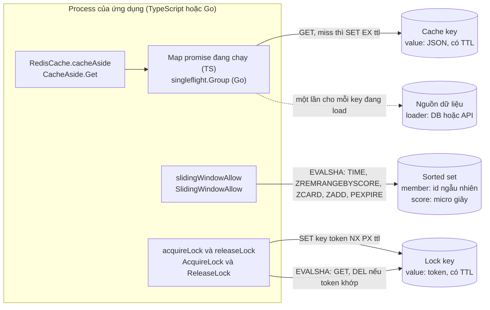
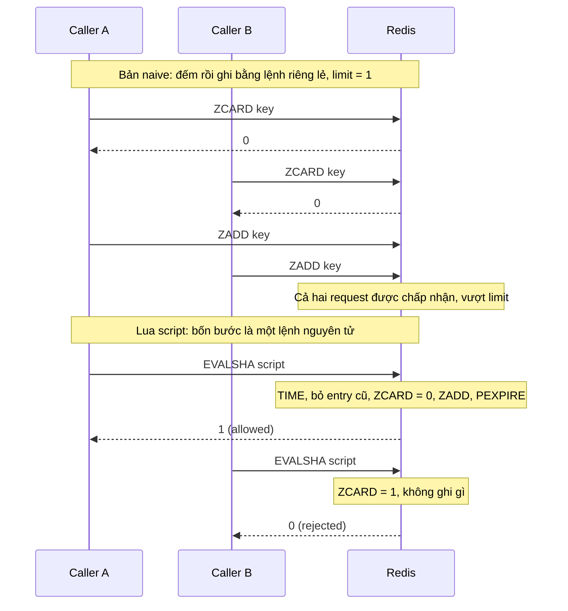
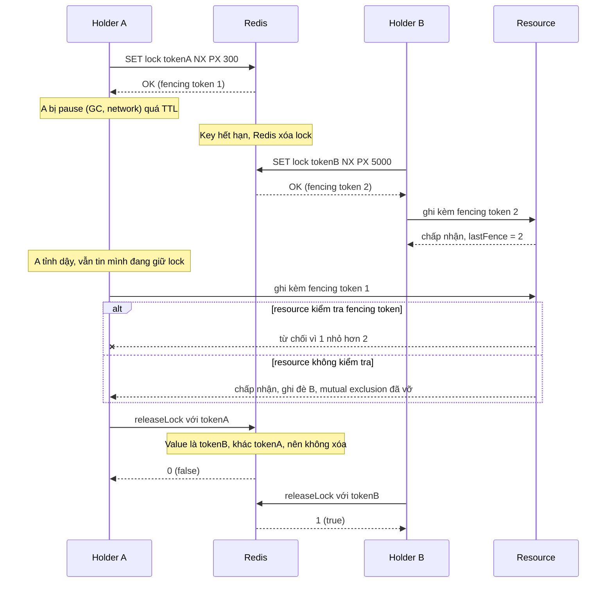
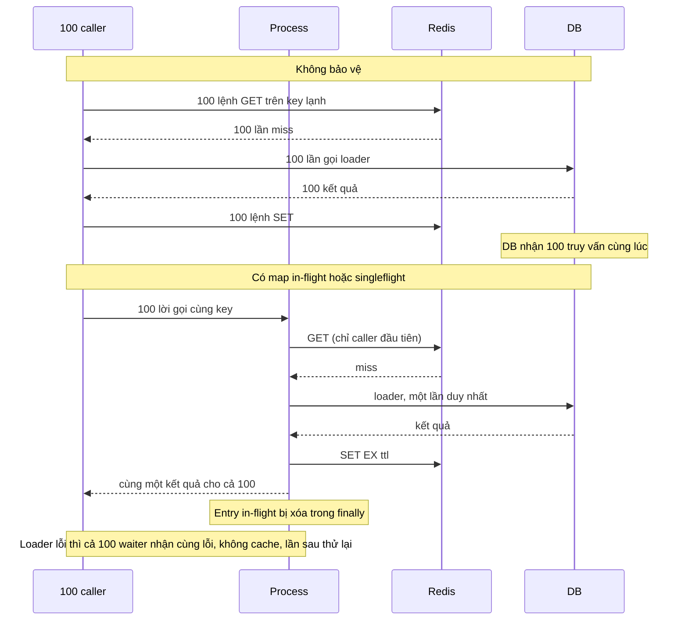

# Use case 3 - Redis làm hạ tầng: rate limiter, distributed lock và cache-aside

## Mục tiêu và kịch bản

Một API đông người dùng cần ba thứ mà Redis làm rất vừa tay.
Thứ nhất là chặn một client gọi quá nhiều (rate limiter).
Thứ hai là bảo đảm chỉ một instance chạy một việc tại một thời điểm (distributed lock), ví dụ cron job chạy trên nhiều pod.
Thứ ba là giữ kết quả của một truy vấn đắt để request sau không phải hỏi lại DB (cache), mà không để hàng trăm request cùng chạy lại truy vấn đó khi key nóng vừa hết hạn (cache stampede).

Redis phù hợp vì cả ba cần cùng một thứ: trạng thái dùng chung giữa nhiều process, có TTL, và các thao tác nguyên tử.
Một Lua script chạy nguyên tử trên server nên cho phép gộp read - decide - write thành một lệnh.
`SET key value NX PX ttl` là set-if-absent kèm TTL trong một lệnh.
TTL của key giúp trạng thái tự dọn khi client chết.

Use case này dựng ba mảnh độc lập trong một file `lab` mỗi ngôn ngữ, không framework và không HTTP:

- `slidingWindowAllow` / `SlidingWindowAllow`: sliding window log trên sorted set, trong một Lua script.
- `acquireLock` / `releaseLock` (Go: `AcquireLock` / `ReleaseLock`): lock trên MỘT node Redis với token ngẫu nhiên và release bằng Lua.
- `RedisCache.cacheAside` (Go: `CacheAside[T].Get`): cache-aside lưu JSON với TTL, chống stampede trong một process.

Lab cần Redis chạy bằng `make up`, đọc `REDIS_URL` (mặc định `redis://127.0.0.1:6379`).
Redis này dùng chung cho mọi lab, nên mọi key đều lấy từ `uniqueName` và bị xóa ở cuối bằng `SCAN` theo prefix (không bao giờ `KEYS`).
Test không bao giờ khẳng định trên trạng thái toàn server.
Lý thuyết của cả chương nằm ở theory.md của chủ đề 09.

## Kiến trúc



Ba mảnh không dùng chung key và không gọi nhau, nên có thể đọc và test riêng từng mảnh.
Mỗi script được định nghĩa một lần cho mỗi client (ioredis `defineCommand`, go-redis `redis.NewScript`), cả hai gửi `EVALSHA` và tự nạp lại script khi server báo `NOSCRIPT`.

## Đường lỗi

Đường lỗi 1: race của limiter viết bằng nhiều lệnh, và cách một Lua script đóng nó lại.



Đường lỗi 2: lock hết hạn khi holder còn đang làm việc, token chặn release nhầm, và fencing token chặn ghi muộn.



Đường lỗi 3: cache stampede khi key lạnh, không có và có chống trùng.



Lab có test cho đường lỗi 1 (50 caller đồng thời, đúng 10 được allow) và đường lỗi 3 (100 caller đồng thời, loader chạy một lần, cùng một test đối chứng không bảo vệ).
Đường lỗi 2 có test cho hai nửa: token chặn release nhầm (`lock_expires_after_ttl`) và hai holder cùng tin mình giữ lock (`expired_holder_still_believes_it_holds_the_lock`).
Phần fencing token chỉ có trong demo, không có trong thư viện: lab này cố ý không cung cấp nó (xem phần giới hạn).

## Giao diện

TypeScript (`ts/lab.ts`):

```ts
slidingWindowAllow(rdb, key, limit, windowMs): Promise<boolean>; // RangeError nếu limit không phải số nguyên >= 0 hoặc windowMs không phải số nguyên > 0
acquireLock(rdb, key, ttlMs): Promise<string | null>; // token hex 128 bit, hoặc null khi lock đang bị giữ
releaseLock(rdb, key, token): Promise<boolean>; // true chỉ khi token khớp và key đã bị xóa
new RedisCache(rdb).cacheAside<T>(key, ttlSec, loader): Promise<T>;
cacheAsideUnprotected(rdb, key, ttlSec, loader); slidingWindowAllowNaive(rdb, key, limit, windowMs); // bản sai, chỉ cho demo và đối chứng
```

Go (`go/lab.go`):

```go
SlidingWindowAllow(ctx, rdb, key, limit int, window time.Duration) (bool, error)
AcquireLock(ctx, rdb, key, ttl time.Duration) (token string, ok bool, err error)
ReleaseLock(ctx, rdb, key, token string) (bool, error)
NewCacheAside[T](rdb).Get(ctx, key, ttl time.Duration, loader func(context.Context) (T, error)) (T, error)
GetUnprotected[T](...), SlidingWindowAllowNaive(...) // bản sai, chỉ cho demo và đối chứng
```

Tham số sai trả `RangeError` (TS) hoặc lỗi bọc `ErrInvalidArgument` (Go), message nói rõ tham số nào sai.

Khác biệt cố ý giữa hai bên:

- Go nhận `time.Duration`, TS nhận số mili giây hoặc giây.
  Go yêu cầu `window` và `ttl` của lock là số mili giây nguyên, và `ttl` của cache là số giây nguyên, vì Redis `PX` và `EX` chỉ nhận số nguyên.
- Go trả `(token, ok, err)` thay cho `string | null`.
- TS dùng `Map` các promise đang chạy, Go dùng `singleflight.Group` (xem phần cache).

## Rate limiter: sliding window log

Script chạy trên một sorted set mỗi key, bốn bước trong một lệnh:

```lua
local time = redis.call('TIME')
local now = tonumber(time[1]) * 1000000 + tonumber(time[2])
redis.call('ZREMRANGEBYSCORE', KEYS[1], '-inf', now - windowMs * 1000)
if redis.call('ZCARD', KEYS[1]) < limit then
  redis.call('ZADD', KEYS[1], now, ARGV[3])
  redis.call('PEXPIRE', KEYS[1], windowMs)
  return 1
end
return 0
```

Các quyết định thiết kế:

- Thời gian lấy từ `TIME` của SERVER trong script, không lấy từ client.
  Nhiều instance của ứng dụng có đồng hồ lệch nhau vẫn đồng ý về cùng một cửa sổ.
- Score là micro giây, member là chuỗi ngẫu nhiên do client sinh (uuid ở TS, 128 bit hex ở Go).
  Hai request trong cùng một micro giây có cùng score nhưng khác member, nên cả hai đều được đếm.
  Nếu member chỉ là thời gian, hai request cùng micro giây sẽ ghi đè nhau và limiter đếm thiếu.
- Entry rời cửa sổ khi tuổi của nó bằng `window` (không phải lớn hơn).
- Request bị từ chối KHÔNG ghi gì.
  Nếu ghi, một client cứ thử lại liên tục sẽ làm cửa sổ trượt mãi và không bao giờ được vào lại.
  Test `rejected_requests_are_not_recorded` khẳng định sorted set y nguyên sau các lần bị từ chối.
- `PEXPIRE` theo `window` trong mỗi lần allow: key idle tự biến mất, không rò bộ nhớ.
  Vì `limit = 0` không bao giờ ghi, nó cũng không tạo key.

So với các thuật toán khác (theo Redis docs, Cloudflare và Stripe):

| Thuật toán             | Cấu trúc trong Redis             | Bộ nhớ mỗi key | Độ chính xác                             | Ghi chú                                                           |
| ---------------------- | -------------------------------- | -------------- | ---------------------------------------- | ----------------------------------------------------------------- |
| Fixed window           | STRING, `INCR` và `EXPIRE`       | O(1)           | Xấp xỉ, cho burst gấp 2 ở ranh giới      | Rẻ nhất, nhưng `INCR` và `EXPIRE` phải nằm trong cùng script      |
| Sliding window log     | SORTED SET (lab này)             | O(limit)       | Chính xác                                | Mỗi request là một entry, nên limit lớn tốn bộ nhớ                |
| Sliding window counter | Hai STRING (cửa sổ trước và nay) | O(1)           | Gần chính xác (Cloudflare đo sai 0,003%) | Ước lượng bằng `previous * (window - elapsed) / window + current` |
| Token bucket           | HASH hai field                   | O(1)           | Cho burst có kiểm soát                   | Stripe dùng token bucket với Redis tập trung                      |

Vấn đề burst ở ranh giới của fixed window: với limit 100 mỗi phút, client gửi 100 request ở giây 59 và 100 request ở giây 61 của phút kế.
Mỗi cửa sổ cố định đều thấy đúng 100 request, nhưng trong 2 giây có tới 200 request, gấp đôi limit.
Sliding window log không có lỗi này vì cửa sổ luôn kết thúc tại thời điểm hiện tại.
Cái giá là bộ nhớ O(limit) mỗi key: limit 10000 mỗi phút cho mỗi user nghĩa là tới 10000 member trong sorted set của user đó.
Với limit lớn, sliding window counter hoặc token bucket là lựa chọn hợp lý hơn.
Lab dùng sliding window log vì nó chính xác và cho thấy rõ cơ chế (sorted set, Lua, TIME của server).

Một limiter trong production nên fail open khi Redis lỗi (khuyến nghị của Stripe), để lỗi hạ tầng không chặn traffic hợp lệ.
Lab này không làm điều đó: lỗi Redis được trả cho caller để quyết định.
Khi bị chặn, API thường trả HTTP 429 kèm `Retry-After`.
Lab chỉ trả allowed hay rejected, không tính `Retry-After` (xem bài tập).

## Distributed lock trên một node

`acquireLock` chạy `SET key token NX PX ttl` với token là 128 bit crypto-random (hex 32 ký tự).
`releaseLock` chạy một Lua script so sánh rồi xóa:

```lua
if redis.call('GET', KEYS[1]) == ARGV[1] then
  return redis.call('DEL', KEYS[1])
end
return 0
```

Token cần thiết vì chỉ dùng `DEL` là không an toàn: holder A hết hạn, B lấy lock, rồi A release muộn và xóa nhầm lock của B.
Test `lock_expires_after_ttl` dựng đúng kịch bản này và khẳng định release muộn của A trả `false` và lock của B còn nguyên.

Từ Redis 8.4, lệnh `DELEX key IFEQ token` làm đúng việc của script trên trong một lệnh, không cần Lua.
Lab giữ Lua vì nó chạy trên mọi phiên bản Redis, và có thêm một test `delex_ifeq_releases_without_lua_on_redis_8_4_plus` chạy lệnh mới (test tự bỏ qua nếu server không có `DELEX`, kiểm tra bằng `COMMAND INFO`).
Server của lab (8.10.2) có lệnh này.

### Lock hết hạn khi đang giữ

TTL vừa là thời gian tự nhả lock, vừa là thời gian holder có để làm xong việc.
Hết TTL thì Redis xóa key và người khác lấy được lock, kể cả khi holder cũ vẫn đang làm việc vì bị GC pause, network delay hoặc xử lý lâu hơn dự kiến.
Redis không báo gì cho holder cũ, nên từ lúc đó cả hai holder đều tin mình đang giữ lock.
Test `expired_holder_still_believes_it_holds_the_lock` chứng minh điều này, và demo cho thấy hậu quả: A tỉnh dậy ghi đè lên kết quả của B.

Token chỉ ngăn A xóa nhầm lock của B.
Nó không ngăn A ghi vào resource trong lúc đó.
Giải pháp của Kleppmann là fencing token: mỗi lần lấy lock, hệ thống phát một số tăng đơn điệu, holder gửi số đó kèm mỗi lần ghi, và resource từ chối số nhỏ hơn số đã thấy.
Demo cài ý tưởng này nhỏ gọn: một script lấy lock và `INCR` một bộ đếm trong cùng một lệnh (để số tăng đúng thứ tự lấy lock), và một `Storage` mô phỏng từ chối token cũ.
Kết quả của demo: resource không kiểm tra thì giá trị cuối là của A (sai), resource có kiểm tra fencing token thì giá trị cuối là của B (đúng).

Lab này KHÔNG cung cấp fencing token trong thư viện, vì phần quan trọng nằm ở resource được bảo vệ (cột version, unique constraint, check-and-set), không phải ở Redis.
Lab cũng không có gia hạn lock (extend TTL), không có retry khi acquire thất bại, và không có watchdog.

### Tranh luận Redlock

Redlock là thuật toán của Redis dùng N=5 master độc lập: lấy lock song song trên cả 5 node và coi là hợp lệ khi lấy được đa số (ít nhất 3) trong thời gian nhỏ hơn validity time.
Hai phía của cuộc tranh luận:

- Kleppmann (2016-02-08) chia lock thành hai mục đích: efficiency (lỗi chỉ tốn chi phí hoặc phiền toái nhỏ) và correctness (lỗi làm hỏng dữ liệu).
  Ông chỉ ra rằng process pause, network delay và clock jump làm client vẫn ghi được sau khi lock hết hạn, và Redlock không sinh được fencing token, lại cần mô hình đồng bộ (độ trễ, pause và sai số đồng hồ có giới hạn).
  Khuyến nghị: lock cho efficiency thì dùng một node Redis và chấp nhận nó là xấp xỉ, lock cho correctness thì dùng hệ consensus như ZooKeeper cùng fencing token, không dùng Redlock.
- antirez (phản hồi) lập luận rằng ứng dụng không cần lock nếu có cơ chế khác tránh race khi mutual exclusion bị vi phạm (ví dụ token ngẫu nhiên lớn cộng check-and-set).
  Ông cho rằng Redlock chỉ cần mô hình "semi synchronous" (đo thời gian tương đối với sai số giới hạn) và đồng ý monotonic clock sẽ tốt hơn.
  Redlock kiểm tra thời gian trước và sau khi lấy đa số nên một pause trong lúc acquire không phá safety.
  Một pause sau khi acquire thì vẫn là vấn đề mà phản hồi này không giải quyết bằng fencing.

Trang `SET` của Redis docs ghi mẫu `SET NX EX` làm lock là "discouraged in favor of Redlock", trong khi trang distributed locks của chính Redis lại nói phương án một instance dùng được khi chấp nhận thỉnh thoảng có race, và nói rằng nếu quan tâm correctness thì phải implement fencing token.
Handbook theo khuyến nghị sau:

- Lock cho efficiency (tránh làm trùng việc, cron chỉ chạy ở một instance): dùng lock một node của lab này, chấp nhận hiếm khi có hai holder.
- Lock cho correctness: đừng dựa vào Redis lock đơn thuần.
  Đưa fencing token hoặc optimistic concurrency xuống chính resource, hoặc dùng hệ consensus (ZooKeeper, etcd).
- Handbook không dạy Redlock như một giải pháp cho correctness, nên lab không cài nó.

## Cache-aside và chống stampede

`cacheAside(key, ttlSec, loader)` đọc Redis, miss thì gọi `loader` rồi ghi kết quả dạng JSON với `EX ttlSec`.
Trước khi gọi loader, cache-aside kiểm tra map đang chạy theo key, nên 100 caller đồng thời trên một key lạnh chỉ làm một lần load.

Các quyết định thiết kế:

- Cả đọc cache, load và ghi cache nằm trong một promise (hoặc một lần `singleflight.Do`) dùng chung theo key.
  Entry chỉ bị xóa SAU khi đã ghi cache, nên một caller đến muộn hoặc nhập vào lần load đang chạy, hoặc thấy giá trị trong Redis.
  Không có khe hở nào cho lần load thứ hai.
- TS: `Map<string, Promise>`, entry bị xóa trong `finally`.
  Vì xóa trong `finally`, một loader bị reject cũng xóa entry: mọi waiter nhận cùng một lỗi, không có gì được cache và lần gọi sau thử lại.
- Go: `singleflight.Group.Do(key, fn)` với cả đọc, load và ghi nằm trong `fn`.
  Lời gọi trùng chờ lần đang chạy rồi nhận cùng kết quả, kể cả lỗi.
- TTL tính bằng giây nguyên (`EX`), nên TTL nhỏ nhất của API là 1 giây.
  Test hết hạn dùng TTL 1 giây và poll bằng `eventually`.
  Go cũng chỉ nhận số giây nguyên để hai bên cùng ngữ nghĩa.
- Giá trị `null` (Go: `nil` của con trỏ, map, slice) ĐƯỢC cache, gọi là negative caching.
  Giá trị đã cache là chuỗi JSON `"null"`, còn miss là key không tồn tại (GET trả nil), nên hai trường hợp không lẫn nhau.
  Lý do chọn cache: nếu không, một id không tồn tại sẽ làm DB bị hỏi lại ở mọi request.
  Cái giá là bản ghi tạo sau đó không thấy được cho tới khi TTL hết hoặc cache bị xóa.
  Ví dụ cache-aside của Microsoft chọn không cache null, nên đây là một quyết định có thể đổi.
- `undefined` (TS) không biểu diễn được bằng JSON, nên bị từ chối bằng `TypeError` và không được cache: loader phải trả `null` cho "không tìm thấy".
- Lỗi Redis được trả cho caller (đơn giản, dễ kiểm chứng).
  Production có thể chọn fall back sang loader khi Redis lỗi.

### Giới hạn của chống stampede này

- Chỉ có tác dụng trong MỘT process.
  Hai instance (hai map hoặc hai `singleflight.Group`) cùng miss một key lạnh thì mỗi instance load một lần: N instance là N lần load.
  Demo in ra đúng điều này (hai instance, loader bị gọi 2 lần).
  Muốn chỉ một lần load trên toàn cụm thì kết hợp với lock: miss thì `acquireLock(key:lock)`, người thắng load rồi ghi cache, người thua chờ rồi đọc lại cache.
  Cách đó thừa hưởng mọi giới hạn của lock ở trên (lock hết hạn khi đang load), và lab không cài nó.
- Map promise của TS là cách cài TỰ THIẾT KẾ tương đương `singleflight`, không có nguồn chính thức cho pattern này.
  Độ tin cậy của nó đến từ test đếm số lần gọi loader dưới tải đồng thời (và một test đối chứng không có map thì loader bị gọi đủ 100 lần), không đến từ tài liệu.
- Go: loader chạy với `ctx` của caller ĐẦU TIÊN.
  Nếu caller đó hủy `ctx`, mọi waiter nhận lỗi hủy.
  Một loader bị treo cũng làm mọi waiter chờ mãi.
  Hướng xử lý (suy luận từ semantics của `Do`, không phải tuyên bố của docs): dùng `DoChan` kết hợp `select` với `ctx` của từng caller.
- Mọi waiter nhận cùng một giá trị, nên với kiểu con trỏ hay object thì đừng sửa nó tại chỗ.
- Hai lời gọi trùng key phải dùng cùng kiểu `T`: map in-flight không kiểm tra điều này.
- Lab không có invalidation khi ghi.
  Thứ tự đúng của cache-aside là cập nhật store trước rồi mới xóa key cache, vì xóa cache trước thì một reader có thể đọc bản cũ từ store và nạp lại cache.
  Cache-aside cũng không đảm bảo nhất quán giữa cache và store.

Hai kỹ thuật khác chỉ được mô tả, lab không cài:

- Stale-while-revalidate: trả giá trị cũ ngay và làm mới ở nền, nên reader không phải chờ loader.
- Probabilistic early expiration (XFetch): mỗi reader tự quyết định tính lại sớm với xác suất tăng dần khi gần hết hạn, nên các instance không cùng miss một lúc.
  Điều kiện tính lại theo paper "Optimal Probabilistic Cache Stampede Prevention" (Vattani, Chierichetti, Lowenstein, VLDB 2015) là `time() - delta * beta * ln(rand()) >= expiry`, với `delta` là thời gian tính lại lần trước và `beta` thường là 1.
  Chưa xác minh: công thức và tên paper khớp nhiều nguồn, nhưng nội dung rằng phân phối mũ là tối ưu lấy từ kết quả tìm kiếm tóm tắt, chưa đọc trực tiếp bản PDF.
  Một cách giảm trùng khác giữa các instance là TTL có jitter (suy luận thiết kế, không phải tuyên bố của docs).

## Chạy

```bash
make up
pnpm vitest run 09-production/usecase-03-ratelimit-lock-cache
go test -race ./09-production/usecase-03-ratelimit-lock-cache/...
make lab-ts LAB=09-production/usecase-03-ratelimit-lock-cache
make lab-go LAB=09-production/usecase-03-ratelimit-lock-cache
```

Use case dùng `golang.org/x/sync` v0.23.0 (cho `singleflight`), có sẵn trong `go.mod` dưới dạng indirect và nay là dependency trực tiếp.
Module này yêu cầu `go 1.26.0`, bằng với `go` directive hiện tại, nên không phải nâng phiên bản Go hay CI.
TS không thêm dependency nào.

Demo in ba phần và dọn mọi key của nó ở cuối:

1. Rate limiter: 20 request đến cùng lúc với limit 5 (Lua cho đúng 5 allowed, bản naive cho vượt limit), rồi cửa sổ trượt cho phép lại.
2. Lock: 5 worker tranh một lock (đúng một người thắng), release sai và đúng token, rồi lock hết hạn khi holder còn làm việc, hai holder, và fencing token từ chối ghi muộn.
3. Cache: 100 request đồng thời cùng miss một key lạnh, không bảo vệ (loader bị gọi 100 lần) và có bảo vệ (1 lần), rồi hai instance (2 lần).

## Kết quả mong đợi

Test (cùng ý nghĩa ở TS và Go, Go dùng CamelCase):

| Test                                                      | Chứng minh                                                                                                                                      |
| --------------------------------------------------------- | ----------------------------------------------------------------------------------------------------------------------------------------------- |
| `allows_limit_requests_then_rejects_within_window`        | Đúng `limit` lần allow rồi từ chối, và 50 caller đồng thời trên nhiều connection với limit 10 cho đúng 10 allowed (sorted set có đúng 10 entry) |
| `window_slides_so_old_requests_stop_counting`             | Request trong cửa sổ bị từ chối, sau khi request cũ nhất rời cửa sổ (poll bằng `eventually`, cận dưới theo thời gian) thì được allow lại        |
| `rejected_requests_are_not_recorded`                      | Sorted set y nguyên sau các request bị từ chối, nên cửa sổ không bị đẩy lùi                                                                     |
| `limit_zero_always_rejects_and_creates_no_key`            | `limit = 0` luôn từ chối và không tạo key                                                                                                       |
| `invalid_limit_or_window_is_rejected_with_a_clear_error`  | Limit âm hoặc không nguyên, window bằng 0, âm, không nguyên: lỗi rõ ràng và không tạo key                                                       |
| `key_has_a_ttl_so_idle_keys_do_not_leak`                  | `PTTL` lớn hơn 0 và không quá `window`                                                                                                          |
| `different_keys_do_not_influence_each_other`              | Hai key limiter độc lập                                                                                                                         |
| `only_one_of_many_concurrent_callers_gets_the_lock`       | 30 caller đồng thời: đúng một token (32 ký tự hex), lock có TTL                                                                                 |
| `release_with_wrong_token_does_not_release`               | Token sai trả false, lock còn, chủ thật vẫn release được, release lần hai trả false                                                             |
| `lock_expires_after_ttl`                                  | Hết TTL thì người khác lấy được (cận dưới theo thời gian), release muộn của holder cũ trả false và không xóa lock của holder mới                |
| `expired_holder_still_believes_it_holds_the_lock`         | Sau khi lock hết hạn và B lấy được, A vẫn cầm token, Redis không báo gì, chỉ release của A thất bại                                             |
| `delex_ifeq_releases_without_lua_on_redis_8_4_plus`       | `DELEX ... IFEQ` thay script release (bỏ qua nếu server không có lệnh)                                                                          |
| `invalid_ttl_is_rejected_with_a_clear_error` (lock)       | TTL của lock bằng 0, âm hoặc không nguyên bị từ chối                                                                                            |
| `hundred_concurrent_cache_misses_call_loader_once`        | 100 caller đồng thời trên key lạnh: loader đúng một lần, cả 100 nhận cùng giá trị, giá trị nằm trong Redis dạng JSON với TTL                    |
| `without_protection_every_concurrent_miss_calls_loader`   | Đối chứng: không bảo vệ thì loader bị gọi đủ 100 lần (loader bị giữ ở gate nên chưa có SET nào)                                                 |
| `cache_hit_does_not_call_loader`                          | Cache hit không gọi loader, kể cả với instance cache khác                                                                                       |
| `ttl_expiry_makes_the_next_call_reload`                   | TTL 1 giây hết thì lần gọi sau load lại (poll bằng `eventually`, cận dưới theo thời gian)                                                       |
| `loader_failure_is_not_cached_and_next_call_retries`      | 5 waiter nhận cùng một lỗi, loader chạy một lần, không có key, lần gọi sau thử lại thành công                                                   |
| `concurrent_callers_on_two_keys_call_loader_once_per_key` | Hai key đồng thời: mỗi key một lần load, giá trị không lẫn nhau                                                                                 |
| `null_value_is_cached_and_distinguished_from_a_miss`      | `null` được cache dạng `"null"`, lần sau không gọi loader                                                                                       |
| `undefined_value_is_rejected_and_not_cached` (chỉ TS)     | `undefined` bị từ chối bằng `TypeError` và không được cache                                                                                     |
| `invalid_ttl_is_rejected_with_a_clear_error` (cache)      | TTL của cache bằng 0, âm hoặc không nguyên bị từ chối (Go: `TestInvalidCacheTTLIsRejectedWithAClearError`)                                      |

Cận dưới về thời gian của các test (`window_slides...`, `lock_expires...`, `ttl_expiry...`) chừa dung sai 50 ms, vì đồng hồ của test và đồng hồ của server là hai đồng hồ khác nhau.
Không test nào có sleep cố định: mọi chỗ chờ đều là `eventually` với timeout ngắn hơn timeout của test.

## Kết quả đo

Các con số dưới đây do test, demo và một lần thăm dò trên Redis 8.10.2 đo, không lấy từ tài liệu.
Chúng là kết quả của một máy và một lần chạy, không phải cam kết.

| Chủ đề                            | Kết quả đo                                                                                                                                                                              |
| --------------------------------- | --------------------------------------------------------------------------------------------------------------------------------------------------------------------------------------- |
| Độ phân giải của `TIME` trong Lua | Micro giây: 1000 lần gọi liên tiếp cho 1000 giá trị khác nhau và không bao giờ giảm. Score lưu trong sorted set đúng bằng `giây * 10^6 + micro giây` (khoảng 1,79e15, không mất chữ số) |
| Phục hồi `NOSCRIPT`               | Sau `SCRIPT FLUSH`, lần gọi lệnh `defineCommand` kế tiếp vẫn chạy bình thường (ioredis nạp lại script). Lab 02 của chủ đề 02 có test cho cả ioredis và go-redis                         |
| Độ phân giải TTL                  | `SET key v EX 1` cho `PTTL` 999 ms ngay sau đó, và key hết hạn khoảng 1,04 giây sau lần ghi đầu (test `ttl_expiry...`)                                                                  |
| Cửa sổ trượt                      | Cửa sổ 1000 ms: allow đổi thành true sau khoảng 1,05 giây kể từ request đầu (test) và 0,99 đến 1,02 giây kể từ lúc bắt đầu poll trong demo                                              |
| Hết hạn lock                      | Lock TTL 500 ms bị lấy lại sau khoảng 0,55 giây                                                                                                                                         |
| `DELEX key IFEQ token`            | Có trên 8.10.2: token sai trả 0 và giữ key, token đúng trả 1 và xóa key                                                                                                                 |
| Limiter naive trong demo          | 20 request đồng thời với limit 5: Lua cho đúng 5 allowed, bản naive cho 20 allowed (cả hai ngôn ngữ). Kết quả của bản naive phụ thuộc may rủi của race nên demo ghi chú điều đó         |
| Reply của `ZRANGE ... WITHSCORES` | ioredis 6.0.0 (RESP3) trả mảng phẳng `[member, score]`, test dựa vào dạng này                                                                                                           |
| Stampede trong demo               | 100 caller đồng thời: 100 lần gọi loader khi không bảo vệ, 1 lần khi có bảo vệ, 2 lần với hai instance                                                                                  |

## Giới hạn thật của use case

- Lock một node không đảm bảo mutual exclusion.
  Lock hết hạn khi holder bị pause, và Redis không báo cho holder biết (phần "Lock hết hạn khi đang giữ" ở trên).
  Dùng nó cho efficiency, đừng dùng nó để bảo vệ tính đúng đắn của dữ liệu.
- Failover làm mất lock.
  Replication của Redis là bất đồng bộ: client A lấy lock trên master, master chết trước khi ghi sang replica, replica lên master và client B lấy được lock cho cùng resource.
  Lab chạy trên một node nên không đo được điều này.
  Redis cũng không dùng monotonic clock cho TTL, nên đổi giờ hệ thống có thể làm hai process cùng giữ lock.
- Không có fencing token trong thư viện, không có gia hạn lock, không có Redlock.
  Phần fencing chỉ có trong demo.
- Sliding window log tốn bộ nhớ O(limit) mỗi key, và mỗi member là một chuỗi ngẫu nhiên.
  Với limit lớn hoặc nhiều key, hãy đo bộ nhớ trước khi chọn.
- Limiter không fail open và không tính `Retry-After`.
  Script có một key nên chạy được trên Redis Cluster, nhưng nếu mở rộng sang nhiều key thì phải dùng hash tag để mọi key cùng slot.
- Chống stampede chỉ trong một process: N instance là N lần load (xem phần cache).
- Cache lab không invalidate khi ghi và không có TTL jitter, stale-while-revalidate hay XFetch.
- Mọi test chạy trên một Redis dùng chung, nên số liệu thời gian ở trên bị ảnh hưởng nếu máy đang bận.

## Bài tập mở rộng

1. Cài `DELEX key IFEQ token` làm đường release chính khi server có lệnh này, và giữ Lua làm đường dự phòng cho Redis cũ hơn.
2. Thêm hàm gia hạn lock (`extendLock`) bằng một Lua script kiểm tra token rồi `PEXPIRE`, và viết test cho thấy holder đã mất lock không gia hạn được.
3. Đưa fencing token vào thư viện (`acquireLockWithFence` trả cả token và số fencing) và viết một test với resource từ chối số cũ.
4. Cho limiter trả thêm số mili giây phải chờ tới khi request cũ nhất rời cửa sổ (cho `Retry-After`), rồi viết lại giao diện và test.
5. Cài sliding window counter (hai STRING) và đo bộ nhớ so với sliding window log ở limit 10000.
6. Cài cache cross-instance: miss thì lấy lock `key:lock`, người thắng load và ghi cache, người thua poll cache.
   Viết test với hai instance và đếm số lần load, rồi nghĩ xem lock hết hạn giữa chừng làm hỏng điều gì.
7. Thêm TTL jitter cho cache và test rằng hai key cùng TTL danh nghĩa có TTL thực khác nhau.
8. Đổi Go sang `DoChan` kết hợp `select` với `ctx` của từng caller, và viết test cho thấy caller hủy `ctx` không kéo các waiter khác theo.

## Nguồn tham khảo

Phiên bản: ioredis 6.0.0, go-redis v9.23.0, golang.org/x/sync v0.23.0, Redis 8.10.2 (kiểm tra ngày 2026-10-06).

- Redis: rate limiting (fixed window, sliding window log và counter, token bucket, Lua nguyên tử, TTL cùng script).
  Nguồn: https://redis.io/tutorials/howtos/ratelimiting/
- Cloudflare: công thức sliding window counter và thử nghiệm 400 triệu request.
  Nguồn: https://blog.cloudflare.com/counting-things-a-lot-of-different-things/
- Stripe: token bucket với Redis, các loại limiter khác, khuyến nghị fail open.
  Nguồn: https://stripe.com/blog/rate-limiters
- Redis: distributed locks, `SET NX PX` với token, release bằng Lua, `DELEX IFEQ` từ 8.4, Redlock, fencing token, failover.
  Nguồn: https://redis.io/docs/latest/develop/clients/patterns/distributed-locks/
- Redis: lệnh `SET` (ghi chú "discouraged in favor of Redlock" cho mẫu `SET NX EX`).
  Nguồn: https://redis.io/docs/latest/commands/set/
- Redis: scripting với `EVAL` và `EVALSHA`, script cache là volatile và lỗi `NOSCRIPT`.
  Nguồn: https://redis.io/docs/latest/develop/programmability/eval-intro/
- Martin Kleppmann (2016-02-08): How to do distributed locking, efficiency và correctness, fencing token.
  Nguồn: https://martin.kleppmann.com/2016/02/08/how-to-do-distributed-locking.html
- antirez: Is Redlock safe, phản hồi cho Kleppmann.
  Nguồn: http://antirez.com/news/101
- Microsoft: Cache-Aside pattern (thứ tự cập nhật store rồi xóa cache, không cache null trong ví dụ).
  Nguồn: https://learn.microsoft.com/en-us/azure/architecture/patterns/cache-aside
- Go: `golang.org/x/sync/singleflight` (`Do`, `DoChan`, `Forget`, cờ `shared`).
  Nguồn: https://pkg.go.dev/golang.org/x/sync/singleflight
- Vattani, Chierichetti, Lowenstein: Optimal Probabilistic Cache Stampede Prevention (VLDB 2015), nguồn của XFetch (chưa đọc trực tiếp bản PDF).
  Nguồn: https://cseweb.ucsd.edu/~avattani/papers/cache_stampede.pdf
- Cache stampede, các cách giảm nhẹ.
  Nguồn: https://en.wikipedia.org/wiki/Cache_stampede
