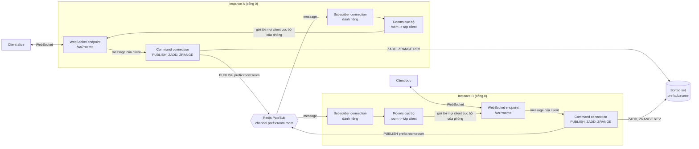
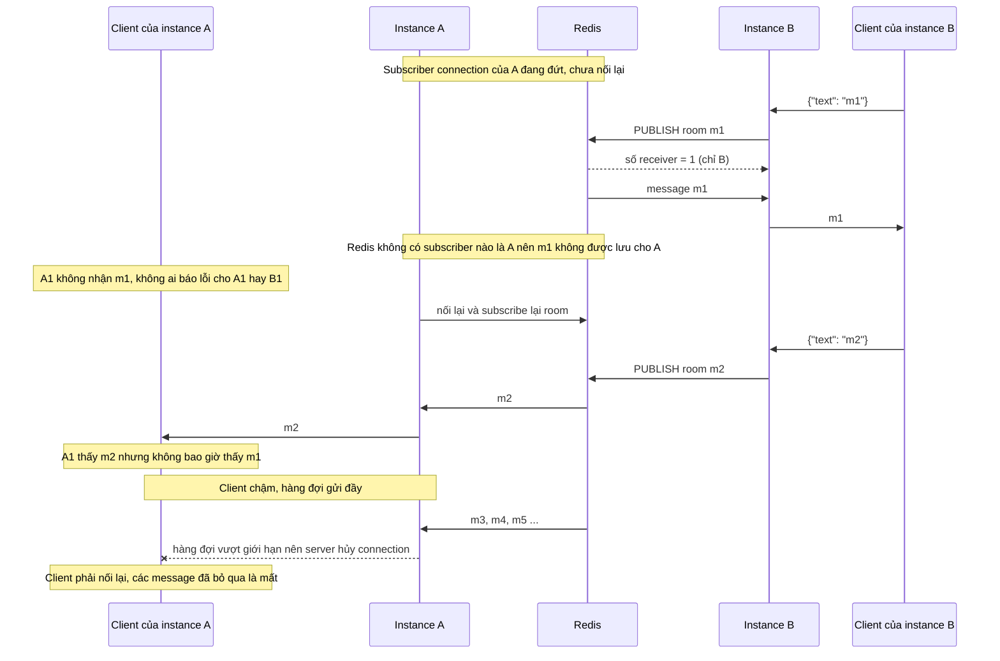
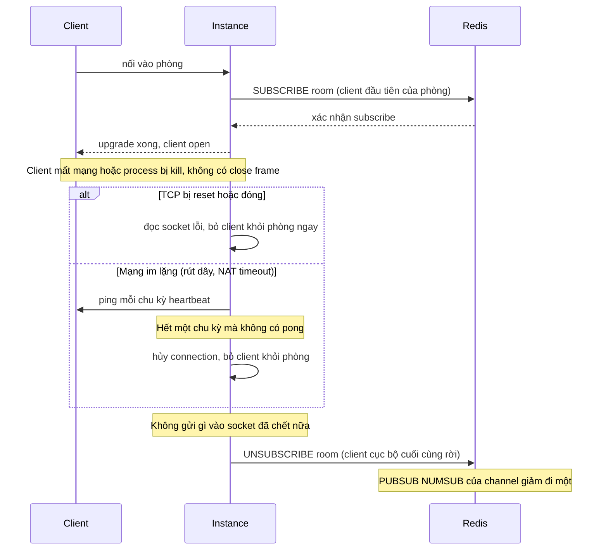
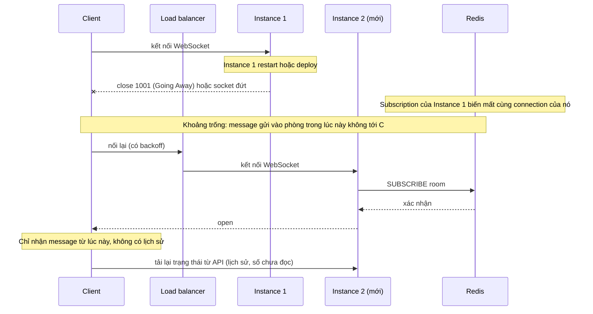
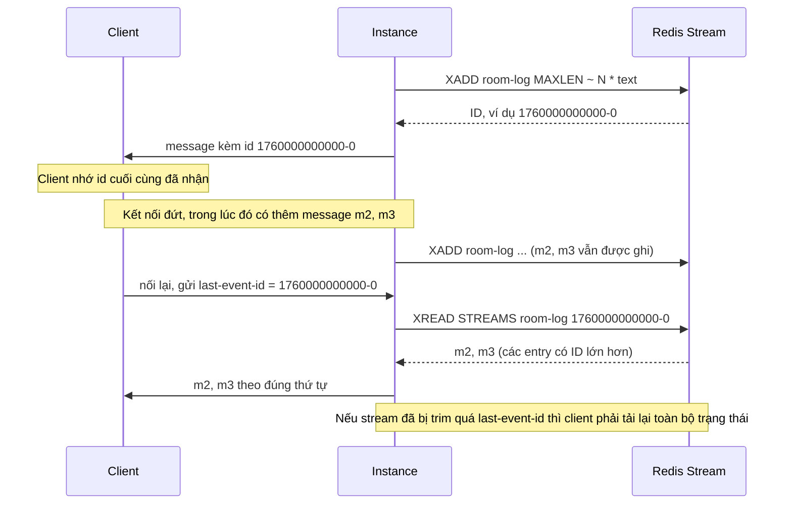

# Use case 4 - Realtime: fan-out chat qua nhiều instance bằng Redis Pub/Sub và leaderboard bằng sorted set

## Mục tiêu và kịch bản

Một ứng dụng chat có phòng, thông báo realtime và bảng xếp hạng chạy trên nhiều máy phía sau một load balancer.
Client giữ một kết nối WebSocket với đúng một instance, nhưng người trong cùng một phòng có thể đang nối vào các instance khác nhau.
Khi alice gửi một câu vào phòng, mọi người trong phòng phải nhận được, bất kể họ đang nối vào máy nào.

Bài toán nhỏ này có hai nửa:

- Fan-out qua nhiều instance: instance nhận message từ client phải báo cho mọi instance khác để chúng đẩy tới client của mình.
  Redis Pub/Sub làm việc này: mỗi instance subscribe channel của các phòng có client cục bộ, và mỗi message là một `PUBLISH`.
- Bảng xếp hạng: điểm số của người chơi được đọc và ghi từ mọi instance, và luôn cần top N theo thứ tự giảm dần.
  Sorted set của Redis sinh ra cho việc này: `ZADD` đặt điểm, `ZRANGE ... REV` lấy top.

Pub/Sub phù hợp với nửa thứ nhất vì nó rẻ, không cần tạo hay dọn gì ở phía Redis, và độ trễ chỉ cỡ một vòng mạng.
Cái giá là Pub/Sub chỉ giao message cho những subscriber ĐANG nối tại thời điểm `PUBLISH` (at-most-once, không lưu gì).
Với chat trực tiếp hoặc thông báo kiểu "có người đang gõ", mất một message hiếm hoi là chấp nhận được.
Với thông báo bắt buộc phải tới (hóa đơn, lệnh giao dịch) hoặc khi client vào muộn cần xem lịch sử thì Pub/Sub không đủ, xem phần so sánh và đường lỗi 4 (Streams).

Use case này dựng MỘT factory mỗi ngôn ngữ, không framework:

- TypeScript: `createRealtimeServer(options)` dùng thư viện `ws` 8.22.0 và `ioredis` 6.0.0.
- Go: `NewServer(ctx, options)` dùng `github.com/coder/websocket` v1.8.15 và `go-redis` v9.23.0.

Mỗi lời gọi factory khởi động một instance: HTTP server trên cổng 0 (hệ điều hành chọn cổng), một connection Redis cho lệnh thường và MỘT connection Redis dành riêng cho subscribe.
Test và demo chạy hai instance trong cùng một process, trên hai cổng khác nhau, cùng một Redis, để đại diện cho hai máy.

Lab cần Redis chạy bằng `make up`, đọc `REDIS_URL` (mặc định `redis://127.0.0.1:6379`).
Redis này dùng chung cho mọi lab, nên mọi tên channel và key đều lấy từ `uniqueName` (qua option `prefix`) và bị xóa ở cuối bằng `SCAN` theo prefix (không bao giờ `KEYS`).
Test không bao giờ khẳng định trên trạng thái toàn server.
Lý thuyết của cả chương nằm ở theory.md của chủ đề 09.

## Kiến trúc



Quy tắc của kiến trúc:

- Mọi message của client đều đi vòng qua Redis, kể cả khi người nhận ở cùng instance với người gửi.
  Instance KHÔNG giao cục bộ rồi mới publish, vì như vậy người nhận cùng instance sẽ nhận hai lần (một lần cục bộ, một lần qua subscriber).
  Hệ quả: người gửi cũng nhận lại message của chính mình đúng một lần, và mọi client trong phòng thấy cùng một thứ tự (thứ tự publish trên channel).
  Cái giá là mỗi message tốn một vòng tới Redis dù người nhận ở ngay cạnh.
- Mỗi instance có MỘT subscriber connection cho mọi phòng.
  Instance subscribe channel của phòng khi client cục bộ đầu tiên vào phòng, và unsubscribe khi client cục bộ cuối cùng rời.
  Số subscription của instance bằng số phòng đang có người, không phải số client.
- Không cần sticky session: client nối vào instance nào cũng được, vì Redis chuyển message giữa các instance.
  Sticky session chỉ cần khi trạng thái của kết nối nằm trong bộ nhớ của instance và không có gì chia sẻ nó.

## Đường lỗi

Đường lỗi 1: message bị mất vì Pub/Sub là at-most-once.
Hai trường hợp: subscriber connection của một instance đang đứt, và một client chậm bị server bỏ.



Đường lỗi 2: client đứt đột ngột, instance dọn phòng và unsubscribe.



Đường lỗi 3: instance restart, client phải nối lại và message trong khoảng trống là mất.



Đường lỗi 4: phương án bền, dùng Redis Streams và `last-event-id`.
Phần này KHÔNG có trong code của lab: đây là thiết kế để so sánh, và xem bài tập.



Lab có test cho đường lỗi 2 (client đóng lịch sự và client bị hủy đột ngột, heartbeat, client chậm) và cho các cạnh liên quan tới đường lỗi 3 (shutdown đóng mọi socket bằng 1001).
Đường lỗi 1 (đứt subscriber connection) và đường lỗi 4 (Streams) không có test: chúng nằm trong bài tập.

## Giao diện

HTTP và WebSocket, giống hệt nhau ở cả hai ngôn ngữ:

| Endpoint                            | Mô tả                                                                                                    |
| ----------------------------------- | -------------------------------------------------------------------------------------------------------- |
| `GET /ws?room=<room>[&name=<name>]` | WebSocket upgrade. Room sai thì HTTP 400 TRƯỚC khi upgrade                                               |
| `POST /leaderboard/:name`           | Body `{"member": string, "score": number}`. Đặt score của member (ZADD). Trả 200 `{name, member, score}` |
| `GET /leaderboard/:name/top?n=<n>`  | Trả 200 `{name, entries: [{member, score}]}` giảm dần theo score. `n` mặc định 10, hợp lệ từ 1 đến 1000  |

Đề bài viết route đọc là `GET /leaderboard/top?n=`, nhưng route đó không nói bảng nào.
Lab giữ nguyên dạng của route ghi `POST /leaderboard/:name` và đặt tên bảng vào đường dẫn: `GET /leaderboard/:name/top?n=`.
Hai route cùng một tiền tố `/leaderboard/:name` nên dễ nhớ, và không bị lẫn một bảng tên `top` với route đọc.

Tên room, tên hiển thị (`name`) và tên bảng đều phải khớp `^[A-Za-z0-9._-]{1,64}$`.
Rỗng, quá 64 ký tự hoặc có ký tự khác (khoảng trắng, `*`, `/`) bị từ chối bằng HTTP 400 với message nói rõ trường nào sai.
`name` là tên hiển thị tùy chọn, mặc định là `anon-<6 ký tự hex>`.
Client có thể tự nhận bất kỳ `name` nào: xác thực nằm ngoài phạm vi lab (xem giới hạn).

Giao thức message:

- Client gửi một text frame JSON `{"text": "..."}`, `text` là chuỗi không rỗng.
- Server điền `from` (tên hiển thị của người gửi) và `ts` (mili giây từ epoch, lấy đồng hồ của instance nhận message), rồi publish `{ "room", "from", "text", "ts" }`.
- Mọi client của phòng, kể cả người gửi, nhận đúng text frame JSON đó.

TypeScript (`ts/lab.ts`):

```ts
createRealtimeServer({ redisUrl, prefix, maxMessageBytes?, maxBufferedBytes?, pingIntervalMs?, closeGraceMs?, onError? }): Promise<RealtimeServer>
// RealtimeServer: url, wsUrl(room, name?), clientCount(room), roomCount(), redisStatus(), shutdown()
roomChannel(prefix, room): string; leaderboardKey(prefix, name): string
```

Go (`go/lab.go`):

```go
NewServer(ctx, Options{RedisURL, Prefix, MaxMessageBytes, SendQueue, PingInterval, WriteTimeout, CloseGrace, OnError}) (*Server, error)
// Server: URL(), WSURL(room, name), ClientCount(room), RoomCount(), Shutdown(ctx) error
RoomChannel(prefix, room) string; LeaderboardKey(prefix, name) string
```

`clientCount(room)` và `roomCount()` là introspection cho test: số client cục bộ của phòng và số phòng mà instance đang subscribe.

Khác biệt cố ý giữa hai bên:

- Giới hạn client chậm của TS tính bằng byte đang chờ gửi (`maxBufferedBytes`), của Go tính bằng số message trong hàng đợi (`SendQueue`).
  Mỗi bên dùng cách tự nhiên với thư viện của mình, cùng một chính sách (hủy client chậm).
- `Shutdown` của Go nhận `context` (thời hạn) và chờ mọi goroutine thoát, trả lỗi nếu còn sót.
  TS không có khái niệm tương đương, nên `shutdown()` chỉ chờ socket, connection Redis và HTTP server đóng.
- Body của một số lỗi HTTP khác nhau chút: đường dẫn `/nope` bị TS từ chối ngay ở bước upgrade bằng text thuần, còn Go trả JSON `{"error": ...}`.
  Test chỉ so sánh status code và trường được nhắc tới trong message.

## Quyết định thiết kế

### Subscribe khi client đầu tiên vào, unsubscribe khi client cuối rời

- Instance giữ một map `room -> { clients, refs }`.
  `refs` đếm client trong phòng cộng các lần upgrade đang chờ subscribe xong.
- Client đầu tiên của phòng làm instance gửi `SUBSCRIBE`, và instance CHỈ nhận kết nối WebSocket sau khi Redis đã xác nhận subscribe.
  Nhờ vậy khi client thấy `open`, mọi message publish sau đó chắc chắn tới được instance của nó.
  TS lấy xác nhận từ promise của `subscribe()`.
  Go tự đọc subscriber connection bằng `PubSub.Receive` (không dùng `Channel()` vì nó nuốt xác nhận subscribe) và đánh thức người chờ theo thứ tự.
- `SUBSCRIBE` và `UNSUBSCRIBE` được gửi ngay tại thời điểm thay đổi trạng thái (TS đồng bộ trong một tick, Go trong lúc giữ mutex), nên thứ tự lệnh trên connection luôn đúng thứ tự sự kiện, kể cả khi một phòng vừa trống rồi có người vào lại.
- Client rời phòng (đóng lịch sự, đứt đột ngột, heartbeat, bị hủy vì chậm) đều đi qua cùng một đường dọn: bỏ khỏi phòng, giảm `refs`, và unsubscribe nếu về 0.

### Giới hạn kích thước message

Hai thư viện có mặc định rất khác nhau, đều đã đọc trong mã nguồn đúng phiên bản của lab:

| Thư viện                  | Mặc định            | Cách đặt                |
| ------------------------- | ------------------- | ----------------------- |
| `ws` 8.22.0               | 104857600 (100 MiB) | `maxPayload` của server |
| `coder/websocket` v1.8.15 | 32768 (32 KiB)      | `Conn.SetReadLimit(n)`  |

Lab đặt tường minh `maxMessageBytes = 4096` ở cả hai (đo bằng byte của cả frame JSON).
Một tin chat không cần tới 32 KiB, và để mặc định của `ws` thì một client độc hại có thể bắt server đọc vào bộ nhớ tới 100 MiB mỗi message.
Vượt giới hạn thì cả hai thư viện tự đóng connection bằng close code 1009 (Message Too Big) trước khi gom hết payload, và chỉ connection đó bị đóng.
Chú ý phong bì: message server gửi xuống lớn hơn message client gửi lên khoảng 100 byte (thêm `room`, `from`, `ts`), nên client cũng phải đặt read limit đủ lớn.

### Message sai định dạng

Server đóng riêng connection đó bằng close code 1003 (Unsupported Data) kèm lý do ngắn nhắc tới JSON, các connection khác và instance không bị ảnh hưởng.
Các trường hợp bị coi là sai (đã có test, cả hai ngôn ngữ): không phải JSON, JSON không phải object, thiếu `text`, `text` không phải chuỗi, `text` rỗng, và frame nhị phân.
Lab chọn đóng thay vì trả lỗi và giữ kết nối, vì client gửi sai định dạng gần như chắc chắn là bug hoặc là kẻ thử tấn công, và đóng buộc người viết client nhìn thấy lỗi.
Close code dùng trong lab (ý nghĩa theo RFC 6455 mục 7.4.1, nằm ngoài các nguồn của handbook):

| Code | Khi nào                                                                                 |
| ---- | --------------------------------------------------------------------------------------- |
| 1000 | Client tự đóng lịch sự (test dùng)                                                      |
| 1001 | Server shutdown (Going Away)                                                            |
| 1003 | Message sai định dạng hoặc frame nhị phân (Unsupported Data)                            |
| 1009 | Message vượt `maxMessageBytes` (Message Too Big), do thư viện tự đóng                   |
| 1011 | Không `PUBLISH` được vì Redis lỗi (Internal Error), không có test                       |
| 1006 | Chỉ client thấy: socket đứt mà không có close frame (đóng đột ngột, client chậm bị hủy) |

### Client chậm: hủy connection, không để hàng đợi tăng vô hạn

Mỗi client có một hàng đợi gửi có giới hạn.
Nếu một client không đọc kịp (mạng chậm, hoặc đang bị treo), dữ liệu chờ gửi cho nó tăng mãi và ăn bộ nhớ của instance.
Lab chọn chính sách `closeSlow` của ví dụ chat trong repo `coder/websocket`: vượt giới hạn thì HỦY connection của client đó, các client khác không bị ảnh hưởng.

- TS: `ws.send` không chặn, nên trước mỗi lần gửi kiểm tra `ws.bufferedAmount`.
  Vượt `maxBufferedBytes` (mặc định 262144) thì `terminate()`.
- Go: mỗi client có một goroutine ghi và một channel có đệm `SendQueue` (mặc định 16).
  Việc đẩy vào channel dùng `select` với `default` nên không bao giờ chặn vòng phát.
  Channel đầy thì hủy context của client, vòng đọc thoát và đóng socket.
  Mỗi lần ghi còn có `WriteTimeout` (mặc định 5 s).
- Không gửi close frame cho client chậm, vì frame đó cũng nằm sau hàng đợi và client sẽ không đọc tới nó.
  Client chậm thấy socket đứt (close code 1006) và phải nối lại.
- Test dùng một client "kẹt" thật: Go dùng `websocket.Dial` rồi không bao giờ gọi `Read`, TS dùng socket TCP thô làm handshake bằng tay rồi `pause()`.
  Test gửi từng đợt nhỏ và chờ client nhanh nhận hết đợt đó trước khi gửi tiếp, nên client nhanh không bao giờ tồn đọng, và vòng lặp chỉ dừng khi server hủy client kẹt.
  Kết quả không phụ thuộc may rủi về thời gian, chỉ phụ thuộc một chặn trên 600 đợt để test không treo.

### Heartbeat

Một kết nối chết trong im lặng (rút dây mạng, NAT timeout) không báo gì cho server.
Server ping mỗi `pingInterval` (mặc định 30 s) và hủy client không trả pong trong một chu kỳ.
TS theo mẫu của README của `ws` (cờ `alive`, `ping()`, `terminate()`).
Go dùng `Conn.Ping(ctx)` với timeout bằng một chu kỳ, và cần vòng đọc đang chạy để đọc pong.
`coder/websocket` v1.8.15 chưa có helper heartbeat (README ghi ở roadmap) nên lab tự viết.

### Origin

Cả hai thư viện đều cần quyết định về header `Origin`, vì trình duyệt luôn gửi nó và một trang web bất kỳ có thể mở WebSocket tới server của bạn (cross-site WebSocket hijacking).
Lab chạy trên localhost và áp một chính sách giống hệt nhau ở cả hai bên:

- Không có header `Origin` (client không phải trình duyệt, như `ws`, `websocket.Dial`, `curl`) thì được nhận.
- Có `Origin` và host của nó bằng header `Host` của request thì được nhận.
- Mọi origin khác bị từ chối bằng HTTP 403 trước khi upgrade.

Đây chính là mặc định của `websocket.Accept` khi `OriginPatterns` rỗng.
`ws` không có kiểm tra Origin dựng sẵn: mã nguồn của nó chỉ chuyển header `Origin` cho hook `verifyClient` (tùy chọn, mặc định `null`) và không làm gì thêm.
TS tự viết kiểm tra này trong handler `upgrade` của HTTP server (mode `noServer`), cùng chỗ với kiểm tra room, nên trả được HTTP 403 giống Go.
Server production phải liệt kê chính xác các origin được phép (`OriginPatterns`, hoặc danh sách trong handler `upgrade` của `ws`) và xác thực người dùng (token, cookie kèm kiểm tra CSRF).
Đừng bật `InsecureSkipVerify` để "cho chạy được".
Phần xác thực và danh sách origin nằm ngoài phạm vi lab.
Cảnh báo "mở Origin sai thì server dễ bị CSRF" là lời của chính tài liệu trong `accept.go` của `coder/websocket`, còn mức độ thực tế với `ws` không có trong research của handbook (chưa xác minh).

### Shutdown

`shutdown()` (TS) và `Shutdown(ctx)` (Go) chạy theo pha tuần tự, mỗi pha chạy dù pha trước lỗi và lỗi được gom lại:

1. Ngừng nhận kết nối mới (đóng listener).
2. Đóng mọi WebSocket bằng 1001, chờ close handshake trong `closeGraceMs`, rồi hủy những socket không trả lời.
   Mỗi client rời phòng qua đường dọn bình thường, nên phòng cuối cùng gửi `UNSUBSCRIBE`.
3. Đóng hai connection Redis.
4. Đóng nốt connection HTTP còn lại.
   Go chờ thêm mọi goroutine (Serve, vòng nhận Redis, mọi handler cùng goroutine ghi và heartbeat) thoát qua một `WaitGroup`.

Gọi lại (kể cả đồng thời) trả về cùng một kết quả: TS lưu lại promise, Go dùng `sync.Once`.
Sau shutdown, `PUBSUB NUMSUB` của channel về 0 sau một khoảng ngắn: Redis dọn subscription của connection đã đóng khi nó đọc tới EOF, bất đồng bộ với `Shutdown`, nên test dùng `eventually` thay vì khẳng định ngay.
Phát hiện này đến từ một lần chạy `-count` lặp lại của chính lab, khi một assertion ngay-sau-shutdown thỉnh thoảng thấy NUMSUB bằng 1.

## Leaderboard

Hợp đồng:

- `POST /leaderboard/:name` với `{"member": "alice", "score": 30}` chạy `ZADD key score member`: ĐẶT score của member (thêm nếu chưa có, thay nếu đã có).
  POST lại cùng member với score khác thay score cũ chứ không cộng dồn (nếu muốn cộng dồn thì dùng `ZINCRBY`, xem bài tập).
  Test đặt `alice` 10, 40 rồi 15 và khẳng định kết quả cuối là 15 (với `ZINCRBY` sẽ là 65).
- `score` phải là số hữu hạn (không phải chuỗi, `NaN` hay `1e999`), `member` là chuỗi 1 đến 128 ký tự, body tối đa 1024 byte.
  Sai thì HTTP 400 (hoặc 413) và không ghi gì vào Redis.
- `GET /leaderboard/:name/top?n=` chạy `ZRANGE key 0 n-1 REV WITHSCORES` (không dùng `ZREVRANGE` vì docs đánh dấu deprecated).
  `n` lớn hơn kích thước bảng thì trả đủ.
  `n=0`, âm, không phải số nguyên (`abc`, `1.5`, `1e2`, rỗng) hoặc lớn hơn 1000 thì HTTP 400.
  Bảng rỗng trả `entries: []` (mảng rỗng, không phải `null`).
- Độ phức tạp theo Redis docs: `ZADD` là O(log N), `ZRANGE` là O(log(N)+M) với M là số kết quả trả về.

Hai chi tiết dễ sai:

- Score bằng nhau: Redis sắp xếp theo thứ tự từ điển của member.
  Truy vấn xuôi cho `alice, carol, dave` cùng score 20, nhưng `ZRANGE ... REV` đảo cả hai chiều nên cho `dave, carol, alice`.
  Test khẳng định đúng thứ tự giảm dần này (ví dụ `dave` trước `carol`), vì đây là hành vi xác định của Redis.
  Muốn tie-break theo thời gian ghi điểm thì phải nhét thời gian vào score hoặc vào member, xem bài tập.
- Kiểu của score: đã đo với ioredis 6.0.0 trên Redis 8.10.2 rằng `redis.call("ZRANGE", key, 0, -1, "REV", "WITHSCORES")` trả mảng LỒNG `[["b","2"],["a","1"]]` với score là CHUỖI, trong khi lệnh có kiểu sẵn `redis.zrange(key, 0, -1, "REV", "WITHSCORES")` trả mảng phẳng `["b","2","a","1"]` (cũng score dạng chuỗi).
  go-redis trả `float64` sẵn.
  `toEntries` xử lý cả hai dạng của ioredis và chuyển score thành number, và test khẳng định kiểu `number` trong JSON ở cả hai ngôn ngữ.

## Chạy lab

```bash
make up
make lab-ts LAB=09-production/usecase-04-realtime
make lab-go LAB=09-production/usecase-04-realtime
pnpm vitest run 09-production/usecase-04-realtime
go test -race ./09-production/usecase-04-realtime/...
```

Demo (cả hai ngôn ngữ in cùng nội dung bằng tiếng Việt) làm ba việc rồi dọn sạch:

1. Chat: hai instance, ba client (alice và bob cùng phòng `general` nhưng khác instance, carol ở phòng `random`).
   Demo chờ `PUBSUB NUMSUB` báo hai instance cùng subscribe channel, rồi cho một client gửi.
   Kết quả mong đợi: client ở instance kia nhận một bản, người gửi nhận lại đúng một bản, client của phòng khác chỉ nhận message của phòng mình.
2. Leaderboard: POST lên instance A, GET top từ instance B, hai member cùng điểm, rồi đặt lại điểm một member làm nó lên đầu, và `n=0` bị HTTP 400.
3. Client đứt đột ngột: `clientCount` về 0 và `PUBSUB NUMSUB` về 0 ngay sau đó.

Dòng cuối của demo xác nhận đã đóng mọi client và instance, xóa mọi key và không còn subscription nào của prefix demo.

## Kiểm thử

Test dùng Redis thật, hai instance trong cùng process, và mọi chờ đều có thời hạn ngắn hơn timeout của test với message nói rõ đang chờ gì.
Không có sleep cố định: sự sẵn sàng chờ bằng `PUBSUB NUMSUB` qua `eventually`, và việc KHÔNG nhận message được chứng minh bằng thứ tự thay vì chờ.

| Test (TS, snake_case)                                                        | Test (Go, CamelCase)                                                 |
| ---------------------------------------------------------------------------- | -------------------------------------------------------------------- |
| `client_on_instance_a_receives_message_sent_via_instance_b`                  | `TestClientOnInstanceAReceivesMessageSentViaInstanceB`               |
| `leaderboard_top_returns_scores_in_descending_order`                         | `TestLeaderboardTopReturnsScoresInDescendingOrder`                   |
| `disconnected_client_is_removed_from_room`                                   | `TestDisconnectedClientIsRemovedFromRoom`                            |
| `invalid_room_is_rejected_with_400_before_the_upgrade`                       | `TestInvalidRoomIsRejectedWith400BeforeTheUpgrade`                   |
| `cross_origin_upgrade_is_rejected_but_same_origin_and_no_origin_are_allowed` | `TestCrossOriginUpgradeIsRejectedButSameOriginAndNoOriginAreAllowed` |
| `malformed_message_closes_only_that_connection_with_1003`                    | `TestMalformedMessageClosesOnlyThatConnectionWith1003`               |
| `oversized_message_closes_connection_with_1009_and_instance_survives`        | `TestOversizedMessageClosesConnectionWith1009AndInstanceSurvives`    |
| `slow_client_is_dropped_without_blocking_others`                             | `TestSlowClientIsDroppedWithoutBlockingOthers`                       |
| `unresponsive_client_is_dropped_by_heartbeat`                                | `TestUnresponsiveClientIsDroppedByHeartbeat`                         |
| `shutdown_closes_everything_and_is_idempotent`                               | `TestShutdownClosesEverythingAndIsIdempotent`                        |

Ba test đầu là ba test bắt buộc của use case.
Mấy điểm đáng đọc trong code test:

- Test fan-out đặt client của phòng khác trên CÙNG instance với người gửi, tức dùng chung subscriber connection.
  Message của phòng khác được gửi SAU, và khi client đó nhận được nó thì message trước (nếu bị giao nhầm) đã phải nằm trong hộp thư rồi, vì hai channel đi trên cùng một connection theo thứ tự.
  Cuối test, một marker chứng minh không có bản sao thừa: người nhận thấy đúng `[message, marker]`.
- Test dọn dẹp chạy bốn pha tuần tự và gom lỗi: đóng client, shutdown instance, xóa key bằng `SCAN`, rồi kiểm tra không còn key hay subscription (`PUBSUB CHANNELS` theo prefix, đã escape glob) của test.
- Go: goroutine trong test chỉ dùng `t.Errorf`, chạy với `-race`, và `Shutdown` trả nil chứng minh mọi goroutine của instance đã thoát.

## Kết quả đo

Đo một lần trên một máy (loopback, Redis 8.10.2, Node 22, Go 1.26), không phải benchmark.
Các con số chỉ để cảm nhận bậc độ lớn, không dùng làm cam kết.

| Đại lượng                                            | TypeScript (`ws`)   | Go (`coder/websocket`) |
| ---------------------------------------------------- | ------------------- | ---------------------- |
| Client đầu tiên của phòng mở kết nối (gồm subscribe) | khoảng 5 ms         | khoảng 3 ms            |
| Client thứ hai của phòng (không subscribe lại)       | khoảng 1 ms         | dưới 1 ms              |
| Đóng đột ngột tới khi instance bỏ client khỏi phòng  | khoảng 2 ms         | khoảng 1 ms            |
| Đóng đột ngột tới khi `NUMSUB` về 0 (client cuối)    | khoảng 6 ms         | khoảng 8 ms            |
| Client chậm bị hủy sau (message 30000 byte)          | 45 message (1,4 MB) | 48 message (1,4 MB)    |
| Heartbeat ping 50 ms hủy client không trả pong sau   | khoảng 100 ms       | khoảng 100 ms          |

Một vài chi tiết:

- Số message trước khi client chậm bị hủy gồm cả bộ đệm của hệ điều hành (gửi và nhận) cộng ngưỡng của lab, nên phụ thuộc máy.
- Client chết trong im lặng bị phát hiện sau khoảng hai chu kỳ ping: chu kỳ đầu đánh dấu và ping, chu kỳ sau thấy chưa có pong.
- Đóng đột ngột trên loopback được phát hiện ngay vì TCP báo EOF hoặc reset.
  Mạng bị rút dây thật không báo gì, nên chỉ heartbeat mới phát hiện được.
- Cài đặt: `ws` 8.22.0 chiếm khoảng 196 KiB và `@types/ws` 8.18.2 khoảng 52 KiB trong kho pnpm; `ws` không kéo dependency nào bắt buộc.
  `bufferutil` và `utf-8-validate` (bản native tăng tốc tùy chọn) là peer dependency tùy chọn của `ws` và KHÔNG được cài, nên không cần `allowBuilds`.
  `github.com/coder/websocket` v1.8.15 khoảng 380 KiB mã nguồn, không dependency ngoài, yêu cầu `go 1.23` (thấp hơn `go 1.26.0` của repo, nên không phải nâng go directive).

## So sánh: Pub/Sub, Streams và broker chuyên dụng cho fan-out realtime

| Tiêu chí                     | Redis Pub/Sub (lab này)                                  | Redis Streams                                                                                                          | Broker chuyên dụng (Kafka, NATS JetStream, RabbitMQ)                                 |
| ---------------------------- | -------------------------------------------------------- | ---------------------------------------------------------------------------------------------------------------------- | ------------------------------------------------------------------------------------ |
| Bảo đảm giao                 | At-most-once, không lưu gì                               | Lưu và replicate, mặc định at-least-once với consumer group                                                            | Tùy broker, thường có ack, retention và replay                                       |
| Client vào muộn hoặc nối lại | Không có lịch sử, mất message trong khoảng trống         | Đọc lại từ ID đã nhớ (`last-event-id`), giới hạn bởi trim                                                              | Đọc lại từ offset hoặc từ queue, giới hạn bởi retention                              |
| Fan-out tới MỌI instance     | Có sẵn: mọi subscriber đều nhận                          | Mỗi instance đọc riêng (XREAD hoặc một group riêng cho mỗi instance); MỘT group chung chia message, không phải fan-out | Có, nhưng cấu hình theo từng broker (fanout exchange, subject, consumer group riêng) |
| Thứ tự                       | Theo thứ tự publish trên một channel                     | Theo ID tăng dần của stream                                                                                            | Theo partition hoặc queue                                                            |
| Chi phí vận hành thêm        | Không, đã có Redis                                       | Không, đã có Redis, nhưng phải quản lý trim và bộ nhớ                                                                  | Thêm một hệ thống phải dựng, giám sát và nâng cấp                                    |
| Hợp với                      | Chat trực tiếp, typing indicator, cập nhật chấp nhận mất | Thông báo cần replay khi nối lại, hoạt động gần realtime                                                               | Luồng sự kiện lớn, cần retention dài, nhiều consumer độc lập                         |

Cột Pub/Sub và Streams lấy từ tài liệu Redis trong research của handbook.
Cột broker chuyên dụng là tóm tắt, chi tiết nằm ở các chương 05 đến 07.

## Giới hạn

- At-most-once: message publish lúc một instance chưa subscribe (đang khởi động, đang nối lại sau khi đứt) hoặc tới một client chậm bị hủy sẽ mất, và không ai được báo.
  `PUBLISH` trả số receiver nhưng đó là số subscriber connection (số instance), không phải số client, và người gửi trong lab không dùng nó.
- Không có lịch sử cho người vào muộn: client mới chỉ thấy message từ lúc nó open.
  Ứng dụng thật tải lịch sử từ DB hoặc từ Streams khi vào phòng.
- Thứ tự: Redis giữ đúng thứ tự publish trên MỘT channel, nên mọi client của phòng thấy cùng một thứ tự.
  Giữa hai phòng khác nhau, hay giữa một message và một lệnh khác (ví dụ ghi DB), không có bảo đảm nào.
- Một client gửi hai message liên tiếp thì chúng được publish theo đúng thứ tự gửi, vì mỗi client có một vòng đọc tuần tự.
  Hai client gửi cùng lúc thì thứ tự do Redis nhận quyết định.
- Không cần sticky session vì Redis chuyển message giữa các instance, nhưng một kết nối WebSocket vẫn gắn với một instance suốt đời nó.
  Khi instance đó chết, client phải nối lại (đường lỗi 3).
- Backpressure và client chậm: lab chọn hủy client chậm.
  Chính sách khác (bỏ message cũ nhất, gộp message, giảm tần suất) cũng hợp lệ và tùy ứng dụng.
- Origin và xác thực nằm ngoài phạm vi: client tự nhận `name`, ai cũng vào được mọi phòng.
  Server production phải kiểm tra Origin theo danh sách, xác thực người dùng, và kiểm tra quyền vào phòng.
- Không có rate limit cho message: một client có thể bắn đầy phòng.
  Use case 3 có sliding window limiter dùng được cho việc này.
- Mở rộng subscriber: mỗi instance dùng một subscriber connection và số subscription bằng số phòng đang có người.
  Số channel lớn (hàng chục nghìn phòng) làm Redis tốn bộ nhớ cho bảng subscription, và mỗi `PUBLISH` tốn thời gian tỷ lệ với số subscriber của channel đó.
  Trong Redis Cluster, Pub/Sub thường gửi message tới mọi node qua cluster bus; sharded Pub/Sub (`SSUBSCRIBE`, `SPUBLISH`, Redis 7.0+) giữ message trong shard (chưa kiểm thử trong lab này).
- Đứt subscriber connection: ioredis (`autoResubscribe`) và go-redis đều nối lại và subscribe lại, nhưng message trong lúc đứt là mất, và lab này chưa có test cho tình huống đó (xem bài tập 1).
- Tên channel không gắn với database number của Redis: publish ở db 10 thì subscriber ở db 1 vẫn nhận được, nên prefix channel theo môi trường (lab dùng `prefix`).
- `PUBSUB NUMSUB` đếm subscriber connection, không đếm client WebSocket: hai instance cùng subscribe một channel cho `NUMSUB = 2` dù có hàng nghìn client.
- Lab chạy trên một Redis duy nhất, không Sentinel hay Cluster, và các instance cùng process nên không thấy được lỗi mạng giữa instance và Redis.

## Bài tập mở rộng

1. Đứt subscriber connection.
   Dùng `CLIENT ID` lúc dựng connection (hoặc đặt tên connection) rồi `CLIENT KILL ID` đúng connection của một instance, và đo: bao lâu thì client resubscribe, message publish trong khoảng trống mất bao nhiêu, và `NUMSUB` về lại 2 khi nào.
   Chỉ kill connection của chính bạn, không động tới connection khác trên Redis dùng chung.
2. Cài đường lỗi 4: ghi mỗi message bằng `XADD room-log MAXLEN ~ N *`, trả ID cho client, và cho client gửi `last-event-id` khi nối lại để server `XREAD` bù các message còn thiếu.
   So sánh số message mất trước và sau.
   Phần này chưa được kiểm chứng trong lab: hãy tự viết test cho nó.
3. Thay chính sách Origin bằng danh sách cho phép (`OriginPatterns` ở Go, danh sách trong handler `upgrade` ở TS), và thêm test cho origin hợp lệ, origin lạ và origin `null`.
4. Thêm xác thực: client gửi token ở query hoặc subprotocol, server kiểm tra trước khi upgrade và gán `from` theo token thay vì cho client tự nhận.
5. Thêm rate limit cho message của mỗi client bằng `slidingWindowAllow` của use case 3, và đóng connection bằng 1008 (Policy Violation) khi vượt.
6. Đổi POST thành cộng dồn (`ZINCRBY`) ở một route riêng `POST /leaderboard/:name/increment`, và viết test chứng minh hai request đồng thời không mất cập nhật.
7. Tie-break theo thời gian: hai người cùng điểm thì ai đạt điểm đó trước xếp trước.
   Gợi ý: mã hóa `score * 2^k + (max - timestamp)` vào score, và nói rõ giới hạn độ chính xác của double (2^53).
8. Thêm endpoint lấy hạng của một member và các member quanh nó (`ZREVRANK` hoặc `ZRANK ... WITHSCORE`, cộng `ZRANGE` theo vị trí), và kiểm tra độ phức tạp theo Redis docs.
9. Chạy lab trên Redis Cluster với sharded Pub/Sub (`SSUBSCRIBE`, `SPUBLISH`) và so sánh số message qua cluster bus với `PUBLISH` thường.
10. Đặt hai instance sau một reverse proxy thật (nginx hoặc Caddy), kill một instance, và quan sát phía client: thời gian phát hiện, thời gian nối lại, và message mất.

## Nguồn tham khảo

Phiên bản của use case: `ws` 8.22.0, `@types/ws` 8.18.2, `github.com/coder/websocket` v1.8.15 (2026-06-15, go 1.23), `ioredis` 6.0.0, `go-redis` v9.23.0, Redis 8.10.2.
Nguồn: https://redis.io/docs/latest/develop/pubsub/
Nguồn: https://redis.io/docs/latest/develop/data-types/sorted-sets/
Nguồn: https://redis.io/docs/latest/commands/zrevrange/
Nguồn: https://redis.io/docs/latest/develop/data-types/streams/
Nguồn: https://github.com/websockets/ws/blob/master/README.md
Nguồn: https://github.com/coder/websocket/blob/v1.8.15/README.md
Nguồn: https://github.com/coder/websocket/blob/v1.8.15/read.go
Nguồn: https://github.com/coder/websocket/blob/v1.8.15/accept.go
Nguồn: https://github.com/coder/websocket/blob/v1.8.15/internal/examples/chat/chat.go
Nguồn: https://proxy.golang.org/github.com/coder/websocket/@latest
Close code (1000, 1001, 1003, 1009, 1011) và ý nghĩa của chúng lấy từ RFC 6455 mục 7.4.1, không nằm trong research của handbook.
Nguồn: https://www.rfc-editor.org/rfc/rfc6455#section-7.4.1
